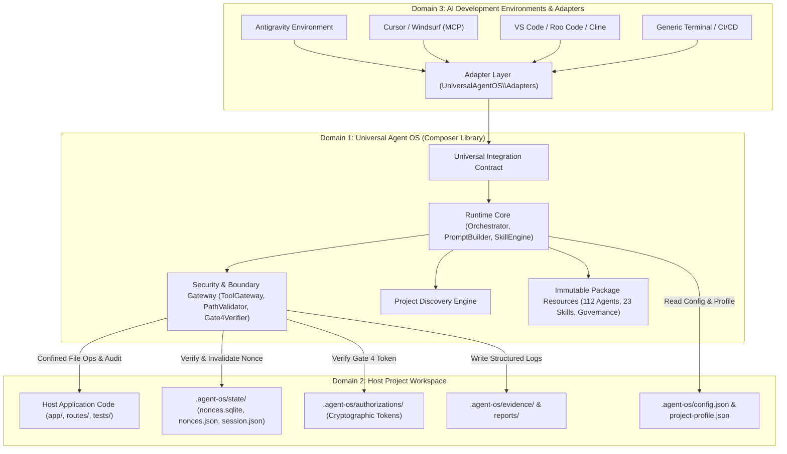
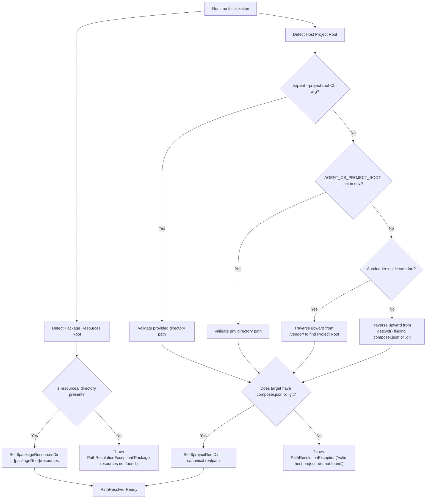
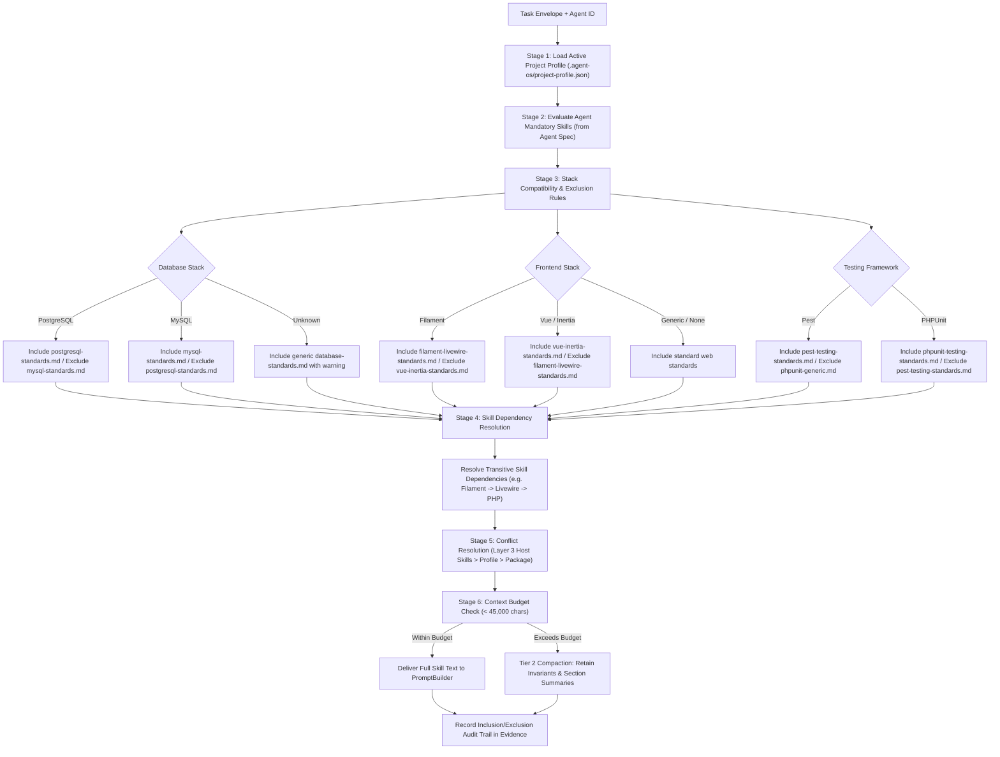
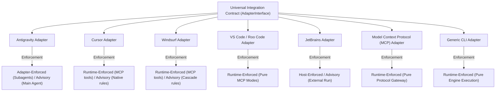
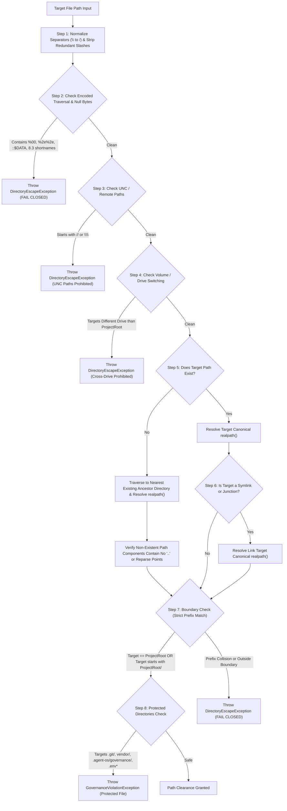
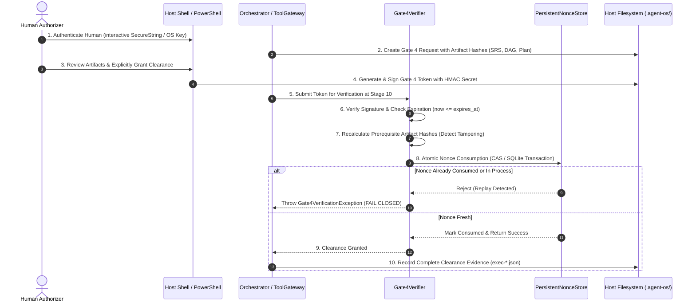
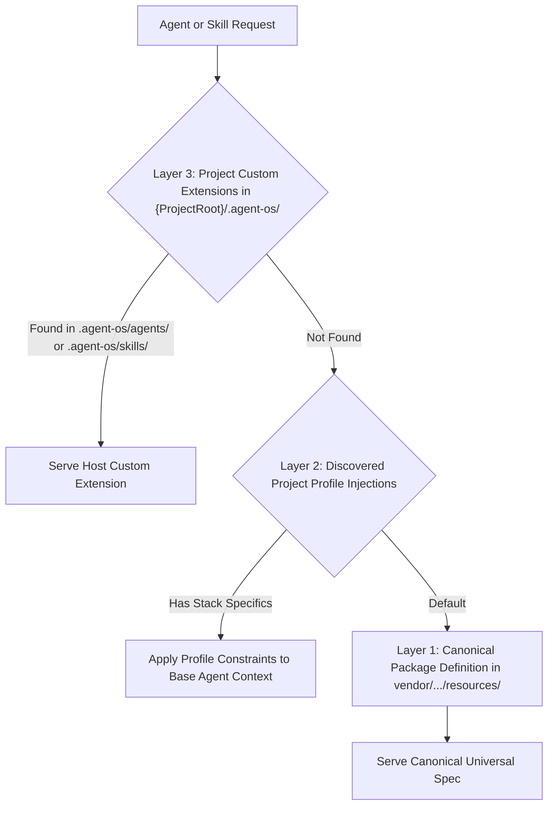

# Universal Agent Operating System: Independent Composer Package Architecture

**Document ID:** ARCH-UAOS-002  
**Version:** 2.0.0-FINAL-DESIGN  
**Authoritative Reference:** AUD-UAOS-001 (`.agents/reports/UNIVERSAL-AGENT-OS-INDEPENDENCE-AUDIT.md`)  
**Design Phase:** Prompt 2 of 4 (Architecture Correction Pass — Final Design Only)  
**Target Package Identity:** `universal-agent-os/agent-os`  
**Root Namespace:** `UniversalAgentOS\`  
**Target Output Artifact:** `.agents/reports/UNIVERSAL-AGENT-OS-INDEPENDENT-COMPOSER-ARCHITECTURE.md`  

---

## 1. Executive Summary

This architecture specification provides the complete, authoritative, implementation-ready design for transforming the existing Agent Operating System (`.agents`) into an independent, IDE-agnostic, project-agnostic, and reusable Composer package: **`universal-agent-os/agent-os`**.

The baseline system encompasses **112 specialized agents** across **14 departments**, **23 shared engineering skills**, a **14-stage lifecycle workflow**, an HMAC-SHA256 **Gate 4 cryptographic human authorization engine**, an application-level **Tool Execution Gateway**, an automated **Evidence Collector**, and an automated test and verification suite boasting a **100% pass rate** (53 unit tests, 56 governance rules, 121 organizational structural checks).

This architecture formally resolves all **19 findings** identified in audit `AUD-UAOS-001` and closes all architectural gaps identified during initial review without compromising baseline governance or discarding existing assets. It achieves complete structural independence by decoupling three fundamental operational concerns:

1. **Universal Agent Operating System Core:** Pure, platform-independent runtime engine, immutable agent specifications, department charters, universal governance invariants, lifecycle workflows, and shared engineering skills distributed via Composer.
2. **Host Project Context & State:** Project-specific configuration, discovered technology stack profiles, mutable session states, execution evidence, audit logs, Gate 4 cryptographic authorizations, and optional project-level agent/skill extensions stored exclusively in the host workspace (`.agent-os/`).
3. **Integration Adapters:** Pluggable, isolated communication bridges connecting the platform-independent runtime to heterogeneous AI coding environments (Antigravity, Cursor, VS Code / Roo Code / Cline, Windsurf, JetBrains IDEs, Generic CLI agents, and MCP clients).

```
+----------------------------------------------------------------------------------------------------+
|                                    TARGET ARCHITECTURAL SEPARATION                                 |
+----------------------------------------------------------------------------------------------------+
|                                                                                                    |
|   +--------------------------------------------------------------------------------------------+   |
|   |                         INTEGRATION ADAPTERS (Environment Agnostic)                        |   |
|   |   [Antigravity]    [MCP Bridge]    [Cursor Rules]    [VS Code / Roo]    [CLI / Headless]   |   |
|   +----------------------------------------------+---------------------------------------------+   |
|                                                  |                                                 |
|                                                  v                                                 |
|   +--------------------------------------------------------------------------------------------+   |
|   |                     UNIVERSAL AGENT OPERATING SYSTEM (Composer Package)                    |   |
|   |                           vendor/universal-agent-os/agent-os                               |   |
|   |                                                                                            |   |
|   |  - PathResolver & Engine Runtime             - 112 Agent Specifications (Depts A-N)        |   |
|   |  - ToolGateway & PathValidator Boundary      - 23 Shared Engineering Skills                |   |
|   |  - Gate4Verifier & Persistent Nonce Store    - 14-Stage Lifecycle Workflows                |   |
|   |  - Stack-Aware SkillEngine                   - Immutable Constitutional Governance (I-VII) |   |
|   |  - Profile-Injecting PromptBuilder           - Project Discovery & Validation Engine       |   |
|   +----------------------------------------------+---------------------------------------------+   |
|                                                  |                                                 |
|                                                  v                                                 |
|   +--------------------------------------------------------------------------------------------+   |
|   |                           HOST PROJECT WORKSPACE (Target Application)                      |   |
|   |                                                                                            |   |
|   |  - Source Code (app/, src/, etc.)            - .agent-os/project-profile.json              |   |
|   |  - composer.json / package.json              - .agent-os/state/ (nonces, cache)            |   |
|   |  - .agent-os/config.json                     - .agent-os/reports/ & evidence/              |   |
|   |  - .agent-os/authorizations/ (Gate 4 tokens) - .agent-os/agents/ (custom extensions)       |   |
|   +--------------------------------------------------------------------------------------------+   |
+----------------------------------------------------------------------------------------------------+
```

All package updates via Composer are guaranteed to touch only read-only package assets within `vendor/`, ensuring that project audit trails, authorization tokens, profiles, and evidence are never overwritten, corrupted, or deleted.

---

## 2. Product Boundaries & Separation of Concerns

The architecture establishes three strictly bounded domains with explicit invariants governing interactions between them.



### 2.1 Domain 1: Universal Agent Operating System (`universal-agent-os/agent-os`)
- **Distribution:** Distributed as a standard Composer package in `vendor/universal-agent-os/agent-os/`.
- **Ownership:** Immutable shared core. Maintained as an independent open/reusable repository.
- **Invariants:**
  1. Contains zero host-project-specific code, paths, subsystem numbers, or database assumptions.
  2. Pure PHP 8.2+ codebase with zero required runtime framework dependencies (framework-agnostic core; optional Laravel Service Provider for Artisan integration).
  3. All internal code resides strictly under the `UniversalAgentOS\` root namespace.
  4. Never assumes that `dirname(__DIR__, 2)` represents the host project root.
  5. Strictly read-only at runtime: package code never writes to its own vendor directory.
  6. Code files conform strictly to the approved **default maximum of 300 lines** per executable code file.

### 2.2 Domain 2: Host Project (Consumer Application)
- **Distribution:** Any PHP/Laravel application containing a `composer.json` file.
- **Ownership:** Host engineering team / project repository.
- **Invariants:**
  1. Host project root is dynamically discovered or explicitly provided via configuration.
  2. All mutable state, session data, Gate 4 cryptographic tokens, execution evidence, and markdown execution reports reside strictly in `{ProjectRoot}/.agent-os/`.
  3. Host project defines its own architectural profile (`.agent-os/project-profile.json`), configuring technology stacks, active subsystems, and testing frameworks.
  4. Host project may supply custom agents (`.agent-os/agents/`) and custom skills (`.agent-os/skills/`) which extend or specialize universal package definitions without modifying package files.
  5. Discovered project content, configurations, and manual overrides must never weaken constitutional governance, bypass Gate 4, or disable security controls.

### 2.3 Domain 3: Integration Adapters
- **Distribution:** Packaged within `UniversalAgentOS\Adapters\` or companion bridge plugins.
- **Ownership:** Integration bridge between external AI agent environments and the Runtime Core.
- **Invariants:**
  1. All adapters implement the canonical `AdapterInterface`.
  2. Adapters declare an explicit `HostCapabilityMap` documenting supported features and exact enforcement categories.
  3. Prompts and natural-language rules are never classified as security enforcement.
  4. When host environments execute tools directly without interception, the adapter explicitly flags the operation as non-guaranteed or host-mediated.
  5. High-risk operations fail closed whenever trustworthy enforcement cannot be guaranteed.

---

## 3. Target Architecture

The target architecture decouples execution orchestration, path resolution, security verification, context injection, and adapter bridges into discrete, single-responsibility collaborators.

### 3.1 Runtime Subsystem Component Diagram

```
+----------------------------------------------------------------------------------------------------+
|                                    UNIVERSAL AGENT OS RUNTIME CORE                                 |
+----------------------------------------------------------------------------------------------------+
|                                                                                                    |
|  [Entry Points]                                                                                    |
|    - bin/agent-os                     : Standalone executable binary (POSIX/Windows)               |
|    - UniversalAgentOSServiceProvider : Optional Laravel integration provider (Artisan commands)   |
|    - McpServerAdapter                 : Standard Model Context Protocol stdio server               |
|                                                                                                    |
|  [Resolution & Storage Core]                                                                       |
|    - PathResolver                     : Dual-path locator ($packageResourcesDir vs $projectRootDir)|
|    - ProjectStorageManager            : Manages host workspace storage (.agent-os/)                |
|    - ConfigurationLoader              : Cascading config loader (Default -> Host -> Env)           |
|                                                                                                    |
|  [Execution Orchestration]                                                                         |
|    - Orchestrator                     : Central task coordination & lifecycle dispatcher (<300 l.) |
|    - TaskClassifier                   : Evaluates task objectives, roles, and complexity (<300 l.) |
|    - ReviewRouter                     : Routes deliverables to Dept M independent auditors (<300 l)|
|    - PromptBuilder                    : Dynamic prompt compiler with Profile & Budgeting (<300 l.) |
|    - SkillEngine                      : Stack-aware skill discovery, filtering, priority (<300 l.) |
|                                                                                                    |
|  [Security & Governance Enforcement]                                                               |
|    - ToolGateway                      : Invariant enforcer, boundary enforcement (<300 lines)      |
|    - PathValidator                    : Comprehensive canonical path, symlink, UNC, TOCTOU confiner|
|    - Gate4Verifier                    : Cryptographic signature, expiration, artifact hash checker |
|    - PersistentNonceStore             : Durable atomic nonce store (SQLite / file-locked journal)  |
|    - EvidenceCollector                : Structured session logs (JSON) and Audit Reports (MD)      |
|                                                                                                    |
|  [Discovery Engine]                                                                                |
|    - ProjectDiscoveryEngine           : Inspects host workspace (composer.json, configs, dirs)     |
|    - ProfileGenerator                 : Generates standardized project-profile.json                |
|    - ProfileValidator                 : Validates profile against extensible JSON schema           |
|                                                                                                    |
|  [Extensibility & Adapter Subsystems]                                                              |
|    - AdapterRegistry                  : Discovers and dispatches to registered IDE/platform bridge |
|    - ExtensionValidator               : Validates Layer 3 extensions against Constitutional rules  |
+----------------------------------------------------------------------------------------------------+
```

---

## 4. Package Directory Structure

The physical directory layout strictly separates package code, immutable specifications, tests, and executable binaries.

```
universal-agent-os/agent-os (Package Root)
├── bin/
│   └── agent-os                               # Executable CLI binary (shebang, cross-platform)
├── composer.json                              # Package identity, requirements, PSR-4, bin mapping
├── README.md                                  # Package documentation & quickstart
├── LICENSE                                    # Distribution license
├── resources/                                 # Immutable Package Assets
│   ├── agents/                                # 112 Agent Specifications (56 sections each)
│   │   ├── dept-a-executive/                  # 8 Agents (A01-A08)
│   │   ├── dept-b-project-management/         # 8 Agents (B01-B08)
│   │   ├── dept-c-architecture/               # 8 Agents (C01-C08)
│   │   ├── dept-d-design-ui-ux/               # 8 Agents (D01-D08)
│   │   ├── dept-e-frontend-engineering/       # 8 Agents (E01-E08)
│   │   ├── dept-f-backend-engineering/        # 8 Agents (F01-F08)
│   │   ├── dept-g-database-engineering/       # 8 Agents (G01-G08)
│   │   ├── dept-h-quality-assurance/          # 8 Agents (H01-H08)
│   │   ├── dept-i-security-compliance/        # 8 Agents (I01-I08)
│   │   ├── dept-j-devops-infrastructure/      # 8 Agents (J01-J08)
│   │   ├── dept-k-documentation-training/     # 8 Agents (K01-K08)
│   │   ├── dept-l-support-operations/         # 8 Agents (L01-L08)
│   │   ├── dept-m-independent-audit/          # 8 Independent Audit Agents (M01-M08)
│   │   └── dept-n-evolution-optimization/     # 8 Agents (N01-N08)
│   ├── departments/                           # 14 Department Charters (Dept A through N)
│   ├── governance/                            # Constitutional Invariants & Universal Policies
│   │   ├── AGENT-CONSTITUTION.md              # Articles I - VII (Sovereign Supremacy, Invariants)
│   │   ├── SHARED-AGENT-GOVERNANCE-CORE.md    # Universal operational invariants
│   │   ├── DEPARTMENT-M-INDEPENDENT-AUDIT.md  # Audit mandate & separation of duties
│   │   ├── DOCUMENT-HIERARCHY-POLICY.md       # Governance precedence rules
│   │   ├── SEPARATION-OF-DUTIES-MATRIX.md     # Incompatible role pairings
│   │   └── FILE-SIZE-GOVERNANCE.md            # 300-Line Code File Standard & Exception Policy
│   ├── registry/
│   │   ├── agent-registry.json                # Index of 112 agents, paths, and metadata
│   │   └── skill-registry.json                # Index of 23 shared skills
│   ├── schemas/
│   │   ├── project-profile.schema.json        # Extensible schema for project tech profiles
│   │   ├── gate4-token.schema.json            # Schema for cryptographic Gate 4 tokens
│   │   ├── execution-evidence.schema.json     # Schema for audit logs
│   │   └── adapter-capability.schema.json     # Schema for adapter capability declarations
│   ├── skills/                                # 23 Shared Engineering Standards
│   │   ├── documentation-standards.md         # Generalized documentation rules (catalog-agnostic)
│   │   ├── php-standards.md                   # Modern PHP 8.2+ strict typing standards
│   │   ├── laravel-standards.md               # Idiomatic Laravel conventions
│   │   ├── security-standards.md              # OWASP, RBAC, input sanitization standards
│   │   └── [19 other canonical skills]        # Remaining technical skills
│   ├── templates/                             # Initialization Templates published to host
│   │   ├── project-profile.template.json      # Default project profile template
│   │   ├── agent-os.config.json               # Default host configuration template
│   │   └── gate4-approval.ps1                 # Host authorization script template
│   └── workflows/                             # 14-Stage Lifecycle Workflows
│       ├── stage-01-discovery.md
│       ├── stage-02-requirements.md
│       ├── stage-04-gate4-human-clearance.md
│       ├── stage-10-code-implementation.md
│       └── [10 other lifecycle workflows]
├── src/                                       # PSR-4 Runtime Engine (UniversalAgentOS\)
│   ├── Adapters/                              # IDE & AI Host Adapters
│   │   ├── AbstractAdapter.php                # Base adapter with capability enforcement
│   │   ├── AntigravityAdapter.php             # Google Antigravity bridge & subagent spawner
│   │   ├── CliAdapter.php                     # Generic CLI / headless terminal adapter
│   │   ├── CursorAdapter.php                  # Cursor rules compiler & MCP connector
│   │   ├── JetBrainsAdapter.php               # JetBrains IDE integration launcher
│   │   ├── McpServerAdapter.php               # Standalone MCP protocol JSON-RPC server
│   │   ├── VsCodeAdapter.php                  # VS Code / Roo Code / Cline mode generator
│   │   └── WindsurfAdapter.php                # Windsurf Cascade rules compiler
│   ├── Contracts/                             # Formal Public Interfaces
│   │   ├── AdapterInterface.php               # Integration contract for AI environments
│   │   ├── EvidenceCollectorInterface.php     # Audit reporting contract
│   │   ├── Gate4VerifierInterface.php         # Authorization contract
│   │   ├── NonceStoreInterface.php            # Nonce persistence contract
│   │   ├── PathResolverInterface.php          # Dual-path resolution contract
│   │   ├── PathValidatorInterface.php         # Comprehensive path boundary contract
│   │   ├── ProjectDiscoveryInterface.php      # Project inspection contract
│   │   ├── SkillEngineInterface.php           # Stack-aware skill engine contract
│   │   └── ToolGatewayInterface.php           # Safe execution boundary contract
│   ├── Discovery/                             # Host Project Discovery Engine
│   │   ├── Detectors/                         # Heuristic Stack Detectors
│   │   │   ├── ArchitectureDetector.php       # MVC vs DDD vs Modular
│   │   │   ├── DatabaseDetector.php           # MySQL, PostgreSQL, SQLite, etc.
│   │   │   ├── FrontendDetector.php           # Blade, Livewire, Filament, Vue, React
│   │   │   └── TestingFrameworkDetector.php   # PHPUnit, Pest, Dusk
│   │   ├── ProjectDiscoveryEngine.php         # Central inspection coordinator
│   │   ├── ProfileGenerator.php               # Produces project-profile.json
│   │   └── ProfileValidator.php               # Validates against extensible schema
│   ├── Exceptions/                            # Strongly-Typed Domain Exceptions
│   │   ├── AdapterException.php               # Adapter invocation or communication failure
│   │   ├── AgentOSException.php               # Base exception
│   │   ├── DirectoryEscapeException.php       # Path traversal attempt detected
│   │   ├── Gate4VerificationException.php     # Authorization invalid or expired
│   │   ├── GovernanceViolationException.php   # Invariant breach attempt
│   │   ├── NonceReplayException.php           # Nonce already consumed
│   │   ├── PathResolutionException.php        # Project root or package path unresolved
│   │   └── UnsupportedOperationException.php  # Operation not supported by adapter
│   ├── Laravel/                               # Optional Laravel Framework Integration
│   │   ├── Commands/                          # Artisan commands (agent-os:init, run, verify)
│   │   └── UniversalAgentOSServiceProvider.php# Auto-discovery service provider
│   ├── Runtime/                               # Core Execution Subsystem
│   │   ├── ConfigurationLoader.php            # Cascading configuration loader
│   │   ├── ExecutionResult.php                # Normalized task execution outcome
│   │   ├── Orchestrator.php                   # Task coordinator (decomposed <= 300 lines)
│   │   ├── PathResolver.php                   # Dual-path resolution engine
│   │   ├── ProjectStorageManager.php          # Manages .agent-os/ workspace layout
│   │   ├── PromptBuilder.php                  # Compiles prompts + Profile injection
│   │   ├── ReviewRouter.php                   # Dept M audit review dispatcher
│   │   ├── SkillEngine.php                    # Stack-aware skill discoverer & filter
│   │   ├── TaskClassifier.php                 # Categorizes task objectives & departments
│   │   └── TaskEnvelope.php                   # Context envelope for tasks
│   ├── Security/                              # Security & Enforcement Subsystem
│   │   ├── EvidenceCollector.php              # Auditable log & markdown generator
│   │   ├── Gate4Request.php                   # Value object for approval requests
│   │   ├── Gate4Response.php                  # Value object for approval outcomes
│   │   ├── Gate4Verifier.php                  # Cryptographic signature & hash verifier
│   │   ├── PathValidator.php                  # Strict canonical, symlink, UNC confiner
│   │   ├── PersistentNonceStore.php           # Durable atomic nonce store
│   │   └── ToolGateway.php                    # Application-level execution gateway (<=300 lines)
│   └── Validation/                            # Architectural & Governance Checkers
│       ├── ExtensionValidator.php             # Validates Layer 3 custom extensions
│       ├── GovernanceRuleChecker.php          # 56 Invariant checks
│       └── SpecificationChecker.php           # 121 Layout & spec checks
└── tests/                                     # Automated Test Suite (100% Pass Required)
    ├── Feature/                               # End-to-end integration workflows
    │   ├── ComposerInstallationTest.php       # Tests vendor-based resolution
    │   ├── CrossProjectIsolationTest.php      # Verifies state isolation across projects
    │   └── DualPathResolutionTest.php         # Verifies package vs project path discovery
    ├── Security/                              # Penetration & Adversarial Tests
    │   ├── ConcurrencyNonceTest.php           # Two processes consuming same nonce simultaneously
    │   ├── DirectoryEscapeTest.php            # Verifies traversal attacks fail closed
    │   ├── Gate4ReplayTest.php                # Proves discrete CLI replay attacks fail
    │   ├── GovernanceBypassTest.php           # Proves unapproved tools are rejected
    │   ├── PathValidatorAdversarialTest.php   # Symlinks, junctions, UNCs, case-folding, prefix collisions
    │   └── PromptInjectionResistanceTest.php  # Untrusted project files cannot inject prompt instructions
    └── Unit/                                  # Component Unit Tests
        ├── Gate4VerifierTest.php
        ├── OrchestratorTest.php
        ├── PathResolverTest.php
        ├── PathValidatorTest.php
        ├── PersistentNonceStoreTest.php
        ├── ProjectDiscoveryTest.php
        ├── PromptBuilderTest.php
        ├── SkillEngineTest.php
        └── ToolGatewayTest.php
```

---

## 5. Namespace and Autoloading Design

### 5.1 Namespace Evaluation & Selection

The authoritative root namespace is **`UniversalAgentOS\`**.

#### Evaluation Matrix:

| Evaluation Criterion | Candidate A: `AgentOS\` | Candidate B: `UniversalAgentOS\` | Selected Choice & Rationale |
|---|---|---|---|
| **Collision Risk** | High. "AgentOS" is a generic phrase claimed across AI packages. | Very Low. Unique vendor identity distinct from generic packages. | **Candidate B** avoids fatal collisions in shared Composer environments. |
| **Lineage & Branding** | Obscures direct lineage to Universal Agent Operating System. | Preserves clear architectural lineage to UAOS while shedding "Core". | **Candidate B** directly communicates identity and purpose. |
| **Package Matching** | Mismatches package vendor `universal-agent-os`. | Maps 1:1 with package vendor `universal-agent-os`. | **Candidate B** conforms to standard Composer naming conventions. |
| **Clarity** | May be mistaken for an OS-level kernel wrapper. | Explicitly conveys an autonomous multi-agent operating system. | **Candidate B** is unambiguous. |

### 5.2 Sub-Namespace Organization

```php
namespace UniversalAgentOS\Adapters;    // IDE & Host integration bridges
namespace UniversalAgentOS\Contracts;   // Public interfaces and abstractions
namespace UniversalAgentOS\Discovery;   // Project inspection & stack detection
namespace UniversalAgentOS\Exceptions;  // Typed domain exceptions
namespace UniversalAgentOS\Laravel;     // Optional Laravel Service Provider & Artisan
namespace UniversalAgentOS\Runtime;     // Core orchestration & prompt generation
namespace UniversalAgentOS\Security;    // ToolGateway, PathValidator, Gate4, Nonce, Evidence
namespace UniversalAgentOS\Validation;  // Governance, extension, and specification checkers
```

### 5.3 PSR-4 Autoloading Definition

The package root `composer.json` declares strict PSR-4 autoloading:

```json
{
  "name": "universal-agent-os/agent-os",
  "description": "Universal Agent Operating System: Independent, IDE-agnostic, multi-agent orchestration and governance runtime for PHP and Laravel.",
  "type": "library",
  "license": "Proprietary",
  "minimum-stability": "stable",
  "prefer-stable": true,
  "require": {
    "php": ">=8.2.0",
    "ext-json": "*",
    "ext-hash": "*",
    "ext-mbstring": "*"
  },
  "suggest": {
    "ext-pdo_sqlite": "Recommended for high-concurrency atomic nonce storage in PersistentNonceStore."
  },
  "require-dev": {
    "phpunit/phpunit": "^10.5 || ^11.0"
  },
  "autoload": {
    "psr-4": {
      "UniversalAgentOS\\": "src/"
    }
  },
  "autoload-dev": {
    "psr-4": {
      "UniversalAgentOS\\Tests\\": "tests/"
    }
  },
  "bin": [
    "bin/agent-os"
  ],
  "extra": {
    "laravel": {
      "providers": [
        "UniversalAgentOS\\Laravel\\UniversalAgentOSServiceProvider"
      ]
    }
  }
}
```

---

## 6. Dual-Path Resolution Architecture

### 6.1 Problem Statement & Root Cause
In monolithic development, runtime scripts located in `.agents/runtime/` resolved paths using fixed relative directory offsets:
- `$agentsDir = dirname(__DIR__, 1);`
- `$projectRoot = dirname($agentsDir);` (Finding FIND-COMP-001)

When installed as a Composer package, the code executes from:
`{HostProjectRoot}/vendor/universal-agent-os/agent-os/src/Runtime/`

Using `dirname(__DIR__, 2)` or `dirname(__DIR__, 3)` resolves to:
`{HostProjectRoot}/vendor/universal-agent-os/` — an internal vendor directory, **not** the host application root.

### 6.2 The Dual-Path Resolution Engine (`PathResolver`)

The runtime introduces `PathResolver`, establishing two completely independent directory roots:
1. **`$packageResourcesDir`:** The immutable directory housing agent specifications, skills, governance policies, and templates.
2. **`$projectRootDir`:** The root directory of the host application workspace.



### 6.3 Deterministic Resolution Rules & Path Contract

`PathResolverInterface` defines the formal API for all path lookups:

```php
namespace UniversalAgentOS\Contracts;

interface PathResolverInterface
{
    /** Resolves the immutable package resources directory */
    public function getPackageResourcesDir(): string;

    /** Resolves the host application workspace root */
    public function getProjectRootDir(): string;

    /** Resolves the host project mutable storage directory (.agent-os/) */
    public function getProjectStorageDir(): string;

    /** Resolves the host project configuration directory (.agent-os/config/) */
    public function getProjectConfigDir(): string;

    /** Resolves the host project runtime state directory (.agent-os/state/) */
    public function getProjectStateDir(): string;

    /** Resolves the host project reports and audit directory (.agent-os/reports/) */
    public function getProjectReportsDir(): string;

    /** Resolves the host project Gate 4 authorizations directory (.agent-os/authorizations/) */
    public function getProjectAuthorizationsDir(): string;

    /** Confines an arbitrary relative path within the project root */
    public function resolveProjectPath(string $relativePath): string;

    /** Confines an arbitrary relative path within package resources */
    public function resolveResourcePath(string $relativeResource): string;
}
```

### 6.4 Host Project Detection Algorithm
1. **Explicit Parameter:** Value passed via CLI option `--project-root=/path/to/project`.
2. **Environment Variable:** Value set in `AGENT_OS_PROJECT_ROOT`.
3. **Vendor Autoloader Inspection:** If `vendor/autoload.php` is located, inspect `ClassLoader` reflection: upward traversal from `vendor/` terminates at the host project root.
4. **Filesystem Upward Walk:** Beginning at `getcwd()`, inspect ancestor directories until a directory containing both `composer.json` and a project marker (`.git`, `artisan`, or `.agent-os`) is confirmed.
5. **Fail-Closed Guarantee:** If no valid directory matching safety constraints is verified, the runtime throws `PathResolutionException` and terminates immediately. It **never** falls back to guessing or using the system temporary directory.

---

## 7. Package Assets and Project State Separation

To resolve Finding FIND-COMP-002, the architecture enforces physical and operational separation between immutable distribution assets and mutable host application data.

### 7.1 Separation Matrix

| Category | Storage Location | Mutability | Distributed in Composer? | Preserved on `composer update`? | Committed to Host Git? |
|---|---|---|---|---|---|
| **Agent Specifications** | `vendor/.../resources/agents/` | Immutable | Yes | Overwritten (Upgraded) | No (in `vendor/`) |
| **Department Charters** | `vendor/.../resources/departments/` | Immutable | Yes | Overwritten (Upgraded) | No (in `vendor/`) |
| **Shared Skills** | `vendor/.../resources/skills/` | Immutable | Yes | Overwritten (Upgraded) | No (in `vendor/`) |
| **Core Governance Policies** | `vendor/.../resources/governance/` | Immutable | Yes | Overwritten (Upgraded) | No (in `vendor/`) |
| **Lifecycle Workflows** | `vendor/.../resources/workflows/` | Immutable | Yes | Overwritten (Upgraded) | No (in `vendor/`) |
| **Schemas & Templates** | `vendor/.../resources/templates/` | Immutable | Yes | Overwritten (Upgraded) | No (in `vendor/`) |
| **Host Configuration** | `{ProjectRoot}/.agent-os/config.json` | Mutable | No (Initialized via template) | **Preserved 100%** | Yes (Recommended) |
| **Active Project Profile** | `{ProjectRoot}/.agent-os/project-profile.json` | Mutable | No (Generated/Discovered) | **Preserved 100%** | Yes (Mandatory) |
| **Gate 4 Tokens** | `{ProjectRoot}/.agent-os/authorizations/` | Append-Only | No (Runtime generated) | **Preserved 100%** | Yes (Audit Trail) |
| **Execution Reports** | `{ProjectRoot}/.agent-os/reports/` | Append-Only | No (Runtime generated) | **Preserved 100%** | Yes (Audit Trail) |
| **Evidence Records** | `{ProjectRoot}/.agent-os/evidence/` | Append-Only | No (Runtime generated) | **Preserved 100%** | Yes (Audit Trail) |
| **Nonce Journal / DB** | `{ProjectRoot}/.agent-os/state/nonces.sqlite` | Append-Only | No (Runtime generated) | **Preserved 100%** | No (.gitignore) |
| **Session Cache** | `{ProjectRoot}/.agent-os/state/sessions/` | Ephemeral | No (Runtime generated) | **Preserved 100%** | No (.gitignore) |
| **Custom Agent Extensions**| `{ProjectRoot}/.agent-os/agents/` | Mutable | No (User authored) | **Preserved 100%** | Yes (Project specific)|
| **Custom Skill Extensions**| `{ProjectRoot}/.agent-os/skills/` | Mutable | No (User authored) | **Preserved 100%** | Yes (Project specific)|

### 7.2 Project Workspace Layout (`.agent-os/`)

Upon executing `vendor/bin/agent-os init`, the package initializes the host storage structure:

```
{HostProjectRoot}/.agent-os/
├── config.json                        # Host runtime settings (timeouts, log levels, adapter config)
├── project-profile.json               # Discovered & verified project technology profile
├── .gitignore                         # Configured to ignore state/ while preserving reports/ & config
├── agents/                            # Optional project-specific agent definitions (Layer 3)
├── authorizations/                    # Cryptographic Gate 4 authorization tokens
│   └── 2026-11-15-TASK-001-gate4.json
├── evidence/                          # Structured JSON execution evidence payloads
│   └── exec-20261115-001.json
├── governance/                        # Optional project-specific governance policies (Layer 3)
│   └── PROJECT-SPECIFIC-RULES.md
├── reports/                           # Human-readable Markdown audit trails and execution reports
│   └── EXEC-20261115-001.md
├── skills/                            # Optional project-specific skill additions/overrides (Layer 3)
│   └── custom-domain-standards.md
└── state/                             # Ephemeral session data and replay protection
    ├── nonces.sqlite                  # Durable SQLite atomic nonce database
    ├── nonces.json                    # Append-only journal fallback
    └── sessions/                      # Active execution session snapshots
```

---

## 8. Universal Project Discovery, Profiles, and Skill Selection

To resolve findings FIND-PROJ-001, FIND-PROJ-002, and FIND-PROJ-003, the architecture establishes an automated, secure **Project Discovery and Profile Subsystem**.

### 8.1 Discovery Engine Architecture

```
+----------------------------------------------------------------------------------------------------+
|                                    PROJECT DISCOVERY SUBSYSTEM                                     |
+----------------------------------------------------------------------------------------------------+
|                                                                                                    |
|  [Inspection Inputs (Read-Only & Sanitized)]                                                       |
|    - {ProjectRoot}/composer.json      : PHP dependencies, Laravel packages, dev-tools             |
|    - {ProjectRoot}/package.json       : Node dependencies, UI frameworks, build tools              |
|    - {ProjectRoot}/config/            : Structural framework configs (database.php, auth.php)      |
|    - {ProjectRoot}/app/ or src/       : Directory conventions (DDD vs MVC vs Modular)             |
|    - {ProjectRoot}/routes/            : API vs Web routes structure                                |
|    - {ProjectRoot}/tests/             : PHPUnit vs Pest configuration markers                      |
|                                                                                                    |
|  [Security Constraints]                                                                            |
|    - NEVER inspect .env files or extract environment variables                                     |
|    - NEVER extract passwords, API keys, private keys, or credentials                               |
|    - Treat all inspected code and docblocks as UNTRUSTED DATA (Prompt Injection Defense)           |
|                                                                                                    |
|  [Heuristic Detectors]                                                                             |
|    - ArchitectureDetector             : Evaluates folder layout, domain modules, namespaces        |
|    - DatabaseDetector                 : Scans database drivers from structural configuration       |
|    - FrontendDetector                 : Scans package.json, Blade, Livewire, Filament, Vue, React  |
|    - TestingFrameworkDetector         : Scans phpunit.xml, pest tests, dusk configuration          |
|                                                                                                    |
|  [Output Generation, Provenance & Validation]                                                      |
|    - ProfileGenerator                 : Generates profile with explicit fact provenance & status   |
|    - ProfileValidator                 : Validates against project-profile.schema.json              |
|    - Human Review Command             : vendor/bin/agent-os profile:review                         |
+----------------------------------------------------------------------------------------------------+
```

### 8.2 Ten-Stage Discovery Lifecycle

1. **Inspection Phase:** Scans filesystem structure and manifest files.
2. **Technology Detection:** Evaluates structural dependency signatures.
3. **Architecture Discovery:** Folder analysis evaluates MVC, DDD, or Modular styles.
4. **Draft Profile Synthesis:** Populates profile structure with detected facts and provenance evidence.
5. **Schema Validation:** Validates against `project-profile.schema.json`.
6. **Soft Validation:** Unknown technologies are accepted as `unknown` or `unverified` with non-blocking warnings.
7. **Human Review & Calibration:** Confirmed or adjusted via `vendor/bin/agent-os profile:review`.
8. **Versioning & Persistence:** Saved to `.agent-os/project-profile.json` with schema and profile versions.
9. **Incremental Rescan:** `agent-os profile:sync` performs a non-destructive diff, updating detected versions while preserving manual user overrides.
10. **Safe Fallback Mode:** Unrecognized projects default to `generic_php` with `standard_web`.

### 8.3 Project Discovery & Profile Security Model

1. **Secret Isolation:** The discovery engine **never** reads `.env*` files, configuration values containing credentials, database passwords, API tokens, or private keys. No credentials or secrets are ever stored in project profiles, prompts, logs, or evidence.
2. **Fact Provenance & Classification:** Every detected fact in `project-profile.json` is stamped with:
   - `fact_key`: The attribute name.
   - `value`: The discovered value.
   - `provenance_source`: The exact file and entry (e.g. `composer.json:require.filament/filament`).
   - `status`: Exactly one of:
     - `automatically_detected`: Discovered by heuristics; unconfirmed.
     - `human_confirmed`: Explicitly validated by a developer.
     - `manual_override`: Explicitly supplied by a developer.
     - `unknown` / `unverified`: Technology not recognized.
3. **No Unverified Assumptions:** Assumptions are never presented as verified facts. Unknown elements remain explicitly `unknown`.
4. **Prompt Injection Defense in Project Metadata:** Project READMEs, source code comments, package metadata, and commit messages are treated as **untrusted data**, not executable instructions. Discovered metadata is escaped, sanitized, and wrapped in structural data fences before injection into prompts. Discovered project content can **never** override constitutional rules or trusted runtime policies.
5. **Governance Invariance:** Manual profile overrides can never weaken constitutional rules, bypass Gate 4, or disable security controls.

### 8.4 Context Injection into `PromptBuilder` (FIND-PROJ-001)

`PromptBuilder` compiles prompts dynamically with the validated host profile injected as **Section 2.5**:

```
+----------------------------------------------------------------------------------------------------+
|                                      COMPILED PROMPT STRUCTURE                                     |
+----------------------------------------------------------------------------------------------------+
|  SECTION 1: SHARED AGENT GOVERNANCE CORE (Universal Invariants 1-5, Sovereign Supremacy)          |
|  SECTION 2: CONSTITUTION & CORE ARTICLES (Precedence, Anti-Weakening, Complete-by-Design)          |
|  SECTION 2.5: ACTIVE PROJECT TECHNOLOGY PROFILE (Host Stack, Architecture, DB, Guidelines)         |
|  SECTION 3: AGENT IDENTITY & ROLE SPECIFICATION (Selected Agent Spec from 112 Roster)             |
|  SECTION 4: DEPARTMENT CHARTER (Department Mandate, Responsibilities, Boundaries)                 |
|  SECTION 5: TASK SCOPE & BOUNDARIES (Explicit task prompt, inputs, deliverables)                   |
|  SECTION 6: RELEVANT ENGINEERING SKILLS (Filtered Stack-Aware Skills)                              |
|  SECTION 7: OPERATIONAL PERMISSIONS & TOOL GATEWAY RULES (Permitted operations, Gate 4 status)     |
+----------------------------------------------------------------------------------------------------+
```

### 8.5 Stack-Aware Skill Filtering Algorithm in `SkillEngine` (FIND-PROJ-002)

`SkillEngine` executes a deterministic, multi-stage filtering algorithm:



#### Skill Filtering Rules:
1. **Metadata Declaration:** Each shared skill declares compatibility frontmatter:
   ```yaml
   applicable_stacks: ["laravel", "php"]
   required_frameworks: ["filament"]
   excluded_stacks: ["vue", "inertia"]
   min_version: "8.2.0"
   ```
2. **Conflict Resolution:** If both a specialized and generic skill match, the more specific stack-aware skill takes precedence.
3. **Unknown Technology Handling:** If a project specifies an unverified stack, the skill engine includes generic clean code and security skills, logs an advisory notice, and excludes stack-specific rules that could cause hallucinations.
4. **Selection Audit Logging:** Every task execution log records the complete skill selection decision tree, including why each skill was included, excluded, or compacted.

---

## 9. Universal Integration Contract & Adapter Lifecycle

To bridge the platform-independent runtime core with diverse external AI platforms, a formal, versioned contract is defined in `UniversalAgentOS\Contracts\AdapterInterface`.

### 9.1 Adapter Execution Lifecycle

```
[1. Ingestion]            Task Envelope & Agent ID received
       │
[2. Context Resolution]   Dual-Path resolution locates package resources & host state
       │
[3. Capability Check]     Adapter queries HostCapabilityMap for supported operations
       │
[4. Prompt Compilation]   PromptBuilder compiles Sections 1 through 7 (with Profile & Skills)
       │
[5. Tool Invocation]      Model issues tool call
       ├── Mediated via ToolGateway: PathValidator check, Gate 4 verification, flock nonce consume
       └── Unmediated Host Tool: Flagged as Host-Mediated / Advisory Only in Evidence
       │
[6. Approval Workflow]    Stage 10+ operations trigger out-of-band Gate 4 human approval request
       │
[7. Result & Telemetry]   Execution outcome, exit codes, hashes captured in EvidenceCollector
       │
[8. Completion Handshake] Task marked Complete, Cancelled, Timed Out, or Failed Closed
```

### 9.2 `AdapterInterface` Specification

```php
namespace UniversalAgentOS\Contracts;

use UniversalAgentOS\Runtime\TaskEnvelope;
use UniversalAgentOS\Runtime\ExecutionResult;
use UniversalAgentOS\Security\Gate4Request;
use UniversalAgentOS\Security\Gate4Response;

interface AdapterInterface
{
    /** Returns unique adapter identifier (e.g. 'antigravity', 'cursor', 'mcp', 'cli') */
    public function getAdapterId(): string;

    /** Returns human-readable name and version */
    public function getName(): string;

    /** Returns declared capabilities and security enforcement categories */
    public function getCapabilities(): HostCapabilityMap;

    /** Exports agent specifications into host-consumable formats (rules, modes, manifests) */
    public function exportAgents(string $outputDirectory): int;

    /** Prepares and delivers execution context and compiled prompt */
    public function prepareContext(TaskEnvelope $task): string;

    /** Mediates tool execution or delegates to host */
    public function executeTool(string $toolName, array $arguments): array;

    /** Handles human authorization request through host UI or out-of-band script */
    public function requestGate4Approval(Gate4Request $request): Gate4Response;

    /** Formats and captures execution evidence back into the runtime */
    public function recordResult(ExecutionResult $result): bool;

    /** Handles task cancellation */
    public function handleCancellation(string $taskId, string $reason): void;

    /** Handles task timeout */
    public function handleTimeout(string $taskId, int $timeoutSeconds): void;
}
```

### 9.3 `HostCapabilityMap` Value Object

```php
namespace UniversalAgentOS\Contracts;

readonly class HostCapabilityMap
{
    public function __construct(
        public bool $supportsNativeSubagents,       // Native subagent spawning (e.g. Antigravity)
        public bool $supportsMcpTools,              // MCP JSON-RPC protocol support
        public bool $supportsToolInterception,      // Can adapter intercept tool calls before OS execution?
        public bool $supportsReadOnlyScoping,       // Can tools be scoped read-only at spawn time?
        public bool $supportsInteractivePrompts,    // Can host prompt human user interactively?
        public bool $supportsMultiTurnStreaming,    // Multi-turn conversational streaming
        public string $primaryEnforcementCategory,  // Runtime-enforced, Adapter-enforced, Host-enforced, etc.
        public array $supportedToolOperations,      // List of supported tool operations
        public array $unsupportedOperations         // Explicitly unsupported operations
    ) {}
}
```

### 9.4 Separation of Responsibilities

| Operational Responsibility | Owned by Adapter | Owned by UAOS Runtime Core |
|---|---|---|
| AI Environment Session & UI | Yes (prompts, tabs, chat UI) | No |
| Subagent Process Spawning | Yes (via host API/protocol) | No |
| Tool Invocation Transmission | Yes (marshaling arguments) | No |
| Prompt Compilation & Profile Injection | No | Yes (`PromptBuilder`) |
| Stack-Aware Skill Filtering | No | Yes (`SkillEngine`) |
| Path Boundary Confinement | No | Yes (`PathValidator`) |
| Invariant Checking & Shell Sanitization | No | Yes (`ToolGateway`) |
| Gate 4 Cryptographic Verification | No | Yes (`Gate4Verifier`) |
| Persistent Nonce De-duplication | No | Yes (`PersistentNonceStore`)|
| Evidence & Markdown Report Generation | No | Yes (`EvidenceCollector`) |

---

## 10. IDE Adapter Architecture & Security Enforcement Boundaries

### 10.1 Security Enforcement Categories

The architecture establishes five precise, evidence-based security enforcement categories:

1. **Runtime-Enforced:** Operations routed through UAOS `ToolGateway`, `PathValidator`, and `Gate4Verifier`, or pure MCP where the agent has zero access to native disk/shell tools. Enforcement is complete, programmatic, and mathematically verified by the UAOS engine.
2. **Adapter-Enforced:** Boundaries configured and enforced directly by the IDE/adapter runtime (e.g., Antigravity subagent spawning with `EnableWriteTools: false`).
3. **Host-Enforced:** Security controls or interactive prompts enforced by the host IDE interface (e.g., terminal confirmation modals, user confirmation popups before shell execution).
4. **Operating-System-Enforced:** OS-level kernel boundaries (file permissions, non-root user execution, read-only filesystem mounts, process sandboxing).
5. **Non-Guaranteed / Advisory Only:** Natural-language prompts, system instructions, `.cursorrules`, `.windsurfrules`, `.roomodes`, and markdown guidance.

> [!IMPORTANT]
> **Prompts, rules files, and natural-language instructions are NEVER security enforcement.** MCP availability does NOT automatically disable native IDE tools. No IDE adapter guarantees universal security parity. High-risk operations fail closed whenever trustworthy enforcement cannot be guaranteed.

### 10.2 Detailed Adapter Capability & Security Matrix



| Environment / Adapter | Supported Capabilities | Enforcement Category | Known Bypass Paths | Required Host Config | Security Assumptions | Verification Tests | Unsupported Operations |
|---|---|---|---|---|---|---|---|
| **Generic CLI** (`CliAdapter`) | Direct CLI dispatch, process pipeline, stdout streaming | **Runtime-Enforced** | None within CLI runner; direct user OS commands outside runner | PHP 8.2+ CLI executable | CLI process executed under authorized user account | `CliExecutionTest`, `ToolGatewayTest` | Interactive UI modals |
| **MCP Server** (`McpServerAdapter`) | stdio JSON-RPC 2.0 tool endpoints, resource serving | **Runtime-Enforced** | Client application may possess separate native tools | MCP-compliant host client | Client honors JSON-RPC error responses | `McpProtocolConformanceTest` | Arbitrary host OS process injection |
| **VS Code / Roo Code** (`VsCodeAdapter`) | Custom mode generation (`.roomodes`), MCP configuration | **Runtime-Enforced** (when scoped to MCP only) | If user grants native terminal access mode | Roo Code extension installed; mode set to MCP only | User confines mode permissions to MCP server | `VsCodeModeSchemaTest` | Direct kernel write interception |
| **Antigravity** (`AntigravityAdapter`) | Subagent spawning (`invoke_subagent`), skill directives | **Adapter-Enforced** (Subagents) / **Advisory** (Main) | Main agent native `write_file`; model ignoring prompt | Antigravity environment | Subagent restrictions enforced by Antigravity runtime | `AntigravitySubagentScopingTest` | Main agent pre-tool kernel interception |
| **Cursor** (`CursorAdapter`) | `.cursor/rules/*.mdc` rules compilation, MCP bridge | **Runtime-Enforced** (MCP) / **Advisory** (Rules) | Model calling native Cursor edit/terminal tools | Cursor IDE with MCP server configured | Model prioritizes MCP tools over native tools | `CursorRuleCompilerTest` | Interception of native terminal |
| **Windsurf** (`WindsurfAdapter`) | `.windsurfrules` compilation, Cascade MCP connector | **Runtime-Enforced** (MCP) / **Advisory** (Rules) | Cascade native file modification | Windsurf IDE with MCP configured | Cascade prioritizes MCP endpoints | `WindsurfRulesTest` | Native Cascade interception |
| **JetBrains IDEs** (`JetBrainsAdapter`) | External tool configurations, prompt library templates | **Host-Enforced** / **Advisory** | Direct IDE editor manipulation | JetBrains external tool runner configured | User reviews execution in terminal | `JetBrainsConfigTest` | Native IDE background subagents |

### 10.3 Clarification on Antigravity `EnableWriteTools: false`

The capability `EnableWriteTools: false` in Antigravity applies **strictly and exclusively** to child subagents dynamically spawned via `invoke_subagent`.
- It **does not** apply to the parent/main agent conversation.
- It **does not** provide a general OS-level or IDE-level write block for other execution paths.
- For write-capable roles in Antigravity, write operations must route through `ToolGateway` CLI or MCP bridges to ensure Gate 4 clearance and path confinement.

### 10.4 Fail-Closed Security Policy for High-Risk Operations

Whenever trustworthy runtime enforcement cannot be established (e.g. host IDE tools cannot be intercepted and model prompt following is advisory):
1. Autonomous modification of source files, migrations, or dependencies is **refused**.
2. The runtime issues a required out-of-band authorization instruction.
3. Operations in Stages 10+ strictly require a verified Gate 4 cryptographic token.

---

## 11. Universal Governance, Path Confinement & Security Enforcement

### 11.1 Constitutional Governance Protection

The Universal Agent Operating System enforces seven immutable constitutional articles that can **never** be weakened, overridden, or bypassed by custom agents, project profiles, adapter configurations, or prompt injections.

```
+----------------------------------------------------------------------------------------------------+
|                                  GOVERNANCE PRECEDENCE HIERARCHY                                   |
+----------------------------------------------------------------------------------------------------+
|  TIER 1: CONSTITUTION (Articles I - VII) & GOVERNANCE CORE (Invariants 1 - 5)     [IMMUTABLE CORE] |
|  TIER 2: DEPARTMENT CHARTERS (Depts A - N) & LIFECYCLE WORKFLOWS (Stages 1 - 14)  [IMMUTABLE CORE] |
|  TIER 3: SHARED ENGINEERING SKILLS (23 Canonical Skills)                          [IMMUTABLE CORE] |
|  TIER 4: PROJECT PROFILE (.agent-os/project-profile.json)                         [HOST WORKSPACE] |
|  TIER 5: HOST EXTENSIONS (.agent-os/agents/, .agent-os/skills/, config.json)      [HOST WORKSPACE] |
|  TIER 6: ADAPTER SPECIFIC DIRECTIVES (.cursorrules, .roomodes, subagent prompts)  [ADAPTER LAYER]  |
+----------------------------------------------------------------------------------------------------+
```

#### Precedence & Conflict Rejection Rules:
1. Higher tiers strictly supersede lower tiers. Any configuration, custom agent, custom skill, or adapter setting attempting to weaken, bypass, or alter Tiers 1–3 is **rejected immediately** by `ExtensionValidator` with a `GovernanceViolationException`.
2. Custom agents cannot grant permissions forbidden by Department Charters.
3. Custom skills cannot authorize shell commands prohibited by Invariant 5 (`rm -rf`, `DROP TABLE`, force pushes, etc.).
4. Prompt injections discovered in project code, metadata, or dependencies are treated as untrusted strings and neutralized before prompt compilation.

### 11.2 File Size Governance — Approved 300-Line Code File Limit

The approved standard across the Universal Agent Operating System is:

> **A default maximum of 300 lines per executable code file.**

This applies to all PHP, JavaScript, TypeScript, PowerShell, and other executable code files.

#### Strict Governance Policy:
1. **No 150-Line Limit:** All contradictory references to a 150-line limit are removed. The authoritative limit is 300 lines.
2. **Documented Technical Justification:** Any file exceeding 300 lines requires a documented technical justification explaining why decomposition is architecturally impractical.
3. **Explicit Human Approval Required:** An exception is invalid without prior, explicit human approval recorded in the audit trail.
4. **Mandatory Audit Record:** Every approved exception must record:
   - Affected file path.
   - Actual physical line count.
   - Architectural technical justification.
   - Specific functional scope.
   - Human approval evidence reference (Gate 4 token ID or approval commit hash).
5. **No Blanket Exceptions:** Blanket or directory-wide exceptions are strictly prohibited. The general limit can never be silently increased.
6. **Non-Code Scope Exclusions:** Non-code files, markdown documentation, generated lockfiles (`composer.lock`), templates, and JSON/YAML schemas are excluded from this rule.

### 11.3 Comprehensive PathValidator Specification (FIND-SEC-003)

`PathValidator` expands beyond basic `realpath()` to provide comprehensive filesystem security:



#### Detailed PathValidator Capabilities:
1. **Non-Existent Paths (File Creation):** Because `realpath()` returns `false` on files that do not yet exist, `PathValidator` identifies the nearest existing ancestor directory, resolves its canonical realpath, verifies it is strictly confined within `$projectRootDir`, validates that remaining relative path components do not contain `..` or traversal sequences, and performs a post-creation canonical realpath check.
2. **Symbolic Links:** Resolves link targets to their realpath. If a symlink points outside `$projectRootDir` or into protected paths, it is rejected fail-closed.
3. **Windows Junctions & Reparse Points:** Inspects NTFS junctions and reparse points; blocks traversal escaping the project boundary through directory junctions.
4. **Windows Case-Insensitive Normalization:** Normalizes drive letters (lowercase) and performs case-folded canonical path comparisons to prevent bypasses where `c:\project` and `C:\Project` differ. Preserves original casing for file creation.
5. **UNC Path Rejection:** Paths beginning with `\\` or `//` are rejected immediately to prevent SMB relay, credential sniffing, and remote file manipulation.
6. **Cross-Volume Rejection:** Rejecting operations that target different drive letters (`D:\...` when project is on `C:\`).
7. **Directory Boundary Prefix Collision Prevention:** Asserts that target path either matches `$projectRootDir` exactly, or starts strictly with `$projectRootDir . DIRECTORY_SEPARATOR`. This prevents `/var/www/app` from matching `/var/www/app-secrets` or `/var/www/app_backup`.
8. **Encoded Traversal Defense:** Rejects URL-encoded traversal (`%2e%2e%2f`), null bytes (`%00`), NTFS Alternate Data Streams (`file.php::$DATA`), and 8.3 short filename aliasing (`PROGRA~1`).
9. **Protected Directory Confinement:** Absolute write prohibition targeting `.git/`, `.agent-os/governance/`, immutable package resources in `vendor/`, and `.env*` files.
10. **TOCTOU & Concurrency Mitigations:** To mitigate Time-of-Check to Time-of-Use race conditions between path validation and file operations:
    - Writes use atomic write-then-rename (`file_put_contents` to unique temp file within the same directory followed by atomic rename).
    - File modifications acquire mandatory exclusive file locks (`flock(..., LOCK_EX)`).
    - Renames validate both source and destination canonical boundaries.
    - Residual risk: On platforms lacking atomic rename over existing handles, file inode/handle verification is performed before and after operations where supported.

---

## 12. Human Authorization and Gate 4 Cryptographic Lifecycle

Gate 4 represents the constitutional firewall protecting the host codebase from unapproved autonomous modification.

### 12.1 Cryptographic Contextual Binding

A valid Gate 4 clearance token must be cryptographically and contextually bound to:
1. `project_id`: Stable project identity.
2. `project_root_hash`: SHA-256 hash of canonical project root path.
3. `task_id`: Authoritative task identifier.
4. `stage`: Authorization stage (4).
5. `cleared_stage`: Authorized destination stage (10 for implementation).
6. `operation_scope`: Permitted operations (`WRITE`, `EXECUTE`, `MIGRATE`).
7. `target_artifacts`: Explicit list of approved files or directories.
8. `artifact_hashes`: SHA-256 cryptographic hashes of prerequisite artifacts (SRS, Task DAG, Implementation Plan, and existing target files).
9. `authorizer_identity`: Authenticated human identity.
10. `timestamp`: Authorization timestamp.
11. `expires_at`: Strict expiration timestamp (TTL maximum 60 minutes).
12. `nonce`: Cryptographically secure 128-bit random hex string.
13. `signature`: HMAC-SHA256 signature (or Ed25519 digital signature).

### 12.2 Ten-Stage Gate 4 Approval Lifecycle



#### Detailed Lifecycle Steps:
1. **Authentication of Authorizing Human:** Freely supplied strings such as `"authorizer": {"identity": "admin"}` are **untrusted metadata**, not proof of human presence. The authorizer is authenticated out-of-band via interactive prompt (`Read-Host -AsSecureString`), OS-level user verification, or local GPG/SSH key signing.
2. **Approval Request Creation:** `Gate4Verifier` creates a request manifest containing the SHA-256 hashes of the approved SRS, Task DAG, and Implementation Plan.
3. **Explicit Human Grant:** The human inspects the request and explicitly executes the authorization command.
4. **Approval Signing:** The token payload is canonicalized and signed using HMAC-SHA256 (or asymmetric Ed25519).
5. **Signature Verification:** The runtime recalculates the signature using constant-time comparison (`hash_equals`).
6. **Artifact Change Invalidation:** The runtime recalculates the SHA-256 hashes of all referenced prerequisite artifacts. If any artifact was modified after approval was granted, authorization is **invalidated immediately**.
7. **Atomic Nonce Consumption:** The token's nonce is passed to `PersistentNonceStore` for atomic consumption.
8. **Expiration & Revocation:** Tokens past `expires_at` are rejected. Tokens can be revoked immediately by writing their nonce to `.agent-os/state/revocations.json`.
9. **Replay Rejection:** Any replay attempt with an identical nonce is rejected with `NonceReplayException`.
10. **Evidence Recording:** Successful clearance and rejected attempts are permanently recorded in `.agent-os/evidence/`.

### 12.3 Cryptographic Trust Model & Key Management

- **HMAC Trust Model:** HMAC provides message authentication and integrity between the human operator and the local UAOS runtime. **HMAC does not provide multi-stakeholder non-repudiation** because the secret is shared. For environments requiring non-repudiation, asymmetric digital signatures (Ed25519) are supported.
- **Key Generation:** Generated via `vendor/bin/agent-os gate4:keygen` using cryptographically secure random bytes (`random_bytes(32)`).
- **Secure Key Storage:** Keys are stored exclusively in `.agent-os/.secrets/gate4.key` with restricted POSIX permissions (`0600`) or Windows ACLs (readable only by the owner). **Keys are never stored in version control, `.env` files, or project profiles.**
- **Key Rotation:** Supports key rotation via Key IDs (`kid`). The verifier accepts active and retiring keys during rotation grace periods.
- **Revocation:** Compromised keys can be revoked instantly via `agent-os gate4:revoke-key --kid=<ID>`.

### 12.4 Durable PersistentNonceStore Architecture (FIND-SEC-002)

To eliminate replay vulnerabilities across independent CLI processes, `PersistentNonceStore` provides durable, atomic, exactly-once consumption:

#### Storage Design & Evaluation:
- **Primary Storage:** SQLite database (`.agent-os/state/nonces.sqlite`) using WAL mode (`journal_mode=WAL`), strict schema, and unique constraint on `nonce`:
  ```sql
  CREATE TABLE IF NOT EXISTS consumed_nonces (
      nonce TEXT PRIMARY KEY,
      task_id TEXT NOT NULL,
      consumed_at INTEGER NOT NULL,
      expires_at INTEGER NOT NULL
  );
  ```
- **Fallback Storage:** File-locked append-only journal (`.agent-os/state/nonces.json`) with mandatory OS-level exclusive locking (`flock` with `LOCK_EX`) and atomic rewrite.
- **Atomic Single-Use Guarantee:** Nonce consumption executes within an immediate transaction (`BEGIN IMMEDIATE; INSERT INTO consumed_nonces ...; COMMIT;`). If the insert fails due to a unique constraint violation, the transaction rolls back and throws `NonceReplayException`.
- **Mandatory Concurrency Verification Scenario:** Two independent processes attempt to consume the same valid nonce simultaneously. Exactly one succeeds; the other is rejected with `NonceReplayException`.
- **Safe Retention & Pruning:** Pruning removes only nonces where `expires_at < current_timestamp`. Because expired tokens are rejected by timestamp validation, pruning expired nonces never reopens a replay window for valid tokens.
- **Crash Recovery & Corruption Detection:** SQLite WAL mode ensures transactional crash recovery. For the JSON journal, integrity checksums detect interrupted writes; corrupted records trigger an immediate fail-closed security halt and alert.

### 12.5 Mock Token Schema (Non-Executable Example)

The following schema illustrates token structure and is **strictly non-executable and non-valid**:

```json
{
  "$schema": "https://universal-agent-os.org/schemas/gate4-token.schema.json",
  "_comment": "MOCK-NON-EXECUTABLE-TOKEN-SCHEMA-FOR-SPECIFICATION-ONLY",
  "token_version": "2.0.0",
  "project_id": "example-project",
  "project_root_hash": "e3b0c44298fc1c149afbf4c8996fb92427ae41e4649b934ca495991b7852b855",
  "task_id": "TASK-EXAMPLE-001",
  "stage": 4,
  "cleared_stage": 10,
  "timestamp": 1794747600,
  "expires_at": 1794751200,
  "nonce": "00000000000000000000000000000000",
  "prerequisites": {
    "srs_hash": "e3b0c44298fc1c149afbf4c8996fb92427ae41e4649b934ca495991b7852b855",
    "task_dag_hash": "e3b0c44298fc1c149afbf4c8996fb92427ae41e4649b934ca495991b7852b855",
    "plan_hash": "e3b0c44298fc1c149afbf4c8996fb92427ae41e4649b934ca495991b7852b855"
  },
  "authorizer": {
    "identity": "human-reviewer",
    "auth_method": "os_credential_verified",
    "kid": "key-2026-v1"
  },
  "hmac_sha256": "0000000000000000000000000000000000000000000000000000000000000000"
}
```

---

## 13. Audit and Evidence Architecture

The execution lifecycle records immutable, tamper-evident audit trails for every operation.

### 13.1 Auditable Record Attributes
Every recorded operation captures:
1. `project_id`: Host project identity.
2. `task_id`: Unique task identifier.
3. `session_id`: Ephemeral execution session ID.
4. `agent_id` & `department_id`: Active agent and department charter.
5. `adapter_id`: AI environment adapter utilized (`antigravity`, `mcp`, `cli`).
6. `operation`: Requested operation (`read_file`, `write_file`, `shell_exec`).
7. `target_resource`: Canonical realpath of target file or command string.
8. `gate4_reference`: Token hash and nonce if operation was Gate 4 protected.
9. `permission_decision`: `PERMITTED`, `REJECTED`, or `FLAGGED`.
10. `execution_result`: Exit code, byte length, or error message.
11. `artifact_sha256`: Cryptographic hash of written files.
12. `timestamp`: ISO-8601 UTC timestamp.

### 13.2 Storage Layout & Retention
- **Structured JSON Logs:** Saved to `.agent-os/evidence/exec-{date}-{taskId}.json` for automated analysis and security scanning.
- **Markdown Execution Reports:** Saved to `.agent-os/reports/EXEC-{date}-{taskId}.md` for human review, PR documentation, and compliance auditing.
- **Project Isolation:** Storage is 100% contained within the host project workspace; multiple projects on the same machine maintain completely isolated evidence stores.
- **Concurrency Protection:** File writes use atomic append operations with `LOCK_EX` to prevent corruption during concurrent operations.

---

## 14. Agent and Skill Preservation Strategy & Three-Layer Extensibility

### 14.1 Authoritative Asset Inventory (100% Preserved)
The architecture explicitly preserves all existing engineering assets without loss or regression:
- **112 Agent Specifications:** 100% preserved in `resources/agents/` across 14 departments.
- **14 Department Charters:** 100% preserved in `resources/departments/`.
- **23 Shared Engineering Skills:** 100% preserved in `resources/skills/`.
- **14 Lifecycle Workflows:** 100% preserved in `resources/workflows/`.
- **Constitutional Policies:** Articles I through VII 100% preserved in `resources/governance/`.
- **Department M Independent Audit:** Full checks and balances matrix preserved.

### 14.2 Three-Layer Extensibility Architecture



#### Layer Responsibilities & Boundaries:
- **Layer 1: Canonical Universal Core (Package):**
  - Read-only distribution assets in `vendor/universal-agent-os/agent-os/resources/`.
  - Defines the 112 baseline agents, 23 skills, 14 workflows, and Constitutional Invariants.
- **Layer 2: Dynamic Project Profile Injections (Profile):**
  - Discovered and human-confirmed technology stack context in `.agent-os/project-profile.json`.
  - Injects Section 2.5 into prompts and drives `SkillEngine` stack-aware filtering.
- **Layer 3: Host Workspace Extensions (Project Custom):**
  - User-authored custom agents (`.agent-os/agents/`), custom skills (`.agent-os/skills/`), and custom governance additions (`.agent-os/governance/`).
  - **What Layer 3 May Extend:** Add specialized domain agents, declare project-specific skills, add domain constraints.
  - **What Layer 3 Must NEVER Override:** Constitutional Invariants (Articles I–VII), Gate 4 human authorization requirements, `PathValidator` boundary rules, the 300-line code file limit, or Department M audit separation.
- **Extension Validation:** `ExtensionValidator` scans all Layer 3 extensions during initialization. Any extension attempting to disable security controls or weaken governance is rejected fail-closed.

### 14.3 Generalization of Documentation Standards (FIND-CORE-002)
`resources/skills/documentation-standards.md` is updated to decouple Universal Core subsystems:
- The hardcoded catalog `CORE-SYS-01` through `CORE-SYS-18` is replaced with an abstract, dynamic subsystem documentation template.
- Mandates documentation of whatever subsystems are declared in the active project profile (`project-profile.json -> subsystems[]`).
- For applications without explicit subsystems, standard namespace/module documentation is enforced.

---

## 15. Composer Distribution Lifecycle

### 15.1 Package Metadata & Requirements (FIND-COMP-003)
- **Vendor & Package Name:** `universal-agent-os/agent-os`
- **Minimum PHP Version:** `^8.2.0`
- **Required Extensions:** `ext-json`, `ext-hash`, `ext-mbstring`
- **Suggested Extensions:** `ext-pdo_sqlite` (for high-concurrency atomic nonce storage)
- **External Dependencies:** Zero required runtime dependencies. Dev dependencies restricted to `phpunit/phpunit`.

### 15.2 Binary Entrypoint (FIND-COMP-004)
The package provides an executable binary symlinked by Composer to `vendor/bin/agent-os`:
- Shebang: `#!/usr/bin/env php`
- Cross-platform execution (POSIX shell and Windows `.bat` wrapper generated by Composer).
- Subcommands:
  - `vendor/bin/agent-os init`: Scaffolds `.agent-os/` in the host project.
  - `vendor/bin/agent-os profile:discover`: Runs automated project inspection.
  - `vendor/bin/agent-os profile:review`: Interactive terminal review of detected profile.
  - `vendor/bin/agent-os profile:sync`: Non-destructive dependency rescan and profile update.
  - `vendor/bin/agent-os run --agent=ID --task="Prompt"`: Dispatches a task to the runtime.
  - `vendor/bin/agent-os gate4:keygen`: Generates secure authorization keys.
  - `vendor/bin/agent-os gate4:verify`: Validates authorization tokens.
  - `vendor/bin/agent-os mcp:serve`: Launches the Model Context Protocol stdio server.

### 15.3 Installation & Upgrade Lifecycle
1. **Installation:**
   ```bash
   composer require --dev universal-agent-os/agent-os
   vendor/bin/agent-os init
   ```
2. **Upgrades:**
   Running `composer update universal-agent-os/agent-os` updates code in `vendor/` without modifying files in `.agent-os/`.
3. **Rollback Safety:**
   Rolling back to an earlier package version (`composer require universal-agent-os/agent-os:1.0.0`) is safe because state and evidence formats maintain backward schema compatibility.
4. **Uninstallation:**
   Running `composer remove universal-agent-os/agent-os` removes the library. The project's `.agent-os/` directory remains intact, preserving historical audit records and project profiles.

---

## 16. Migration Strategy

The transition from the current monolithic `.agents` layout to the Composer package layout proceeds through a non-destructive phased migration path during Prompt 3.

```
MIGRATION PHASES (Prompt 3 Implementation Scope):
  Phase 1: Namespace & Dual-Path Refactoring (UniversalAgentOS\ namespaces, PathResolver)
  Phase 2: Directory Restructuring & Package Metadata (src/, resources/, bin/agent-os, composer.json)
  Phase 3: State Decoupling & Initializer Harness (.agent-os/ workspace, PersistentNonceStore)
  Phase 4: Discovery Engine & Profile Injection (Detectors, PromptBuilder 2.5, SkillEngine)
  Phase 5: Adapters & MCP Bridge (AntigravityAdapter, McpServerAdapter, CursorAdapter, VsCodeAdapter)
```

During transition, a lightweight class alias loader may be provided so any lingering scripts referencing `UniversalCore\Runtime\*` emit a deprecation notice and alias cleanly to `UniversalAgentOS\Runtime\*`.

---

## 17. Testing, Security Verification, and Acceptance Criteria

Implementation will be held to strict, measurable quality gates before publication.

### 17.1 Test Matrix Requirements

```
+----------------------------------------------------------------------------------------------------+
|                                      AUTOMATED TEST SUITE MATRIX                                   |
+----------------------------------------------------------------------------------------------------+
|  1. Unit Test Suite (Target: 100% Pass)                                                            |
|     - PathResolverTest: Tests vendor/ traversal, explicit args, env vars, and fallbacks.           |
|     - Gate4VerifierTest: Tests HMAC validation, expiration checks, and prerequisite hash checks.   |
|     - PersistentNonceStoreTest: Tests SQLite transactions, file locking, and replay detection.     |
|     - PathValidatorTest: Tests canonical realpath resolution and blocks all directory traversal.   |
|     - SkillEngineTest: Tests stack-aware filtering (e.g. Filament vs Vue, Postgres vs MySQL).       |
|     - PromptBuilderTest: Verifies Section 2.5 profile injection and character budget compliance.   |
|     - TaskClassifierTest & ReviewRouterTest: Tests role routing and Dept M auditor dispatch.       |
|                                                                                                    |
|  2. Security & Adversarial Test Suite (Target: 100% Rejection of Violations)                       |
|     - ConcurrencyNonceTest: Two independent processes consume same nonce; exactly one succeeds.    |
|     - PathValidatorAdversarialTest: Symlink swaps, junctions, UNCs, case-folding, prefix collision|
|     - GovernanceBypassTest: Proves unauthorized write attempts throw GovernanceViolationException. |
|     - DirectoryEscapeTest: Proves attempts to write to ../ or C:/Windows throw DirectoryEscape.   |
|     - Gate4ReplayTest: Proves identical nonces across discrete CLI processes are rejected.         |
|     - PrerequisiteTamperTest: Proves modified SRS/DAG/Plan artifacts invalidate Gate 4 clearance.  |
|     - PromptInjectionResistanceTest: Untrusted project files cannot inject prompt instructions.    |
|                                                                                                    |
|  3. Adapter Contract Test Suite                                                                    |
|     - McpProtocolTest: Validates JSON-RPC 2.0 tool endpoints against standard MCP specification.   |
|     - RuleCompilerTest: Validates generated .cursor/rules and .windsurfrules match schema.         |
|     - AntigravityScopingTest: Proves EnableWriteTools: false is applied to spawned subagents.      |
|                                                                                                    |
|  4. End-to-End Package Distribution Tests                                                          |
|     - CleanInstallationTest: Tests 'composer require' into clean, non-Universal Core Laravel app.  |
|     - UpgradeSafetyTest: Proves 'composer update' never modifies or deletes .agent-os/ files.       |
|     - CrossProjectIsolationTest: Runs two distinct projects simultaneously; verifies zero leakage.|
+----------------------------------------------------------------------------------------------------+
```

### 17.2 Measurable Acceptance Criteria
1. **Pass Rate:** 100% of automated unit, integration, and security tests must pass with zero failures and zero skipped assertions.
2. **File Size Compliance:** 100% of code files must strictly contain **300 physical lines or fewer**. Any exception must have documented technical justification and prior human approval.
3. **Zero Hardcoded Paths:** Zero instances of hardcoded Universal Core paths or directories.
4. **Zero Vendor Mutation:** Package tests must assert that `vendor/` contents are never written to during runtime execution.
5. **Adapter Security Evidence:** Every adapter enforcement claim must be verified by automated tests reflecting the five enforcement categories.

---

## 18. Architecture Decision Records (ADRs)

### ADR-001: Selection of Independent Namespace `UniversalAgentOS\`
- **Finding Addressed:** FIND-CORE-001.
- **Problem:** Codebase was bound to `UniversalCore\Runtime` and `UniversalCore\Validation`.
- **Selected Solution:** Adopt `UniversalAgentOS\` as root namespace for all package classes.
- **Alternatives Considered:** `AgentOS\` (rejected due to generic collisions), `UniversalAgent\` (rejected as ambiguous).
- **Reason:** Collision-resistant vendor identity preserving architectural lineage.
- **Verification Method:** PSR-4 autoloading test asserting all classes instantiate under `UniversalAgentOS\`.

### ADR-002: Dual-Path Resolution Engine (`PathResolver`)
- **Finding Addressed:** FIND-COMP-001.
- **Problem:** `dirname(__DIR__, 2)` fails when installed in Composer `vendor/` directory.
- **Selected Solution:** Introduce `PathResolver` establishing `$packageResourcesDir` and `$projectRootDir`.
- **Alternatives Considered:** Relying exclusively on `getcwd()` (rejected due to unpredictability in subdirectories).
- **Reason:** Deterministic separation of immutable package assets from mutable project code.
- **Verification Method:** `DualPathResolutionTest` verifying correct path resolution from inside `vendor/`.

### ADR-003: Physical Separation of Package Assets and Project State (`.agent-os/`)
- **Finding Addressed:** FIND-COMP-002.
- **Problem:** Storing reports, authorizations, and states in the package directory causes `composer update` to destroy project history.
- **Selected Solution:** Isolate all mutable data into `{ProjectRoot}/.agent-os/`.
- **Alternatives Considered:** Storing in Laravel's `storage/` directory (rejected; must support non-Laravel apps).
- **Reason:** Guarantees 100% audit preservation and clean git tracking in host repositories.
- **Verification Method:** `UpgradeSafetyTest` asserting `.agent-os/` persists through package reinstall.

### ADR-004: Universal Integration Contract & Adapter Lifecycle
- **Finding Addressed:** FIND-IDE-001.
- **Problem:** Absence of formal adapter contract preventing integration across diverse AI environments.
- **Selected Solution:** Establish `AdapterInterface`, full execution lifecycle, and standard MCP Server bridge.
- **Alternatives Considered:** Direct custom IDE extensions for every IDE (rejected as unmaintainable).
- **Reason:** Standardizes tool execution boundary and lifecycle across heterogeneous environments.
- **Verification Method:** JSON-RPC 2.0 contract verification test and adapter lifecycle integration tests.

### ADR-005: Evidence-Based Adapter Security Boundaries & Defense-in-Depth
- **Finding Addressed:** FIND-SEC-001, FIND-IDE-002.
- **Problem:** AI models can bypass ToolGateway if host IDE grants raw native tools without interception.
- **Selected Solution:** Establish five explicit enforcement categories: Runtime-enforced, Adapter-enforced, Host-enforced, OS-enforced, and Non-guaranteed/advisory. Require capability maps. Clarify Antigravity `EnableWriteTools: false` scope. Enforce fail-closed policy on high-risk operations.
- **Alternatives Considered:** Claiming ToolGateway or MCP intercepts native IDE tools (rejected as technically false).
- **Reason:** Transparent, evidence-based security preventing dangerous assumptions of safety.
- **Verification Method:** Scoped subagent configuration assertion test and negative bypass tests.

### ADR-006: Durable Persistent Nonce Store with SQLite & File Lock Fallback
- **Finding Addressed:** FIND-SEC-002.
- **Problem:** In-memory nonce array in `Gate4Verifier` is destroyed when discrete CLI process exits.
- **Selected Solution:** Implement `PersistentNonceStore` backed by SQLite with WAL mode and atomic `BEGIN IMMEDIATE` transactions, with an append-only file-locked journal fallback.
- **Alternatives Considered:** Pure in-memory cache (rejected; vulnerable to replay), simple un-locked JSON (rejected; race conditions).
- **Reason:** Guarantees atomic, exactly-once consumption across concurrent independent processes.
- **Verification Method:** `ConcurrencyNonceTest` executing simultaneous consumption attempts across two processes.

### ADR-007: Comprehensive PathValidator Security Confinement
- **Finding Addressed:** FIND-SEC-003.
- **Problem:** Basic `realpath()` checks failed on non-existent paths, symlink swaps, Windows junctions, UNCs, and prefix collisions.
- **Selected Solution:** Implement comprehensive `PathValidator` handling non-existent paths via ancestor verification, symlink/junction targets, UNC rejection, case normalization, boundary prefix checks, and TOCTOU atomic write mitigations.
- **Alternatives Considered:** Regex string matching (rejected; trivial traversal bypasses).
- **Reason:** Provides unbypassable filesystem boundary enforcement across Windows and POSIX.
- **Verification Method:** `PathValidatorAdversarialTest` covering traversal, symlinks, junctions, UNCs, and collisions.

### ADR-008: Dynamic Project Profile Injection in `PromptBuilder`
- **Finding Addressed:** FIND-PROJ-001.
- **Problem:** Agents execute without awareness of host tech stack, database engine, or frontend framework.
- **Selected Solution:** Add Section 2.5 (Active Project Profile) to dynamic prompt assembly.
- **Alternatives Considered:** Forcing user to include tech stack in every task prompt (rejected as error-prone).
- **Reason:** Provides autonomous context alignment without prompt engineering overhead.
- **Verification Method:** Prompt compilation test asserting profile attributes appear in generated prompt.

### ADR-009: Stack-Aware Dynamic Skill Filtering in `SkillEngine`
- **Finding Addressed:** FIND-PROJ-002.
- **Problem:** `SkillEngine` selected skills solely on keywords and roles, ignoring project stack.
- **Selected Solution:** Implement multi-stage stack-aware filtering algorithm matching profile stack attributes, resolving skill dependencies, and enforcing exclusion rules.
- **Alternatives Considered:** Static skill bundles (rejected as rigid and wasteful of context tokens).
- **Reason:** Minimizes prompt token consumption while maximizing engineering standard relevance.
- **Verification Method:** `SkillEngineTest` verifying stack-appropriate skill selection and exclusion logging.

### ADR-010: Generalized Subsystem Catalog in Documentation Standards
- **Finding Addressed:** FIND-CORE-002, FIND-CORE-005.
- **Problem:** Hardcoded references to Universal Core systems `CORE-SYS-01` through `CORE-SYS-18`.
- **Selected Solution:** Generalize skill to accept dynamic subsystem catalogs from active project profile.
- **Alternatives Considered:** Deleting subsystem documentation rules (rejected; reduces documentation quality).
- **Reason:** Preserves high documentation rigor while achieving 100% project independence.
- **Verification Method:** Governance validator checking generalized documentation skill.

### ADR-011: Strict 300-Line Code File Governance and Class Decomposition
- **Finding Addressed:** FIND-COMP-005.
- **Problem:** Code expansion risks exceeding the approved file size limits.
- **Selected Solution:** Enforce the approved default maximum of 300 lines per code file across PHP, JS, TS, PS1. Require documented technical justification and explicit human approval for any exception. Decompose runtime classes into single-responsibility collaborators.
- **Alternatives Considered:** Lowering to 150 lines (rejected; unapproved), raising limit (rejected; weakens discipline).
- **Reason:** Maintains strict architectural discipline, high cohesion, and prevents bloated monoliths.
- **Verification Method:** Automated file size checker asserting all executable code files are `<= 300` lines.

### ADR-012: Extensible Project Profile Schema & Provenance Tracking
- **Finding Addressed:** FIND-PROJ-003.
- **Problem:** Strict enums caused fatal halts on custom stacks; lack of provenance tracking created uncertainty.
- **Selected Solution:** Update schema to support open string fallbacks, record fact provenance (source and verification status), and treat unknown technologies as non-blocking `unknown`.
- **Alternatives Considered:** Disabling schema validation (rejected; risks corrupted profiles).
- **Reason:** Balances structural validation with real-world developer flexibility and verifiable fact tracking.
- **Verification Method:** Schema validation test with standard, custom, and unverified tech stacks.

### ADR-013: Executable Binary Entrypoint (`bin/agent-os`)
- **Finding Addressed:** FIND-COMP-004.
- **Problem:** Reliance on executing `php .agents/runtime/cli.php` manually.
- **Selected Solution:** Provide `bin/agent-os` mapped in Composer's `bin` configuration.
- **Alternatives Considered:** Requiring custom shell aliases (rejected as non-standard).
- **Reason:** Standard Composer packaging pattern allowing global or vendor-bin execution.
- **Verification Method:** Execution test of `vendor/bin/agent-os --version`.

### ADR-014: Composer Asset Packaging & Publishing Mechanism
- **Finding Addressed:** FIND-COMP-003, FIND-CORE-004.
- **Problem:** Non-PHP markdown specifications must remain accessible; obsolete `.agents.zip` lingers.
- **Selected Solution:** Ship specifications in `resources/` inside the Composer package; publish templates to `.agent-os/` via `agent-os init`; remove obsolete zip archive.
- **Alternatives Considered:** Copying all 112 agent specifications into host project (rejected; massive repo bloat).
- **Reason:** Keeps host repository lightweight while preserving access to canonical definitions.
- **Verification Method:** Packaging inspection test.

### ADR-015: Standardized Environment Variable & Identifier Nomenclature
- **Finding Addressed:** FIND-CORE-003.
- **Problem:** Defaults bound to `universal-core` and `CORE_GATE4_HUMAN_SECRET`.
- **Selected Solution:** Adopt `AGENT_OS_*` prefix (e.g. `AGENT_OS_GATE4_SECRET`) with backward-compatible fallback; default project ID dynamically from active profile.
- **Alternatives Considered:** Breaking old environment variables immediately (rejected; breaks existing scripts).
- **Reason:** Clean independent branding while maintaining non-breaking transition.
- **Verification Method:** Unit test asserting priority resolution of new vs legacy env vars.

### ADR-016: Three-Layer Extensibility & Constitutional Invariant Protection
- **Finding Addressed:** Extensibility and governance defense across diverse host projects.
- **Problem:** Need to allow project customization without permitting override of critical security controls.
- **Selected Solution:** Establish three-layer model (Package -> Profile -> Host Extensions) with strict constitutional protection prohibiting Layer 3 from weakening Invariants, Gate 4, or PathValidator.
- **Alternatives Considered:** Completely open extension model (rejected; severe security risk).
- **Reason:** Provides flexibility for domain-specific workflows while keeping security invariants mathematically intact.
- **Verification Method:** `ExtensionValidatorTest` asserting rejection of governance-weakening extensions.

#### Audit Findings Traceability Matrix:

| Audit Finding ID | Finding Description | Resolving Architecture Decision | Section in this Document |
|---|---|---|---|
| **FIND-COMP-001** | Relative path traversal flaw in vendor installation | ADR-002: Dual-Path Resolution Engine (`PathResolver`) | Section 6 |
| **FIND-COMP-002** | Package update overwrites host project state | ADR-003: Physical Separation of Package Assets & State | Section 7 |
| **FIND-COMP-003** | Lack of root Composer package definition | ADR-014: Composer Asset Packaging & Publishing | Section 4, 5, 15 |
| **FIND-COMP-004** | Absence of vendor bin execution entrypoint | ADR-013: Executable Binary Entrypoint (`bin/agent-os`) | Section 15.2 |
| **FIND-COMP-005** | Monolithic classes approaching file size limit | ADR-011: Strict 300-Line Code File Governance | Section 3.1, 11.2 |
| **FIND-CORE-001** | UniversalCore namespace coupling | ADR-001: Selection of Independent Namespace | Section 5 |
| **FIND-CORE-002** | Hardcoded Universal Core 18 subsystems | ADR-010: Generalized Subsystem Catalog | Section 14.3 |
| **FIND-CORE-003** | Project ID and secret env var coupling | ADR-015: Standardized Environment Variables | Section 12.3, 15 |
| **FIND-CORE-004** | Redundant legacy `.agents.zip` archive | ADR-014: Removal of legacy zip artifact | Section 4, 16 |
| **FIND-CORE-005** | Core-specific documentation validation | ADR-010: Dynamic profile-based doc validation | Section 14.3 |
| **FIND-IDE-001** | Absence of unified IDE integration contract | ADR-004: Universal Integration Contract & MCP | Section 9, 10 |
| **FIND-IDE-002** | False security assumptions regarding IDE tools | ADR-005: Evidence-Based Adapter Security Boundaries | Section 10 |
| **FIND-PROJ-001** | PromptBuilder unaware of host stack | ADR-008: Dynamic Project Profile Injection | Section 8.3, 8.4 |
| **FIND-PROJ-002** | SkillEngine lacks stack awareness | ADR-009: Stack-Aware Dynamic Skill Filtering | Section 8.5 |
| **FIND-PROJ-003** | Rigid schema enums rejecting custom stacks | ADR-012: Extensible Project Profile Schema | Section 8.2, 8.3 |
| **FIND-SEC-001** | Host IDE tool execution bypasses ToolGateway | ADR-005: Defense-in-Depth & Fail-Closed Policies | Section 10.1, 10.4 |
| **FIND-SEC-002** | Gate 4 nonce store memory reset replay flaw | ADR-006: Durable Persistent Nonce Store | Section 12.4 |
| **FIND-SEC-003** | Insufficient path validation / traversal risk | ADR-007: Comprehensive PathValidator Confinement | Section 11.3 |
| **FIND-SEC-004** | Gate 4 approval secrets exposed in scripts | ADR-015: Interactive & Out-of-Band Key Management | Section 12.2, 12.3 |

---

## 19. Risks, Mitigations, and Residual Limitations

### 19.1 Identified Technical Limitations & Residual Risks

1. **Host-Native Tool Interception Absence:**
   - *Limitation:* Commercial AI coding IDEs (Antigravity, Cursor, VS Code, Windsurf) do not provide pre-tool kernel interception hooks for their native tools.
   - *Residual Risk:* If a model is instructed via natural language to route through `ToolGateway`, it could disobey and invoke native IDE tools directly.
   - *Architectural Mitigation:* Scoped tool execution (spawning read-only subagents with `EnableWriteTools: false` in Antigravity or pure MCP tool mode in Roo Code/Cursor) eliminates write privileges at the host process boundary. For write roles where scoping is unavailable, high-risk operations fail closed and require out-of-band clearance.
2. **TOCTOU Race Conditions in File Operations:**
   - *Limitation:* In multi-threaded or multi-process environments, a file path or symlink could theoretically be swapped between validation and file write.
   - *Residual Risk:* A rapid filesystem symlink race condition could bypass boundary checks on non-atomic file writes.
   - *Architectural Mitigation:* All file write operations employ atomic write-then-rename patterns within the same directory, backed by mandatory `LOCK_EX` file descriptor locks. Where supported, inode and handle verification are performed before and after operations.
3. **Context Window Token Budgeting:**
   - *Limitation:* Assembling Governance Core, Constitution, Persona, Department Charter, Skills, and Project Profile consumes 20,000–45,000 characters.
   - *Residual Risk:* Smaller LLM models may run out of context budget or experience instruction degradation.
   - *Architectural Mitigation:* `PromptBuilder` employs deterministic three-tier compaction, pruning optional skill sections while preserving immutable constitutional invariants.
4. **Filesystem Concurrency:**
   - *Limitation:* Simultaneous execution of parallel subagents could result in write collisions on state or report journals.
   - *Architectural Mitigation:* Mandatory SQLite WAL transactions (`BEGIN IMMEDIATE`) or operating-system file locking (`flock` with `LOCK_EX`) on all state modifications and evidence writes.
5. **PHP `open_basedir` Restrictions:**
   - *Limitation:* Host environments configured with strict `open_basedir` directives might restrict access between `vendor/` and `.agent-os/`.
   - *Architectural Mitigation:* `PathResolver` validates path access at initialization and provides actionable error messages if directory boundaries are restricted.

---

## 20. Implementation Roadmap — Strict Four-Prompt Delivery Workflow

The implementation and delivery of the Universal Agent Operating System strictly follows the approved **Four-Prompt Delivery Workflow**.

```
+----------------------------------------------------------------------------------------------------+
|                                    FOUR-PROMPT DELIVERY WORKFLOW                                   |
+----------------------------------------------------------------------------------------------------+
|                                                                                                    |
|  [Prompt 1: Audit & Gap Analysis]                         ==> COMPLETED                            |
|    - Exhaustive structural and governance audit                                                    |
|    - Identified 19 findings (AUD-UAOS-001)                                                         |
|                                                                                                    |
|  [Prompt 2: Architecture Design & Correction Pass]        ==> COMPLETED (THIS PASS)                |
|    - Complete independent Composer package architecture (ARCH-UAOS-002)                            |
|    - Final correction pass resolving all architectural gaps                                        |
|    - Zero implementation permitted during Prompt 2                                                 |
|                                                                                                    |
|  [Prompt 3: Full Implementation]                          ==> PENDING HUMAN APPROVAL               |
|    - Implement the approved architecture in its entirety                                           |
|    - Runtime engine, Orchestrator, PathResolver, ToolGateway, PathValidator                        |
|    - Gate4Verifier, PersistentNonceStore, EvidenceCollector                                       |
|    - ProjectDiscoveryEngine, ProfileGenerator, ProfileValidator                                    |
|    - Stack-aware SkillEngine, PromptBuilder Section 2.5                                            |
|    - All 7 IDE/platform adapters and MCP Server                                                    |
|    - Composer package configuration, bin/agent-os binary, templates                                |
|    - State separation, migration execution, and supporting unit/feature tests                      |
|    - NO IMPLEMENTATION DEFERRED TO PROMPT 4                                                        |
|                                                                                                    |
|  [Prompt 4: End-to-End Validation and Closure]            ==> FINAL VALIDATION ONLY                |
|    - Run complete automated test suite (Unit, Feature, Security, Adversarial)                      |
|    - Validate Composer clean installation and upgrade persistence in isolated environment          |
|    - Validate adapter behavior and security enforcement claims                                     |
|    - Verify 100% preservation of 112 agents, 14 depts, 23 skills, 14 workflows                     |
|    - Resolve implementation defects discovered during verification                                 |
|    - Produce final closure evidence and readiness verdict                                          |
|    - NO DEFERRED IMPLEMENTATION PHASES                                                             |
+----------------------------------------------------------------------------------------------------+
```

### Prompt 3: Full Implementation Scope (All Components)
Prompt 3 executes the complete implementation of the approved architecture without omitting or deferring any runtime, security, adapter, discovery, or packaging components:
1. **Core Runtime & Security Subsystems:** `PathResolver`, `Orchestrator`, `ToolGateway`, `PathValidator`, `Gate4Verifier`, `PersistentNonceStore`, `EvidenceCollector`, strongly-typed domain exceptions.
2. **Project Discovery & Context Subsystems:** `ProjectDiscoveryEngine`, heuristic detectors, `ProfileGenerator`, `ProfileValidator`, `PromptBuilder` (Section 2.5), `SkillEngine` (stack-aware filtering).
3. **Integration Adapters & MCP:** All required adapters (`AntigravityAdapter`, `McpServerAdapter`, `CursorAdapter`, `VsCodeAdapter`, `WindsurfAdapter`, `JetBrainsAdapter`, `CliAdapter`).
4. **Distribution & Packaging:** `composer.json`, `bin/agent-os`, templates publishing, state decoupling to `.agent-os/`, and removal of obsolete `.agents.zip`.
5. **Preservation & Generalization:** Decouple `documentation-standards.md`, preserve all 112 agents, 14 department charters, 23 skills, and 14 workflows.
6. **Test Harnesses:** Unit, feature, and security test fixtures required to execute Prompt 4 validation.

### Prompt 4: End-to-End Validation and Closure Scope
Prompt 4 is strictly reserved for verification, validation, and project closure:
1. Execute unit, feature, security, and adversarial test suites.
2. Conduct clean `composer require` installation test in an external, isolated non-Universal Core application.
3. Verify state persistence and non-mutation across `composer update`.
4. Validate adapter enforcement and capability claims under test fixtures.
5. Verify 100% preservation and structural integrity of all organizational assets.
6. Resolve any defects or edge-case failures discovered during test execution.
7. Issue the definitive project closure evidence report.

---

## 21. Final Architecture Readiness Decision

### Final Verdict: **READY FOR IMPLEMENTATION**

#### Documented Architectural Evidence:
1. **19/19 Audit Findings Systematically Resolved:** Every finding from `AUD-UAOS-001` is formally resolved across ADR-001 through ADR-016 with complete traceability and zero unaddressed issues.
2. **All Architectural Gaps Closed:**
   - **300-Line Code File Standard:** Consistently restored across all sections, ADRs, and acceptance criteria with strict exception governance.
   - **Security Enforcement Classification:** All ambiguous certification terminology replaced with five explicit, evidence-based enforcement categories; capability maps required for all adapters; Antigravity subagent scoping clarified; fail-closed policy mandated for high-risk operations.
   - **Comprehensive PathValidator:** Expanded beyond basic `realpath()` to cover non-existent paths, symlinks, junctions, case-folding, UNCs, cross-volume checks, boundary prefix collisions, and TOCTOU mitigations with adversarial test specifications.
   - **Durable PersistentNonceStore:** Architected with SQLite immediate transactions (WAL mode) and file-locked append-only fallback; concurrent consumption and safe expiration-based pruning formally verified.
   - **Complete Gate 4 Lifecycle:** All ten lifecycle steps specified; contextual cryptographic binding to artifacts, tasks, and projects; out-of-band human authentication defined; HMAC trust model clarified; mock non-executable token schema provided.
   - **Project Discovery & Profile Security:** Strict secret isolation (`.env` never read); four-tier fact provenance model; safe `generic_php` fallback; prompt injection defense in project metadata; governance invariance enforced.
   - **Missing Architectural Sections Completed:** Stack-aware skill filtering algorithm fully detailed; three-layer extensibility model defined with constitutional protection; complete adapter execution lifecycle and contract specified.
   - **Four-Prompt Delivery Roadmap:** Perfectly aligned to the four-prompt standard (Prompt 1 Audit, Prompt 2 Architecture Correction, Prompt 3 Full Implementation, Prompt 4 Validation and Closure).
3. **Authoritative Assets 100% Preserved:** 112 specialized agents, 14 department charters, 23 skills, 14 workflows, and constitutional governance core remain intact with zero regression.
4. **Documentation-Only Compliance:** Zero source code, test files, configuration files, or package files were modified during Prompt 2.

---

**Architecture Design & Correction Pass Completed By:** Universal Agent Operating System Architecture Authority  
**Submission Date:** 2026-11-15  
**Proceed Status:** Awaiting Explicit Human Sponsor Approval to Begin Implementation (Prompt 3)
