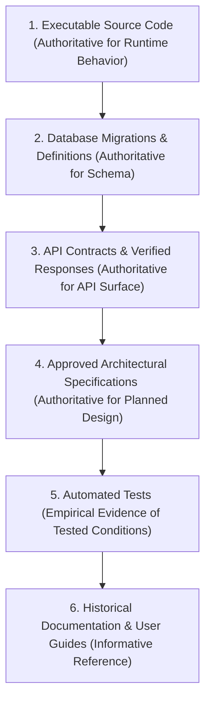
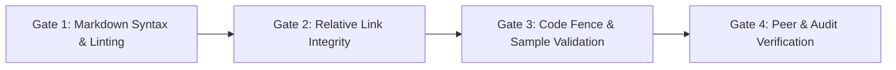
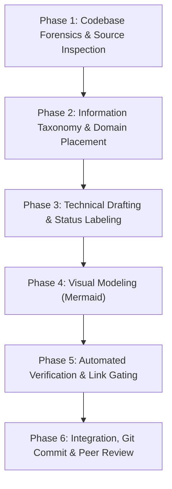
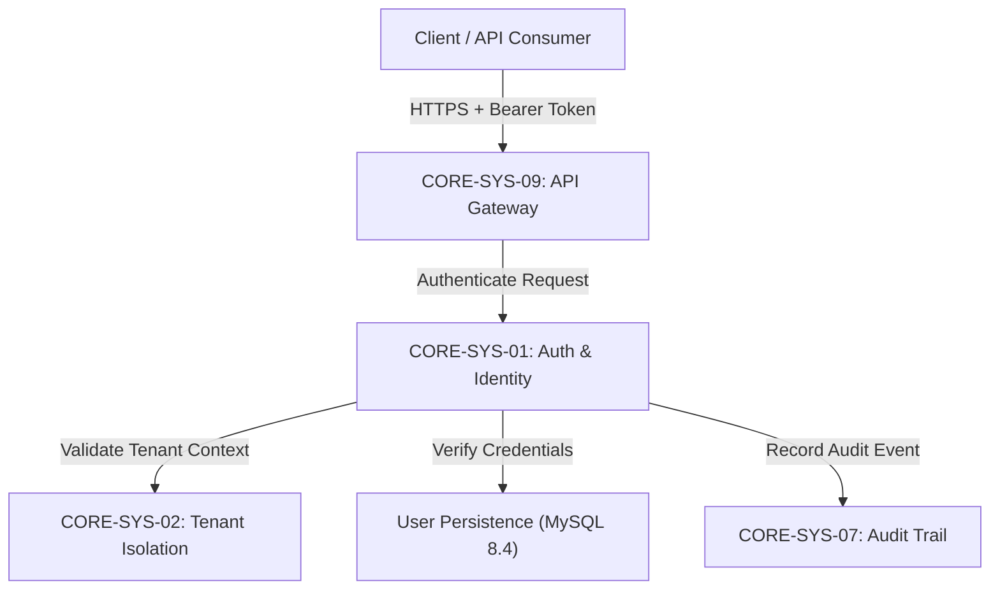

# Shared Engineering Skill: Technical Documentation and Knowledge Management Standards

**Skill ID:** SKILL-DOC-001  
**Version:** 2.0.0  
**Classification:** Reusable Engineering Skill  
**Status:** Active  

---

## 1. Skill Identity and Purpose

The **Technical Documentation and Knowledge Management Standards** skill establishes the authoritative enterprise standard for authoring, structuring, validating, synchronizing, and governing technical knowledge across Universal Core.

Its primary purpose is to transform documentation from passive, speculative prose into an active, code-grounded, empirically verified engineering asset. In enterprise software engineering, undocumented code is incomplete code, and out-of-sync documentation is an operational hazard.

This skill equips autonomous agents and software engineers to:
- Enforce the foundational rule that **documentation must reflect actual implemented source code**, eliminating fictional endpoints, fabricated database tables, and speculative capabilities.
- Rigorously apply explicit **implementation status classifications** (`[Implemented]`, `[Verified]`, `[Partially Implemented]`, `[Designed but Not Implemented]`, `[Planned]`, `[Deprecated]`, `[Unsupported]`, `[Unknown / Requires Verification]`) to every architectural and technical statement.
- Maintain a strictly ordered **Source-of-Truth Hierarchy**, resolving discrepancies deterministically without inventing behavior or silently altering code.
- Govern the root-level documentation repository (`docs/`) structured across 18 standardized domains, establishing navigable indexes and linking to canonical specifications without duplication.
- Produce authoritative documentation across eight specialized engineering disciplines: Architecture, Systems, APIs (OpenAPI 3.1.0), Databases, Operations, Development, Security, and Architecture Decision Records (ADRs).
- Enforce automated and peer-reviewed **Documentation Quality Gates** in CI/CD pipelines, validating Markdown structure, relative link integrity, and technical contract alignment.
- Harmonize knowledge management directly with Git version control workflows (`SKILL-GIT-001`), ensuring documentation changes accompany code changes within atomic pull requests.

---

## 2. Scope and Applicability

This standard applies universally to all technical documentation, repository guides, code docblocks, API schemas, database dictionaries, architecture decision records, and operational runbooks across Universal Core.

### 2.1 Target Audiences
All documentation authored under this standard must address the distinct technical and operational requirements of its intended stakeholders:
- **Software Developers:** Need concrete setup instructions, strict typing contracts, dependency injection patterns, DTO structures, and debugging workflows.
- **Senior & Principal Engineers:** Require domain boundary definitions, transactional boundaries, concurrency controls, and extensibility patterns.
- **Architects:** Require system context diagrams, inter-service dependency maps, state transition models, and ADR rationales.
- **Technical Leads:** Require task breakdown structures, component responsibility matrices, and code review criteria.
- **QA Engineers:** Require observable failure modes, test fixture definitions, boundary-value ranges, and verifiable acceptance criteria.
- **DevOps & Operations Engineers:** Require deployment runbooks, environment variable dictionaries, monitoring telemetry metrics, log structures, and disaster recovery procedures.
- **Security Engineers:** Require threat model boundaries, authentication/authorization policies, cryptographic key lifecycles, and isolation guarantees.
- **Project Maintainers & Reviewers:** Require change changelogs, version compatibility matrices, deprecation schedules, and contribution governance.
- **New Team Members:** Require end-to-end getting started guides, local development prerequisites (Windows Laragon / PowerShell), and architecture overviews.

---

## 3. Required Knowledge and Competencies

Engineers and agents implementing this skill must demonstrate verified expertise across seven core competencies:

1. **Source Code Inspection & Forensic Extraction:** Ability to parse PHP 8.3+ classes, Laravel 11.x service providers, routing tables, middleware pipelines, Eloquent models, and Form Requests to extract exact operational behavior.
2. **Information Architecture & Taxonomy:** Structuring multi-level documentation hierarchies, crafting navigable catalogs, and establishing unambiguous taxonomies without duplicated content.
3. **Specification Engineering (OpenAPI & JSON Schema):** Authoring complete, compliant OpenAPI 3.1.0 specifications, request/response JSON schemas, authentication schemes, and RFC 7807 problem details.
4. **Relational Schema Forensics:** Inspecting database migrations, foreign key constraints, composite indexes, and enum declarations to document real database schemas accurately.
5. **Visual Architecture Modeling (Mermaid):** Authoring deterministic, syntax-compliant Mermaid diagrams (Flowcharts, Sequence Diagrams, State Diagrams, Entity-Relationship Diagrams, Class Diagrams) without HTML tags or syntax errors.
6. **Normative Language & Technical Writing:** Utilizing RFC 2119 precision language (`MUST`, `MUST NOT`, `SHOULD`, `SHOULD NOT`, `MAY`) to formulate unambiguous, enforceable requirements.
7. **Documentation Quality Gating & CI Verification:** Executing markdown linters, link checkers, and code fence verifiers to maintain zero broken references across repository files.

---

## 4. Core Engineering Principles

### 4.1 Principle 1: Documentation Must Reflect Actual Code (Empirical Grounding)
Documentation MUST be derived from the actual implementation whenever implementation exists. Agents and engineers MUST NEVER document assumed, desired, or speculative functionality as implemented.

Before drafting or updating any documentation, authors MUST inspect:
- Concrete PHP classes, interfaces, traits, and method signatures.
- Service container bindings in Service Providers.
- Route definitions (`routes/web.php`, `routes/api.php`) and assigned middleware.
- Form Requests, validation rules, and authorization policies.
- Eloquent models, table mappings, casts, relationships, and global scopes.
- Database migration files and database seeders.
- Queued jobs, event listeners, and notification dispatchers.
- Configuration files (`config/*.php`) and `.env.example` keys.
- PHPUnit / Pest automated test suites and assertions.

Every component documentation document MUST answer twelve core questions:
1. **What does the component do?** (Exact functional responsibility).
2. **Why does it exist?** (Architectural and business motivation).
3. **Where does it belong in the architecture?** (Layer, domain aggregate, or namespace).
4. **How does it work internally?** (Step-by-step algorithmic execution flow).
5. **What does it depend on?** (Upstream dependencies, services, interfaces).
6. **What depends on it?** (Downstream consumers, listeners, controllers).
7. **How is it used?** (Tested, runnable code examples).
8. **What inputs and outputs does it support?** (Parameter types, return types, DTO contracts).
9. **What errors or failure conditions can occur?** (Exceptions thrown, HTTP error statuses).
10. **What security and isolation rules apply?** (Tenant boundaries, gates, permissions).
11. **How is it tested?** (Unit, feature, or integration test references).
12. **How can it be extended or maintained?** (Interfaces, strategy hooks, event hooks).

---

### 4.2 Principle 2: Source-of-Truth Rules and Precedence Hierarchy
When documentation, specifications, tests, or code exhibit discrepancies, the following deterministic precedence hierarchy MUST resolve the conflict:



#### Precedence Invariants:
1. **Runtime Invariant:** Executable code is authoritative for actual runtime behavior. If documentation states an action returns a `JsonResponse` but the controller returns a `View`, the code is authoritative regarding what currently occurs.
2. **Schema Invariant:** Database migration files and verified database schema definitions are authoritative for implemented database structure.
3. **API Contract Invariant:** Published OpenAPI 3.1.0 specifications and verified HTTP responses are authoritative for public API contracts.
4. **Planned Design Invariant:** Approved Architecture Decision Records (ADRs) and department specifications are authoritative for intended architecture where implementation has not yet occurred.
5. **Test Invariant:** Tests provide empirical evidence of tested behavior under specific inputs; they do not prove correctness under untested conditions.
6. **Discrepancy Remediation Protocol:**
   - Step 1: Identify and document the exact discrepancy between code and documentation.
   - Step 2: Determine whether the code behavior represents an intentional implementation or an undocumented defect.
   - Step 3: If code represents the intended behavior, update documentation to match reality.
   - Step 4: If code is defective, author a regression test demonstrating the defect, correct the code via an authorized PR, and align documentation.
   - Step 5: **STRICT PROHIBITION:** Authors MUST NOT silently modify source code merely to make documentation appear correct, nor fabricate missing behavior.

---

### 4.3 Principle 3: Implementation Status Classification
Every architectural component, system catalog entry, API endpoint, and technical document MUST display an explicit implementation status banner at its beginning.

| Status Tag | Operational Definition | Permitted Assertions |
| :--- | :--- | :--- |
| `[Implemented]` | Production-grade code exists in the repository, has been merged, and is executable. | Concrete classes, methods, configurations, and commands may be documented as active. |
| `[Verified]` | Code exists AND has passed automated tests, static analysis, and independent audit. | Performance metrics, test coverage, and security boundaries may be documented as verified facts. |
| `[Partially Implemented]` | Foundational code exists, but certain methods, interfaces, or edge cases remain in progress. | Implemented features must be documented; incomplete features must be explicitly marked as unfulfilled. |
| `[Designed but Not Implemented]` | Formal specifications or ADRs exist, but zero executable application code exists in the repository. | Architecture, schemas, and contracts may be documented as planned designs. MUST NOT document as active. |
| `[Planned]` | Conceptually scheduled in project roadmaps, but detailed technical specifications are not yet authored. | High-level goals may be outlined. MUST NOT fabricate endpoints, parameters, or schema definitions. |
| `[Deprecated]` | Code exists but is scheduled for removal in a future major release. | Deprecation reason, migration path, and removal timeline MUST be documented. |
| `[Unsupported]` | Workflows, configurations, or integrations that are deliberately prohibited or out-of-scope. | Explicit warnings describing why this path is unsupported and what alternative MUST be used. |
| `[Unknown / Requires Verification]` | Legacy code or unverified behavior where automated tests have not yet proven runtime characteristics. | Investigation requirements and risk warnings MUST be documented. |

**Zero-Tolerance Rules:**
- NEVER describe a planned or designed feature as `[Implemented]`.
- NEVER describe a generic code template or example as a project implementation.
- NEVER invent API routes, database fields, artisan commands, or config keys.

---

### 4.4 Principle 4: Documentation Writing Quality and Information Hygiene
Technical documentation must be concise, objective, unambiguous, and formatted in professional GitHub Flavored Markdown.

#### Quality Standards:
- **Tone & Style:** Professional, imperative, active voice. Avoid conversational commentary, marketing buzzwords, or filler.
- **Heading Hierarchy:** Strict sequential Markdown headings (`#` -> `##` -> `###` -> `####`). Never skip heading levels.
- **Code Fences:** Every code block MUST declare its syntax identifier (`php`, `json`, `yaml`, `bash`, `powershell`, `sql`, `markdown`, `mermaid`).
- **Diagrams:** Use Mermaid for dynamic diagrams. All node text with special characters MUST be quoted (e.g., `id["Process (Step 1)"]`).
- **Prerequisites & Expected Outputs:** All instructional guides and runbooks must specify exact prerequisites before instructions and explicit expected outputs after execution.
- **Dual Explanation for Complex Systems:**
  1. *Conceptual Explanation:* Explains domain models, business boundaries, and high-level mechanics for architects and new engineers.
  2. *Technical Specification:* Explains class hierarchies, method signatures, transaction isolation levels, exceptions, and extension hooks for implementers.

#### Prohibited Anti-Patterns:
- Empty sections or placeholder headings ("TBD", "Coming Soon", "Insert notes here").
- Unexplained domain acronyms or internal jargon.
- Duplication of entire specification files across multiple directories.
- Stale, hardcoded absolute paths referencing local developer machines (e.g., `C:\Users\developer\...`). Use repository-relative paths (`docs/...`, `app/...`).
- Broken internal links or orphaned documentation files.

---

## 5. Root-Level Documentation Architecture (`docs/`)

Universal Core mandates a centralized root-level documentation directory located at:
`C:\laragon\www\core\docs\`

This directory provides the canonical knowledge navigation layer for the entire project. It indexes all existing specifications, guides development, and captures runtime operations.

### 5.1 Canonical Documentation Tree (18-Domain Baseline)
```text
docs/
├── README.md                           # Master navigation guide, philosophy, and index of documentation
├── DOCUMENTATION-INDEX.md              # Central navigable catalog of all authoritative technical resources
├── DOCUMENTATION-STANDARDS.md          # Project-specific summary of documentation rules and lifecycle
├── DOCUMENTATION-CHANGELOG.md          # Chronological record of documentation releases and structural updates
│
├── 00-governance/                      # Documentation lifecycle, approval policies, and quality gates
│   ├── README.md
│   ├── documentation-governance.md
│   ├── documentation-lifecycle.md
│   ├── ownership-and-responsibilities.md
│   ├── review-and-approval-policy.md
│   ├── versioning-and-deprecation.md
│   └── documentation-quality-gates.md
│
├── 01-getting-started/                  # Developer onboarding for Windows Laragon / PowerShell stack
│   ├── README.md
│   ├── introduction.md
│   ├── prerequisites.md
│   ├── installation.md
│   ├── environment-setup.md
│   ├── project-structure.md
│   ├── first-steps.md
│   └── troubleshooting.md
│
├── 02-architecture/                     # High-level architecture, boundaries, principles, and ADRs
│   ├── README.md
│   ├── architecture-overview.md
│   ├── architectural-principles.md
│   ├── system-boundaries.md
│   ├── dependency-architecture.md
│   ├── data-flow.md
│   ├── security-architecture.md
│   ├── scalability-and-performance.md
│   └── architecture-decisions/
│       └── README.md                   # Index of all Architecture Decision Records (ADRs)
│
├── 03-core-systems/                     # Catalog and specifications for CORE-SYS-01 through CORE-SYS-18
│   ├── README.md
│   ├── system-catalog.md               # Master matrix of all 18 core systems with status tags
│   ├── system-dependency-map.md        # Inter-system coupling and communication topology
│   ├── system-integration-guide.md     # Cross-system integration patterns and event contracts
│   └── systems/
│       ├── README.md
│       ├── CORE-SYS-01/                # Authentication, Authorization & Identity Management
│       │   └── README.md
│       ├── CORE-SYS-02/                # Multi-Tenant Isolation & Organization Hierarchy
│       │   └── README.md
│       ├── CORE-SYS-03/                # Dynamic Form, Validation & Schema Management
│       │   └── README.md
│       ├── CORE-SYS-04/                # Dynamic Workflow, State Machine & Orchestration
│       │   └── README.md
│       ├── CORE-SYS-05/                # Notification, Dispatch & Multi-Channel Alerting
│       │   └── README.md
│       ├── CORE-SYS-06/                # File, Media & Secure Document Asset Management
│       │   └── README.md
│       ├── CORE-SYS-07/                # Audit Trail, Event Sourcing & Compliance Ledger
│       │   └── README.md
│       ├── CORE-SYS-08/                # Cryptography, Envelope Encryption & Key Management
│       │   └── README.md
│       ├── CORE-SYS-09/                # API Gateway, Ingress Throttling & Webhook Dispatch
│       │   └── README.md
│       ├── CORE-SYS-10/                # Job Queue, Asynchronous Processing & Scheduling
│       │   └── README.md
│       ├── CORE-SYS-11/                # Caching, Distributed Memory & Performance Acceleration
│       │   └── README.md
│       ├── CORE-SYS-12/                # Search, Indexing & Full-Text Retrieval
│       │   └── README.md
│       ├── CORE-SYS-13/                # Reporting, Data Aggregation & Business Intelligence
│       │   └── README.md
│       ├── CORE-SYS-14/                # Billing, Subscription & Payment Gateway Integration
│       │   └── README.md
│       ├── CORE-SYS-15/                # Localization, Internationalization & Multi-Language
│       │   └── README.md
│       ├── CORE-SYS-16/                # Configuration, Dynamic Settings & Feature Flag Management
│       │   └── README.md
│       ├── CORE-SYS-17/                # Telemetry, Health Probing & Observability Monitoring
│       │   └── README.md
│       └── CORE-SYS-18/                # System Closure, Backup & Disaster Recovery Orchestration
│           └── README.md
│
├── 04-development/                      # Daily development workflows, standards, and guidelines
│   ├── README.md
│   ├── development-environment.md      # Native Windows Laragon, PHP 8.3+, PowerShell conventions
│   ├── coding-standards.md             # Strict typing, Laravel Pint, PSR-12, clean architecture
│   ├── architecture-guidelines.md      # Action classes, single-responsibility, DTOs
│   ├── dependency-management.md        # Composer 2.x and NPM dependency governance
│   ├── database-development.md         # Migration authoring, indexing rules, seeders
│   ├── api-development.md              # RESTful API design, FormRequests, JSON:API envelopes
│   ├── frontend-development.md         # Blade, Livewire 3, Filament, Tailwind RTL guidelines
│   ├── testing-guide.md                # Pest & PHPUnit testing execution, factories, datasets
│   ├── debugging-guide.md              # Xdebug, Laravel Ray, log analysis, query profiling
│   └── local-workflows.md              # Common PowerShell scripts and artisan routines
│
├── 05-guides/                           # Step-by-step practical implementation and troubleshooting guides
│   ├── README.md
│   ├── implementation-guides/
│   │   └── README.md
│   ├── integration-guides/
│   │   └── README.md
│   ├── migration-guides/
│   │   └── README.md
│   └── troubleshooting-guides/
│       └── README.md
│
├── 06-api-reference/                    # OpenAPI 3.1.0 specifications and API contracts
│   ├── README.md
│   ├── api-overview.md
│   ├── authentication.md               # Bearer tokens, Sanctum/Passport flows
│   ├── authorization.md                # Scopes, permissions, role hierarchy
│   ├── error-handling.md               # RFC 7807 problem details, error envelopes
│   └── endpoints/
│       └── README.md                   # Modular endpoint contract specifications
│
├── 07-database/                         # Relational database architecture, data dictionaries, migrations
│   ├── README.md
│   ├── database-architecture.md        # MySQL 8.4 LTS, InnoDB engine, utf8mb4 collation
│   ├── schema-overview.md              # Entity relational overview and table classifications
│   ├── relationships.md                # Cardinality, cascading deletes, foreign key invariants
│   ├── migrations.md                   # Zero-downtime Expand-Contract migration protocols
│   ├── indexing-and-performance.md     # B-tree indexing, covering indexes, query plans
│   └── data-integrity.md               # ACID transactions, row-level locking, deadlocks
│
├── 08-security/                         # Threat modeling, encryption, secrets, and incident response
│   ├── README.md
│   ├── security-overview.md            # Defense-in-depth security architecture
│   ├── authentication-and-authorization.md # Multi-factor auth, session security, RBAC
│   ├── secrets-management.md           # Zero secrets in git, .env protection, vault integration
│   ├── encryption-and-cryptography.md  # AES-256-GCM, envelope encryption, key rotation
│   ├── isolation-and-access-boundaries.md # Multi-tenant scoping and cross-tenant defense
│   ├── secure-development.md           # OWASP Top 10 mitigation, CSRF, XSS, SQLi defense
│   └── security-incident-procedures.md # Incident triage, key revocation, breach protocols
│
├── 09-operations/                       # Production deployment, runtime tuning, monitoring, recovery
│   ├── README.md
│   ├── deployment.md                   # Atomic zero-downtime symlink deployment pipelines
│   ├── environment-configuration.md    # Production PHP-FPM, OPcache, Redis, MySQL settings
│   ├── monitoring-and-observability.md # Health checks, RED/USE metrics, uptime probes
│   ├── logging.md                      # Structured JSON logging, Monolog, log aggregation
│   ├── backup-and-recovery.md          # Hot physical backups, point-in-time recovery, RPO/RTO
│   ├── queue-operations.md             # Supervisord daemon management, Redis queue workers
│   └── incident-response.md            # Operational escalation, runbooks, post-mortems
│
├── 10-testing-and-quality/              # Quality gates, test portfolios, mutation testing
│   ├── README.md
│   ├── testing-strategy.md             # Testing pyramid, deterministic execution rules
│   ├── test-architecture.md            # Test harnesses, base test cases, database refreshing
│   ├── unit-testing.md                 # Pure memory unit tests, Value Objects, Actions
│   ├── integration-testing.md          # Feature tests, database persistence, event dispatching
│   ├── api-testing.md                  # HTTP assertions, JSON schema contract validation
│   ├── browser-testing.md              # Laravel Dusk, UI testing, RTL visual verification
│   ├── security-testing.md             # IDOR testing, authorization bypass, fuzzing probes
│   └── quality-gates.md                # PHPStan Level 8+, Infection MSI >= 80%, Pint
│
├── 11-configuration-reference/          # Configuration keys, environment variables, feature flags
│   ├── README.md
│   ├── configuration-overview.md       # Configuration loading, immutability, caching
│   ├── environment-variables.md        # Comprehensive .env dictionary with validation rules
│   ├── application-settings.md         # Dynamic database settings and overrides
│   └── feature-flags.md                # Pennant feature flags, rollout strategies
│
├── 12-release-management/               # Semantic versioning, release procedures, changelogs
│   ├── README.md
│   ├── release-process.md              # Pre-flight checklist, release tagging, verification
│   ├── versioning-policy.md            # Semantic Versioning 2.0.0 guidelines
│   ├── changelog.md                    # Generated and curated project changelog
│   ├── compatibility-matrix.md         # PHP, MySQL, Redis, Composer version support
│   ├── upgrade-guides/
│   │   └── README.md                   # Version-to-version migration instructions
│   └── deprecation-policy.md           # Deprecation notices, warnings, removal windows
│
├── 13-contributing/                     # Engineering contribution and review standards
│   ├── README.md
│   ├── contribution-guidelines.md      # Workflow for internal engineers and AI agents
│   ├── pull-request-process.md         # PR lifecycle, templates, gating criteria
│   ├── code-review-standards.md        # Review criteria, blocking conditions, resolution
│   ├── commit-message-conventions.md   # Conventional Commits format and types
│   └── documentation-contributions.md  # Rules for updating and validating docs
│
├── 14-reference/                        # Authoritative glossaries, terminology, dependencies
│   ├── README.md
│   ├── glossary.md                     # Domain and enterprise engineering glossary
│   ├── terminology.md                  # Canonical definitions of technical terms
│   ├── supported-versions.md           # Framework, library, and runtime support lifecycle
│   ├── dependencies.md                 # Core Composer and NPM dependency catalog
│   ├── standards-and-specifications.md # External specifications (RFCs, PSRs, W3C)
│   └── frequently-asked-questions.md   # Engineering FAQs and common resolutions
│
├── 15-decisions/                        # Architecture Decision Records (ADRs) repository
│   ├── README.md                       # Decision record process and catalog of ADRs
│   └── adr/
│       └── README.md                   # Concrete ADR records (ADR-0001, ADR-0002, ...)
│
├── 16-templates/                        # Reusable Markdown document templates
│   ├── README.md
│   ├── technical-document-template.md  # Standard technical document blueprint
│   ├── architecture-document-template.md # Architecture specification blueprint
│   ├── api-document-template.md        # API endpoint reference blueprint
│   ├── system-document-template.md     # Core system specification blueprint
│   ├── implementation-guide-template.md # Step-by-step implementation guide blueprint
│   ├── troubleshooting-template.md     # Incident and troubleshooting blueprint
│   ├── adr-template.md                 # Canonical Architecture Decision Record blueprint
│   └── release-notes-template.md       # Release notes blueprint
│
└── 17-archive/                          # Historical, superseded, or deprecated documents
    └── README.md                       # Archival policy and historical index
```

### 5.2 Canonical Linking and Anti-Duplication Rules
Universal Core possesses authoritative constitutional and governance specifications in `.agents/governance/`, department charters in `.agents/departments/`, and operational workflows in `.agents/workflows/`.

Authors MUST follow these strict integration rules:
1. **Link, Do Not Duplicate:** Never duplicate entire governance policies, department charters, or agent specifications into `docs/`. Instead, `docs/` files MUST link directly to the canonical `.agents/...` path and provide contextual guidance on how engineers and operators apply those standards.
2. **Coherent Navigation Layer:** `docs/` serves as the user-facing and engineer-facing navigation layer for the repository. Readers starting at `docs/README.md` must be able to discover both high-level developer guides and upstream governance charters seamlessly.
3. **Preserve Upstream Immutability:** Updating documentation under `docs/` must never alter governance documents or agent specifications unless explicitly authorized by Constitutional Governance.

---

## 6. Specialized Standards for Documentation Disciplines

### 6.1 Architecture Documentation
Architecture documents must capture structural topologies, boundaries, and trade-offs.
- **Mandatory Sections:**
  1. System Context & Strategic Goals.
  2. Component Breakdown & Domain Aggregates.
  3. Data Flow & Inter-Component Communication.
  4. Failure Domains & Circuit Breakers.
  5. Security Boundaries & Threat Modeling.
  6. Visual Mermaid Architecture Diagram.
  7. Architectural Decisions & Constraints.

### 6.2 System Documentation (Core Systems Catalog)
Each core system (CORE-SYS-01 through CORE-SYS-18) must possess a standardized specification:
- **Identity & Scope:** Unique ID, System Name, Responsible Agent, and Domain Boundary.
- **Implementation Status:** Explicit status banner (`[Implemented]`, `[Designed but Not Implemented]`, etc.).
- **Public Contracts & Interfaces:** PHP interfaces, public service methods, event payloads, and DTO definitions.
- **Internal Mechanisms:** State machine transitions, persistence models, transactional boundaries, and background job scheduling.
- **Dependencies:** Inbound and outbound couplings with other core systems.
- **Security & Multi-Tenancy:** Scoping invariants, permission checks, data isolation rules.
- **Testing & Failure Handling:** Fallback mechanisms, exception handling, and regression test references.

### 6.3 API Documentation (OpenAPI 3.1.0)
API documentation must strictly reflect executable routing and Form Request validations:
- **Contract Source:** Authoritative OpenAPI 3.1.0 specifications formatted in YAML or JSON.
- **Endpoint Structure:**
  - HTTP Verb & URI Path.
  - Summary & Detailed Description.
  - Authentication Scheme (Bearer Sanctum token, API key) and required scopes/permissions.
  - Request Parameters (Path, Query, Header) with types and validation constraints.
  - Request Body Schema with field-level descriptions and example payloads.
  - Response Schemas for `200/201 Success` envelopes and `400/401/403/404/422/500` error envelopes conforming to RFC 7807 Problem Details.
  - Rate limiting thresholds and headers (`X-RateLimit-Limit`, `X-RateLimit-Remaining`).
  - Idempotency guarantees (`Idempotency-Key` header support).

### 6.4 Database Documentation (Data Dictionaries)
Database documentation must accurately document relational storage structures:
- **Engine & Settings:** Storage engine (`InnoDB`), character set (`utf8mb4`), collation (`utf8mb4_unicode_ci`).
- **Table Definition:** Table name, business purpose, domain aggregate owner.
- **Column Matrix:** Column name, physical data type, nullable flag, default value, index status, and business definition.
- **Relational Invariants:** Primary keys, foreign key constraints, referenced parent tables, and delete cascade behaviors (`RESTRICT`, `CASCADE`, `SET NULL`).
- **Indexing Strategy:** B-tree index rationale, composite index column order, and query performance justifications.
- **Data Lifecycle:** Soft delete mechanics, tenant scoping (`tenant_id`), partitioning, and data retention policies.

### 6.5 Operational Documentation (Runbooks & SRE Guides)
Operational guides must enable on-call engineers to operate, monitor, and recover systems:
- **Prerequisites:** Minimum software versions, network access, environment variables, and CLI permissions.
- **Step-by-Step Execution:** Sequential commands with expected CLI responses.
- **Monitoring & Metrics:** Key health indicators, Prometheus/CloudWatch metric names, and alerting thresholds.
- **Triage & Troubleshooting:** Symptom-cause-remediation tables for high-frequency failure modes.
- **Disaster Recovery & Rollback:** Exact rollback command sequences, database point-in-time recovery steps, and service restart procedures.

### 6.6 Developer Documentation
Developer documentation ensures swift, error-free onboarding and daily contribution:
- **Local Environment:** Clear instructions for native Windows Laragon, PowerShell, PHP 8.3 CLI, MySQL 8.4, and Redis.
- **Coding Conventions:** Strict typing, constructor promotion, readonly properties, Action class design.
- **Testing Workflows:** Pest and PHPUnit command invocations, filtering tests by group, refreshing test databases.
- **Pull Request Lifecycle:** Branching, conventional commits, quality gates, and code review criteria.

### 6.7 Security Documentation
Security documentation protects confidentiality, integrity, and availability:
- **Threat Model:** Identified trust boundaries, assets, threat actors, and attack vectors.
- **Authentication & RBAC:** Multi-factor authentication, session management, permission hierarchy.
- **Secrets Management:** Invariants prohibiting secrets in source control, `.env` file security, and key rotation procedures.
- **Envelope Encryption:** Key derivation functions, master keys, data encryption keys (DEKs), and cipher specs (AES-256-GCM).
- **Incident Response Protocol:** Immediate containment, credential revocation, forensic logging, and post-incident disclosure.

### 6.8 Architecture Decision Records (ADRs)
ADRs capture significant architectural decisions, preserving historical context and rationale:
- **Canonical Filename:** `docs/15-decisions/adr/ADR-XXXX-short-title.md` (e.g., `ADR-0001-native-laragon-stack.md`).
- **Standard Statuses:** `Proposed`, `Accepted`, `Rejected`, `Deprecated`, `Superseded`.
- **Mandatory Sections:** Title, Date, Status, Context, Decision, Consequences (Positive, Negative, Neutral), Compliance Verification, References.

---

## 7. Documentation Maintenance and Quality Gates

Documentation is a living asset. Documentation drift is prevented through strict synchronization rules and automated quality gates.

### 7.1 Mandatory Code-Documentation Synchronization Rules
1. **Public Contract Changes:** Any PR modifying a public method signature, controller route, or DTO contract MUST update the corresponding documentation within the same PR.
2. **Schema Changes:** Any PR introducing a database migration MUST update the relevant Data Dictionary and schema documentation.
3. **Configuration Changes:** Any PR adding or altering an environment variable in `config/*.php` MUST update `.env.example` and `docs/11-configuration-reference/environment-variables.md`.
4. **Security & Authorization Changes:** Any modification to gates, policies, or cryptographic routines MUST update security documentation.
5. **Breaking Changes:** Breaking modifications MUST include an upgrade guide entry in `docs/12-release-management/upgrade-guides/`.

### 7.2 Documentation Quality Gates
Before any pull request containing documentation can be merged, it must satisfy four automated and peer-reviewed gates:



1. **Gate 1: Markdown Syntax & Linting:** Files must pass markdownlint checks with zero errors (consistent heading styles, proper list indentation, valid table formatting).
2. **Gate 2: Relative Link Integrity:** All relative markdown links (`[text](../path/file.md)`) must resolve to existing files and valid anchor tags. Zero 404 dead links permitted.
3. **Gate 3: Code Fence & Sample Validation:** Code snippets must declare valid language specifiers. PHP and JSON code blocks must represent syntactically valid code reflecting actual class names and schemas.
4. **Gate 4: Peer & Audit Verification:** Department N (Documentation Closure) or designated reviewers must confirm that documented claims reflect verified repository code. Automated linters verify formatting; human and AI reviewers verify technical truth.

---

## 8. Documentation Versioning, Ownership, and Governance

### 8.1 Documentation Ownership Matrix
- **Department N (Documentation & Closure):** Ultimate custodian of documentation structure, quality gates, and system closure artifacts (`DOC-001`, `APIDOC-001`, `ADR-001`).
- **Originating Producer Agents:** Responsible for drafting initial technical specifications and runbooks corresponding to their domain (e.g., Department E for Database Dictionaries, Department F for Security Specs).
- **Department M (Independent Audit):** Audits documentation accuracy against executable code during Stage 12 and Stage 13 lifecycle reviews.

### 8.2 Versioning Rules
- Technical documentation adheres to **Semantic Versioning 2.0.0** (`MAJOR.MINOR.PATCH`).
- A `MAJOR` bump reflects structural reorganization of documentation, breaking API contract changes, or architectural rewrites.
- A `MINOR` bump reflects new documented features, systems, or complete guides added without breaking navigation.
- A `PATCH` bump reflects typo corrections, link fixes, minor clarifications, or updated code examples.
- Document headers must display Document ID, Version, Classification, and Last Verified Date.

### 8.3 Deprecation and Archival Policy
When a subsystem, component, or pattern is deprecated:
1. Update the document status banner to `[Deprecated]`.
2. Add a prominent deprecation notice detailing the sunset timeline, replacement alternative, and migration guide link.
3. Once removed from code, move the historical documentation file into `docs/17-archive/`, updating internal links to prevent breakage.

---

## 9. Cross-Skill Integration with Git Engineering Standards

Documentation Engineering operates in lockstep with Git Engineering Standards (`SKILL-GIT-001`):
1. **Atomic Documentation PRs:** Code changes and their associated documentation updates MUST be committed in the same branch and merged within the same pull request.
2. **Conventional Commits for Documentation:** Documentation updates MUST use the `docs` type conforming to Conventional Commits:
   - `docs(api): update authentication endpoints for sanctum bearer tokens`
   - `docs(db): document composite indexes for tenant billing transactions`
   - `docs(adr): record ADR-0015 on redis queue and cache segregation`
3. **Branch Naming for Documentation:** Dedicated documentation improvements or restructuring must utilize the `docs/` branch prefix:
   - `docs/DOC-102-core-systems-catalog`
   - `docs/DOC-105-laragon-onboarding-guide`
4. **Release Tag Synchronization:** Every Git release tag (`vX.Y.Z`) MUST correspond to a verified, tagged state of the `docs/` repository, including an updated `DOCUMENTATION-CHANGELOG.md`.

---

## 10. Step-by-Step Documentation Authoring Method

Autonomous agents and engineers authoring or updating documentation MUST follow this six-phase methodology:



### Phase 1: Codebase Forensics & Source Inspection
1. Read the target PHP classes, models, migrations, routes, or configuration files.
2. Verify whether automated tests exist for the target component and inspect test assertions.
3. Determine the true implementation status: `[Implemented]`, `[Verified]`, or `[Designed but Not Implemented]`.

### Phase 2: Information Taxonomy & Domain Placement
1. Identify the target directory under `docs/` (e.g., `03-core-systems/`, `06-api-reference/`, `07-database/`).
2. Verify if a canonical specification exists in `.agents/governance/` or `.agents/departments/`. If so, prepare to link rather than duplicate.
3. Select the appropriate standardized template from `docs/16-templates/`.

### Phase 3: Technical Drafting & Status Labeling
1. Embed the mandatory metadata block (ID, Version, Status, Last Verified).
2. Write the 12 core component questions (What, Why, Where, How, Dependencies, Usage, Errors, Security, Testing, Extension).
3. Ensure all code blocks declare syntax specifiers and demonstrate real, runnable code.
4. Apply RFC 2119 normative language (`MUST`, `SHOULD`, `MAY`).

### Phase 4: Visual Modeling (Mermaid)
1. Design visual diagrams (flowcharts, sequence diagrams, ER diagrams) to clarify complex workflows.
2. Verify Mermaid syntax: use double quotes around labels containing special characters, brackets, or parentheses.
3. Validate diagram rendering.

### Phase 5: Automated Verification & Link Gating
1. Check that all internal relative markdown links resolve correctly.
2. Verify heading hierarchy consistency.
3. Run markdown linter and link checker.

### Phase 6: Integration, Git Commit & Peer Review
1. Update `docs/DOCUMENTATION-INDEX.md` and the parent directory `README.md` to include the new document.
2. Stage documentation files with code changes using `git add docs/ ...`.
3. Commit using conventional commit format: `docs(<scope>): <description>`.
4. Submit pull request for review and Department M / Department N audit verification.

---

## 11. Concrete Implementation Examples

### 11.1 Concrete Example: Architecture Decision Record (ADR)
```markdown
# Architecture Decision Record: ADR-0012 — Redis Workload Segregation

**ADR ID:** ADR-0012  
**Status:** Accepted  
**Date:** 2026-11-15  
**Deciders:** Chief Software Architect (ARCH-001), DevOps Authority (OPS-001), Lead Performance Engineer (PERF-001)  
**Technical Standards Ref:** SKILL-DEVOPS-001, SKILL-DOC-001, SKILL-GIT-001  

## 1. Context and Problem Statement
Universal Core utilizes Redis for both asynchronous background job queues and high-throughput application caching. In high-traffic scenarios, application caching risks filling the allocated Redis memory (`maxmemory`). 

Redis enforces `maxmemory-policy` at the server/process level, meaning logical databases (`SELECT 0` and `SELECT 1`) share identical memory limits and eviction policies. If `allkeys-lru` eviction is enabled, queue jobs risk silent deletion during cache spikes. Conversely, if `noeviction` is configured, cache writes fail with out-of-memory errors once limits are reached.

## 2. Decision Drivers
- Zero data loss for background queues (financial settlements, webhook deliveries, audit ledgers).
- High-performance, ephemeral caching with automatic eviction of stale entries.
- Prevention of cascading application failures when cache memory saturates.

## 3. Considered Options
- Option 1: Single Redis instance with `noeviction` and manual TTL-based application cache pruning.
- Option 2: Single Redis instance with `volatile-lru` eviction and persistent queue storage.
- Option 3: Dedicated multi-instance Redis architecture (Queue instance on port 6380, Cache instance on port 6379).

## 4. Decision Outcome
Chosen Option: **Option 3: Dedicated multi-instance Redis architecture**.

Production and staging environments MUST deploy two isolated Redis processes:
1. `redis-queue` (Port 6380): Configured with `maxmemory-policy noeviction` and Append-Only File (AOF) persistence enabled.
2. `redis-cache` (Port 6379): Configured with `maxmemory-policy allkeys-lru` and volatile in-memory storage.

### Positive Consequences
- Guarantees zero silent job evictions under severe cache memory pressure.
- Cache memory saturation gracefully evicts least-recently-used cache items without throwing exceptions.
- Independent monitoring, memory limits, and metrics for queue and cache workloads.

### Negative Consequences
- Slight increase in server memory overhead due to running two Redis server daemons.
- Requires dual connection parameters in environment configuration (`REDIS_QUEUE_HOST`/`PORT` vs `REDIS_CACHE_HOST`/`PORT`).

## 5. Compliance and Verification
- DevOps and deployment pipelines must verify two active Redis daemon processes in staging and production.
- CI static analysis checks must ensure `config/queue.php` references the queue connection and `config/cache.php` references the cache connection.
```

---

### 11.2 Concrete Example: System Specification Document (CORE-SYS-01 Snippet)
```markdown
# Core System Specification: Authentication, Authorization & Identity Management

**System ID:** CORE-SYS-01  
**System Name:** Authentication, Authorization & Identity Management  
**Status:** [Designed but Not Implemented]  
**Responsible Agent:** Lead Security Engineer (SEC-001)  
**Architectural Classification:** Core Infrastructure Service  
**Canonical Directory:** `docs/03-core-systems/systems/CORE-SYS-01/`  

---

## 1. System Mission and Purpose
CORE-SYS-01 provides universal identity verification, multi-tenant authentication, API token issuing, multi-factor authentication (MFA), and fine-grained role-based access control (RBAC) across Universal Core applications.

## 2. Architectural Boundaries


## 3. Public Interfaces and Contracts
```php
<?php

declare(strict_types=1);

namespace App\Core\Auth\Contracts;

use App\Core\Auth\DTOs\AuthenticationResult;
use App\Core\Auth\DTOs\Credentials;

interface AuthenticationServiceInterface
{
    /**
     * Authenticate user credentials within tenant isolation boundary.
     *
     * @throws \App\Core\Auth\Exceptions\AuthenticationFailedException
     * @throws \App\Core\Auth\Exceptions\AccountLockedException
     * @throws \App\Core\Auth\Exceptions\TenantMismatchException
     */
    public function authenticate(Credentials $credentials): AuthenticationResult;

    /**
     * Revoke active access token session.
     */
    public function revokeSession(string $tokenId): void;
}
```

## 4. Implementation Status and Traceability
- **Runtime Code:** `[Designed but Not Implemented]`. No classes exist yet in `app/Core/Auth/`.
- **Approved Specifications:** Documented in `.agents/agents/F_security_cryptography/security-architect.md` and `.agents/skills/secure-coding-standards.md`.
- **Planned Database Tables:** `users`, `personal_access_tokens`, `roles`, `permissions`, `role_user`, `permission_role`.
```

---

## 12. Self-Review and Verification Checklist

Every agent or engineer authoring or updating documentation MUST complete this verification checklist prior to PR submission:

- [ ] **Empirical Grounding:** Did you personally inspect the actual source code, migrations, or configurations before authoring the document?
- [ ] **Status Tag Applied:** Is every component explicitly tagged (`[Implemented]`, `[Verified]`, `[Designed but Not Implemented]`, etc.)?
- [ ] **No Fabricated Capabilities:** Have you strictly refrained from inventing fictional API endpoints, database fields, or commands?
- [ ] **Source-of-Truth Compliant:** Does the document respect the code -> migration -> API -> approved spec precedence hierarchy?
- [ ] **Audience Appropriateness:** Does the document address both conceptual architecture and concrete implementation details?
- [ ] **Heading Hierarchy:** Are markdown headings strictly sequential without skipped levels?
- [ ] **Syntax-Specifying Code Blocks:** Does every code fence specify a valid language (`php`, `json`, `sql`, `powershell`, `yaml`, `mermaid`)?
- [ ] **Mermaid Syntax Validated:** Are all Mermaid diagram node labels containing special characters enclosed in double quotes?
- [ ] **Relative Links Verified:** Do all relative links resolve to existing files without broken paths?
- [ ] **Anti-Duplication Respected:** Does the document link to canonical governance specs instead of copy-pasting them?
- [ ] **Conventional Commit Used:** Is the git commit message formatted using the `docs(...)` conventional commit standard?
- [ ] **PR Atomic Update:** Are code changes and documentation changes bundled within the same pull request?
