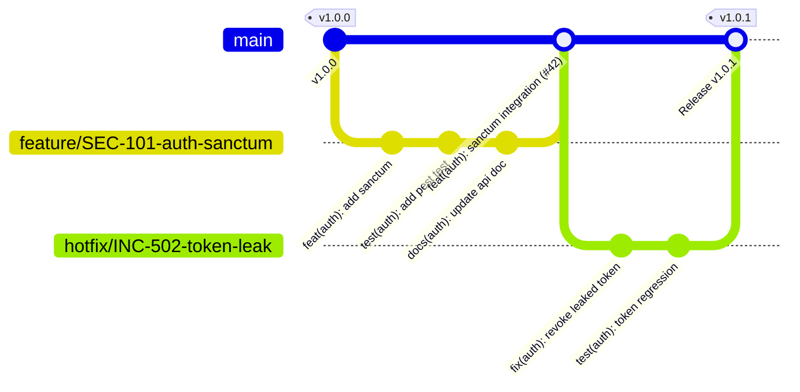
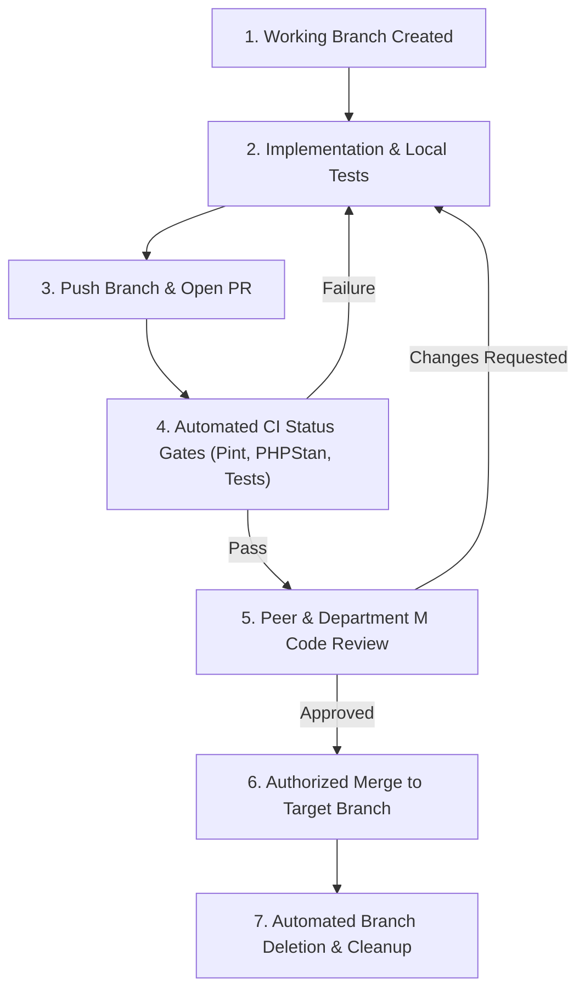
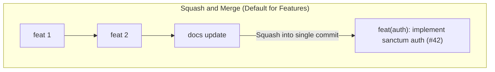
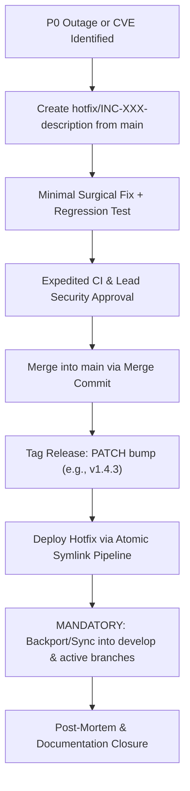
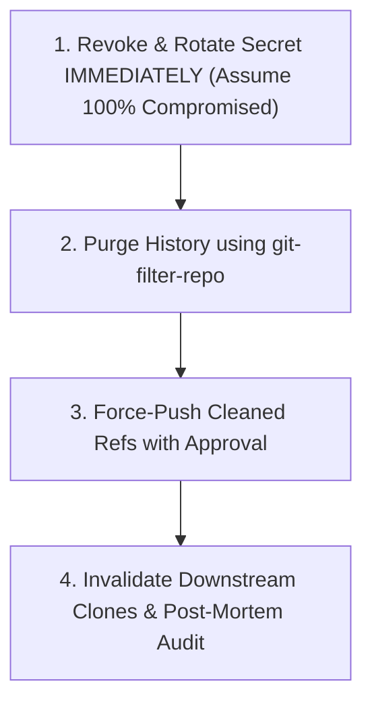
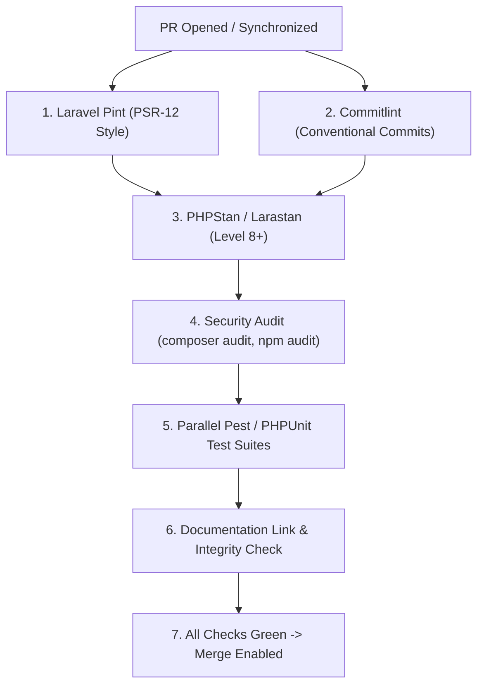
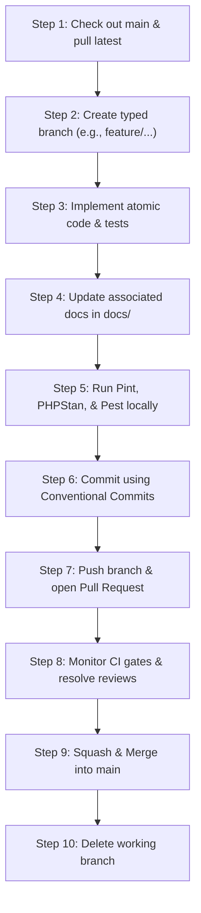

# Shared Engineering Skill: Git Workflow and Conventional Commits Standards

**Skill ID:** SKILL-GIT-001  
**Version:** 2.0.0  
**Classification:** Reusable Engineering Skill  
**Status:** Active  

---

## 1. Skill Identity and Purpose

The **Git Workflow and Conventional Commits Standards** skill establishes the authoritative enterprise engineering standard for source control management, branching models, commit hygiene, pull request governance, code review protocols, merge mechanics, release tagging, and repository integrity across Universal Core.

Its primary purpose is to maintain an immutable, auditable, deterministic, and automated-changelog-ready Git history. In enterprise software engineering, version control is the authoritative ledger of code evolution; sloppy commit messages, uncontrolled branching, unverified merges, or committed secrets compromise the security and maintainability of the entire organization.

This skill equips autonomous agents and software engineers to:
- Enforce an enterprise **branching architecture** that balances continuous delivery with unshakeable stability, distinguishing protected long-lived branches (`main`, `develop`) from short-lived working branches.
- Establish **Trunk-Based Development** with short-lived feature branches as the default operational model while specifying precise applicability criteria for scheduled GitFlow release trains.
- Author precise, machine-parsable commit messages strictly conforming to **Conventional Commits 1.0.0** (`<type>(<scope>): <description>`) with comprehensive coverage across 12 standardized change types.
- Govern the end-to-end **Pull Request (PR) and Code Review lifecycle**, establishing mandatory checklists, review severity hierarchies (`[BLOCKER]`, `[IMPORTANT]`, `[SUGGESTION]`, `[NITPICK]`), and automated CI status gates.
- Execute disciplined **merge strategies** (Squash Merges for linear feature histories, Merge Commits `--no-ff` for release/hotfix integration topology) while strictly prohibiting the dangerous rebasing of published, shared branches.
- Direct formal **Semantic Versioning 2.0.0** release workflows using immutable annotated Git tags (`vX.Y.Z`) and automated changelog synthesis.
- Execute controlled, auditable **emergency hotfix workflows** for critical production incidents, guaranteeing immediate backporting and post-mortem documentation closure.
- Safeguard repository security with strict **secret prevention policies**, pre-commit scanning, GPG/SSH commit signing, and explicit forensic remediation protocols for accidental credential exposure using `git-filter-repo`.
- Provide definitive, non-destructive **conflict resolution and reflog recovery runbooks**, establishing clear boundaries between safe and destructive Git commands.
- Seamlessly synchronize Git operations with Documentation Engineering Standards (`SKILL-DOC-001`), ensuring documentation updates accompany code changes within identical atomic commits.

---

## 2. Scope and Applicability

This standard applies universally across all source repositories, codebases, microservices, libraries, configuration packages, and documentation repositories within Universal Core.

### 2.1 Environmental Boundaries
- **Local Developer Environment:** Native Windows Laragon using PowerShell. Commands and runbooks must operate reliably in native PowerShell consoles without requiring bash-specific shims or non-standard GNU utilities.
- **Hosted Repositories & CI/CD:** Remote Git hosts (GitHub, GitLab) running automated webhook triggers and GitHub Actions CI pipelines.
- **Repository Types:** Applies equally to monolithic application repositories, domain modules, shared libraries, and infrastructure/governance repositories.

---

## 3. Required Knowledge and Competencies

Engineers and agents implementing this skill must demonstrate verified expertise across eight core disciplines:

1. **Git Directed Acyclic Graph (DAG) Internals:** Deep understanding of Git object models (blobs, trees, commits, annotated tags), SHA-1/SHA-256 content addressing, commit ancestry, and detached HEAD states.
2. **Branching Model Architecture:** Nuanced mechanics of Trunk-Based Development, short-lived feature branches, GitFlow integration patterns, and release branch lifecycles.
3. **Conventional Commits Specification:** Formatting rules, breaking change syntax (`!:` or `BREAKING CHANGE:` footer), atomic scoping, and integration with semantic release engines.
4. **Merge & History Mechanics:** Behavioral differences, advantages, and trade-offs between Fast-Forward merges, Merge Commits (`--no-ff`), Squash Merges, and Interactive Rebasing (`git rebase -i`).
5. **Cryptographic Provenance & Signing:** Public-key cryptography for commit and tag signing via GPG or SSH keys, verification badges, and key rotation.
6. **Secret Scanning & History Remediation:** Identification of high-entropy strings, API keys, certificates; execution of history rewriting tools (`git-filter-repo`, BFG Repo-Cleaner) to purge committed secrets from the entire DAG.
7. **Disaster Recovery & Reflog Forensics:** Tracking detached commit pointers via `git reflog`, restoring inadvertently deleted branches, undoing bad merges, and preserving uncommitted changes via `git stash`.
8. **CI/CD Quality Gate Integration:** Configuring branch protection rules, required status checks, CODEOWNERS automated review assignments, and PR gating workflows.

---

## 4. Enterprise Branching Strategy

A disciplined branching model protects production stability while allowing rapid, unblocked engineering progression. Universal Core defines an enterprise branching hierarchy separating long-lived protected branches from short-lived disposable branches.



### 4.1 Long-Lived Protected Branches

#### 4.1.1 The `main` Branch (Authoritative Production Code)
- **Role:** Represents production-ready, deployable, fully verified code at all times.
- **Protection Level:** Highest tier. Direct routine pushes are strictly prohibited.
- **Access Control:** No engineer or autonomous agent may push directly to `main`.
- **Merge Requirements:** Code reaches `main` strictly through approved Pull Requests that have passed all automated CI quality gates and received authorized peer approvals.
- **Release References:** All production release tags (`vX.Y.Z`) MUST point directly to verified commits on `main`.

#### 4.1.2 The `develop` Branch (Optional Integration Branch)
- **Role:** Serves as an integration branch for scheduled, multi-version release trains when the project's release model explicitly warrants it.
- **Trunk-Based vs GitFlow Selection Criteria:**
  - **Trunk-Based Development (Project Default):** Recommended for all modern SaaS applications, continuous deployment pipelines, and agile teams. Developers branch directly from `main`, implement small atomic changes, and merge back to `main` via short-lived PRs. Eliminates long merge freezes and painful integration reconciliations.
  - **GitFlow Integration Model:** Permitted ONLY when a project simultaneously maintains multiple supported legacy releases in production (e.g., v1.x and v2.x supported concurrently), or when strict regulatory/client release approval cycles mandate extended multi-week stabilization windows.
  - **Prohibition:** Teams MUST NOT mix Trunk-Based and GitFlow patterns haphazardly. The active branching model must be explicitly declared in the project's profile.

---

### 4.2 Short-Lived Working Branches

All functional development, bug fixes, refactoring, and documentation work occurs on temporary, short-lived branches created from `main` (or `develop` if GitFlow is active).

#### 4.2.1 Standardized Branch Naming Taxonomy
Branch names MUST follow the strict lowercase pattern:
`<type>/<ticket-id>-<short-description>`

| Branch Prefix | Purpose & Scope | Source Branch | Merge Target | Merge Strategy |
| :--- | :--- | :--- | :--- | :--- |
| `feature/` | New functional capability or enhancement | `main` | `main` | Squash Merge |
| `bugfix/` | Defect correction during routine development | `main` | `main` | Squash Merge |
| `hotfix/` | Critical, urgent production incident repair | `main` (release tag) | `main` & `develop` | Merge Commit (`--no-ff`) |
| `release/` | Release preparation, changelog, version bumps | `develop` or `main` | `main` | Merge Commit (`--no-ff`) |
| `docs/` | Technical documentation or runbook updates | `main` | `main` | Squash Merge |
| `refactor/` | Code restructuring without behavioral change | `main` | `main` | Squash Merge |
| `test/` | Adding, improving, or repairing test suites | `main` | `main` | Squash Merge |
| `chore/` | Tooling, dependencies, linter configurations | `main` | `main` | Squash Merge |
| `security/` | Security hardening or vulnerability remediation | `main` | `main` | Squash Merge |
| `spike/` | Experimental research, prototype exploration | `main` | None (closed) | DO NOT MERGE |

#### 4.2.2 Branch Lifecycle Rules
1. **Short Lifespan:** Working branches SHOULD exist for no longer than 48 to 72 hours. Long-lived feature branches (> 5 business days) are classified as technical debt and require architectural approval.
2. **Regular Synchronization:** Working branches MUST be synchronized daily with the upstream target branch using `git pull --rebase origin main` to prevent massive merge conflicts at PR time.
3. **Atomic Scope:** A branch MUST address a single logical ticket or capability. Never combine unrelated bug fixes, features, or formatting sweeps into a single branch.
4. **Immediate Deletion:** Branches MUST be deleted automatically or manually immediately following successful merge into the target branch.

---

### 4.3 Branch Protection Rules and Invariants

Remote repository hosting platforms (GitHub, GitLab) MUST enforce the following protection rules on `main` (and `develop` where configured):

1. **Require Pull Request Before Merging:** Direct pushes (`git push origin main`) MUST be blocked at the server level for all users, including administrators.
2. **Require Minimum Approvals:** At least one independent review approval (and two for security-sensitive modules or Department M audits) is mandatory before merge enablement.
3. **Enforce CODEOWNERS:** Changes modifying `.agents/`, `config/auth.php`, `database/migrations/`, or cryptographic handlers require approval from designated domain owners.
4. **Require Status Checks to Pass (CI Gate):** All CI workflows (Laravel Pint, PHPStan Level 8+, Pest/PHPUnit test suite, security audits, doc validation) MUST pass with zero failures.
5. **Require Branches to be Up-to-Date:** The working branch must be synchronized with the latest tip of `main` before the merge button becomes active.
6. **Require Conversation Resolution:** Every review comment, suggestion, or question must be marked as resolved before merging.
7. **Prohibit Force Pushes:** `git push --force` is strictly disabled on protected branches.
8. **Prohibit Branch Deletion:** Protected branches cannot be deleted under any circumstances.
9. **Emergency Bypass Logging:** If an emergency bypass of branch protection is authorized (e.g., during catastrophic production outage mitigation), the action MUST be logged with incident ticket references and audited by Department M within 24 hours.

---

## 5. Commit Message Standards (Conventional Commits 1.0.0)

Universal Core strictly enforces the **Conventional Commits 1.0.0** specification. Every commit message must be structured, meaningful, and machine-parsable to enable automated changelog generation and semantic release tagging.

### 5.1 Canonical Commit Message Structure
```text
<type>(<scope>): <description>

[optional body explaining why and what, wrapped at 72 characters]

[optional footer(s) containing breaking changes and issue references]
```

### 5.2 Standard Commit Types

| Type | Description & Semantic Impact | Example Scope & Subject |
| :--- | :--- | :--- |
| `feat` | New feature or functional capability (`MINOR` bump) | `feat(billing): add stripe webhook payment settlement` |
| `fix` | Bug fix or defect resolution (`PATCH` bump) | `fix(auth): prevent session fixation on password reset` |
| `docs` | Documentation-only updates (`PATCH` or non-release) | `docs(api): update openapi schema for user registration` |
| `style` | Formatting, whitespace, semicolon fixes (no logic change) | `style(pint): format controller files to laravel standard` |
| `refactor` | Code restructuring without bug fix or new feature | `refactor(queue): extract redis worker dispatch action` |
| `perf` | Performance improvement or query optimization | `perf(eloquent): add composite index to tenant invoices` |
| `test` | Adding missing tests or correcting existing tests | `test(pest): add mutation tests for invoice calculation` |
| `build` | Changes to build system, Composer dependencies, NPM | `build(deps): upgrade pestphp/pest to v3.0` |
| `ci` | Changes to CI/CD workflows, GitHub Actions, scripts | `ci(actions): add parallel pest test matrix execution` |
| `chore` | Routine maintenance, tasks, repository housekeeping | `chore(gitignore): exclude laragon local log directory` |
| `revert` | Reverting a previous commit | `revert: revert feat(auth): add sanctum tokens` |
| `security` | Security hardening, CVE fix, vulnerability patch | `security(crypto): rotate envelope key derivation salts` |

### 5.3 Formatting Rules and Syntax Directives
1. **Header Length:** The entire header (`<type>(<scope>): <description>`) MUST NOT exceed 72 characters (50 characters is recommended).
2. **Imperative Mood:** The `<description>` MUST use imperative, present tense ("add", not "added" or "adds"; "fix", not "fixed" or "fixes").
3. **No Capitalization & No Trailing Period:** The subject MUST begin with a lowercase letter and MUST NOT end with a period (`.`).
4. **Scope Guidelines:** The `<scope>` identifies the affected subsystem or domain aggregate in lowercase (e.g., `auth`, `tenant`, `billing`, `api`, `queue`, `db`, `deps`, `docs`, `adr`).
5. **Commit Body Rules:**
   - Separated from the header by an empty blank line.
   - Explains the **motivation** ("why") and **technical impact** ("what"), never merely repeating the diff.
   - Wrapped neatly at 72 characters per line.
6. **Breaking Changes:**
   - Breaking changes MUST be signaled either by an exclamation mark before the colon in the header (`feat(api)!: remove v1 legacy endpoints`) OR by a `BREAKING CHANGE:` footer.
   - The footer MUST describe the exact breaking change and provide a migration path.
7. **Issue Referencing:** Footers MUST reference related issue tracker tickets: `Closes #142`, `Fixes #205`, `Refs CORE-SYS-01`.

### 5.4 Valid and Invalid Commit Examples

#### Valid Examples:
```text
feat(auth): implement sanctum token authentication

Add Sanctum token issuance and validation for API requests.
Enforces 60-minute token expiration and tenant isolation checks.

Closes #84
```

```text
fix(tenant): prevent cross-tenant data leakage in user search

Apply TenantScope explicitly to User::search query builder to
guarantee queries cannot traverse organization boundaries.

Fixes #112
```

```text
feat(api)!: migrate error response envelope to rfc 7807

Replace custom { error: message } JSON structure with standardized
RFC 7807 Problem Details object containing type, title, and status.

BREAKING CHANGE: All API clients expecting legacy error envelopes
must update their response parsers to RFC 7807 format.
```

#### Invalid Examples (Prohibited):
- `git commit -m "fix bug"` (Missing type, scope, imperative details; vague).
- `git commit -m "WIP"` (Prohibited. Work-in-progress commits must never be published to shared branches).
- `git commit -m "Fixed the issue with users."` (Past tense, capitalized, trailing period, missing scope).
- `git commit -m "feat: updates"` (No meaningful information; violates clarity directive).

---

## 6. Pull Request and Code Review Governance

The Pull Request (PR) is the primary collaborative instrument for code verification, knowledge sharing, and constitutional compliance.



### 6.1 Pull Request Requirements
Every PR submitted to Universal Core MUST include:
1. **Title:** Formatted strictly according to Conventional Commits (e.g., `feat(queue): implement redis multi-instance connection`).
2. **Problem Statement & Motivation:** Clear explanation of what business or architectural problem is being solved.
3. **Summary of Changes:** Bulleted list of modified classes, migrations, or configurations.
4. **Empirical Verification Evidence:** Command outputs, Pest test results (e.g., `Tests: 42 passed`), PHPStan Level 8+ verification, and coverage traces.
5. **Documentation Alignment:** Explicit references to updated files under `docs/` or confirmation that public contracts were unaffected.
6. **Breaking Changes Assessment:** Clear statement indicating whether the change is backward-compatible or breaking.
7. **Database Migration & Rollback Impact:** If migrations are included, explain the Expand-Contract phase and test rollback execution (`migrate:rollback`).

### 6.2 Code Review Criteria and Severity Hierarchy
Reviewers must inspect code systematically against eight engineering facets:
1. **Correctness & Logic:** Does the code correctly fulfill requirements without edge-case flaws or race conditions?
2. **Architecture Compliance:** Does it adhere to Hexagonal boundaries, Action class patterns, and strict typing?
3. **Security Invariants:** Are inputs validated via FormRequests? Are queries parameterized? Are tenant boundaries enforced?
4. **Database Performance:** Are queries free of N+1 problems? Are indexes utilized effectively?
5. **Test Quality:** Does the test suite cover boundary conditions and failure states? Is Infection MSI acceptable?
6. **Documentation Synchronization:** Are docblocks, OpenAPI specs, and `docs/` files aligned with the changes?
7. **Code Style & Cleanliness:** Does the code satisfy Laravel Pint and PSR-12 without superfluous comments?
8. **Reversibility:** Can this change be safely rolled back in production without data corruption?

#### Review Comment Severity Levels:
- `[BLOCKER]` Critical defect, security flaw, data corruption risk, or constitutional violation. Merge is blocked until resolved.
- `[IMPORTANT]` Architectural inconsistency or edge case that SHOULD be addressed before merge.
- `[SUGGESTION]` Non-blocking recommendation for cleaner syntax, micro-optimization, or improved naming.
- `[NITPICK]` Minor cosmetic detail (spelling, trivial whitespace). Merge is not blocked.
- `[QUESTION]` Inquiring about design intent or context without requiring code changes.

### 6.3 Approval Invalidation Rules
If a developer pushes substantial new commits to an open PR after an approval has been granted, **the existing approval MUST be automatically dismissed** by GitHub repository configuration, requiring re-review. Minor formatting commits do not invalidate approval if verified by CI.

---

## 7. Merge Strategies and History Hygiene

Maintaining a clean, understandable, and bisectable Git history requires deliberate merge strategy selection.

### 7.1 Standard Merge Strategies



#### 7.1.1 Squash and Merge (Universal Core Project Default)
- **Applicability:** Mandatory default for all `feature/`, `bugfix/`, `docs/`, `refactor/`, `test/`, and `chore/` branches merging into `main`.
- **Rationale:** Compresses dozens of intermediate, exploratory, or fixup commits into a single, clean, atomic commit on the target branch. Keeps the commit history on `main` perfectly linear, legible, and easy to bisect (`git bisect`).
- **Commit Message on Squash:** The final squash commit message MUST be edited to match the Conventional Commit header of the PR, incorporating the PR number: `feat(billing): add stripe settlement webhook (#108)`.

#### 7.1.2 Merge Commit (`--no-ff`)
- **Applicability:** Reserved strictly for `release/` and `hotfix/` branches merging into `main` or `develop`.
- **Rationale:** Explicitly preserves the branch topology, integration point, and release candidate history in the Git DAG.

#### 7.1.3 Rebase and Merge
- **Applicability:** Permitted only when a PR consists of multiple meticulously crafted, independent, and individually passing conventional commits that each represent a distinct atomic architectural step.
- **Requirement:** Every commit in the branch MUST independently pass CI static analysis and automated test suites.

### 7.2 The Golden Rule of Git History Hygiene
> **GOLDEN RULE:** NEVER rebase, squash, or rewrite history on published, shared, or protected branches (`main`, `develop`, published release branches).

Rebasing rewrites commit hashes. If a shared branch is rebased, all downstream team members and CI agents encounter divergent histories, forcing chaotic reconciliations. Rebasing is strictly confined to local, private working branches prior to PR review.

---

## 8. Release and Semantic Versioning Management

Universal Core strictly implements **Semantic Versioning 2.0.0** (`MAJOR.MINOR.PATCH`):
$$\text{Version} = \text{MAJOR}.\text{MINOR}.\text{PATCH}$$

```mermaid
flowchart LR
    C["Conventional Commits Analyzed"] -->|Breaking Change| V1["MAJOR Bump (X+1.0.0)"]
    C -->|feat(...) Commits| V2["MINOR Bump (X.Y+1.0)"]
    C -->|fix(...)/docs(...) Commits| V3["PATCH Bump (X.Y.Z+1)"]
```

### 8.1 Semantic Version Transitions
1. **MAJOR:** Incremented when incompatible API contracts, major architectural refactoring, or breaking schema migrations are introduced. (e.g., `1.4.2` $\rightarrow$ `2.0.0`).
2. **MINOR:** Incremented when backward-compatible features, new endpoints, or new core systems are deployed. (e.g., `1.4.2` $\rightarrow$ `1.5.0`).
3. **PATCH:** Incremented when backward-compatible bug fixes, security patches, performance improvements, or documentation corrections are deployed. (e.g., `1.4.2` $\rightarrow$ `1.4.3`).

### 8.2 Annotated Git Release Tags
Release tags in Universal Core MUST be **annotated and immutable**. Lightweight tags are prohibited for production releases.

#### Standard Release Tagging Command:
```powershell
# Create an annotated, signed release tag on main
git tag -a v2.1.0 -m "Release v2.1.0: Enterprise Multi-Tenant Billing and Sanctum Auth"
git push origin v2.1.0
```

#### Tag Invariants:
- Release tags MUST match the regex pattern `^v(0|[1-9]\d*)\.(0|[1-9]\d*)\.(0|[1-9]\d*)$`.
- **Immutability Invariant:** Once a tag is pushed to remote, it MUST NEVER be deleted, moved, or altered. If a released version contains a fatal flaw, the team MUST issue a subsequent `PATCH` or `hotfix` release rather than repointing the existing tag.

### 8.3 Automated Changelog Generation
Changelogs MUST be generated or synchronized during release preparation, cataloging all conventional commits since the previous release tag:
- Groups commits by section: Features, Bug Fixes, Performance Improvements, Documentation, Security.
- Highlights Breaking Changes and upgrade instructions prominently.
- Synchronized directly with `docs/12-release-management/changelog.md` and root `CHANGELOG.md`.

---

## 9. Hotfix and Emergency Production Workflows

When a critical defect (P0 data corruption, service outage, active security vulnerability) strikes production, normal sprint planning is suspended in favor of the **Emergency Hotfix Workflow**.



### 9.1 Emergency Hotfix Protocol
1. **Incident Triage:** Incident Commander or Chief Engineering Officer authorizes an emergency hotfix and logs ticket `INC-XXX`.
2. **Branch Creation:** Branch directly from the current production tag on `main`:
   ```powershell
   git checkout -b hotfix/INC-404-sql-injection-patch v1.4.2
   ```
3. **Surgical Scope:** Changes MUST be minimal and atomic. Do not introduce refactoring or unrelated cleanup into a hotfix branch.
4. **Mandatory Regression Test:** A hotfix PR MUST include a failing Pest/PHPUnit test that reproduces the incident condition before applying the fix.
5. **Expedited Review:** Requires approval from at least one Department F Security specialist or Department M Auditor.
6. **Deployment & Tagging:** Merged into `main`, tagged with an immediate `PATCH` version (e.g., `v1.4.3`), and deployed.
7. **Mandatory Backport Synchronization:** Immediately merge or cherry-pick the hotfix commit into `develop` and all active feature branches to eliminate regression risks:
   ```powershell
   git checkout develop
   git merge --no-ff hotfix/INC-404-sql-injection-patch
   git push origin develop
   ```
8. **Incident Closure:** Department N documents root cause and resolution in `docs/09-operations/incident-response.md`.

---

## 10. Git Security and Repository Integrity

Source code repositories are prime targets for supply-chain attacks, credential harvesting, and intellectual property theft. Universal Core enforces defense-in-depth Git security.

### 10.1 Absolute Prohibition of Committed Secrets
Under Article III of the Engineering Constitution, hardcoding or committing secrets into Git is a constitutional violation:
- **Zero Secrets Invariant:** Passwords, API tokens, private keys, database credentials, JWT secrets, TLS certificates, and unhashed authorization tokens MUST NEVER be committed to any branch.
- **Environment Files:** `.env` and `.env.*` files (except `.env.example`) MUST be permanently excluded in `.gitignore`.
- **Pre-Commit Enforcement:** Engineers and autonomous agents SHOULD utilize pre-commit hooks (e.g., `pre-commit`, Gitleaks, TruffleHog) to scan staged files for high-entropy strings prior to commit creation.

### 10.2 Accidental Secret Exposure Remediation Protocol
If a secret or credential is inadvertently committed and pushed to a remote repository—even for a fraction of a second—the author and security team MUST immediately execute this four-step remediation:



1. **Step 1: Immediate Revocation & Rotation (Paramount Action):**
   Assume the credential is compromised the instant it reaches remote storage. Revoke the token, rotate the password, or regenerate the cryptographic key at the provider level immediately. Deleting the commit does NOT un-compromise the secret.
2. **Step 2: Permanent History Scrubbing (`git-filter-repo`):**
   Standard `git rm` or `git commit --amend` leaves the secret accessible in Git history and packfiles. The file or pattern MUST be completely excised from the DAG:
   ```powershell
   # Scrub sensitive file completely from all commits, tags, and stashes
   git-filter-repo --path config/secrets.json --invert-paths
   ```
3. **Step 3: Force-Push Cleaned DAG with Administrative Authorization:**
   Once verified locally, an authorized repository administrator must force-push the purged refs:
   ```powershell
   git push origin --force --all
   git push origin --force --tags
   ```
4. **Step 4: Clone Invalidation & Forensic Reporting:**
   All team members must discard existing local clones and re-clone the repository. Department M files an audit report detailing the incident.

### 10.3 Cryptographic Commit and Tag Signing
To prevent identity spoofing, commit authors and release managers SHOULD sign commits and tags using GPG or SSH keys:
```powershell
# Configure Git to sign commits with SSH key
git config --global user.signingkey "ssh-ed25519 AAAAC3NzaC1lZDI1NTE5..."
git config --global gpg.format ssh
git config --global commit.gpgsign true
```

---

## 11. Conflict Resolution and Repository Maintenance

Merge conflicts occur naturally in concurrent team engineering. Resolving them safely requires structured procedures that preserve intent and prevent accidental code deletion.

### 11.1 Command Safety Classification

| Command Classification | Git Commands | Operational Rule & Safety Boundary |
| :--- | :--- | :--- |
| **Safe / Non-Destructive** | `git status`, `git diff`, `git log`, `git checkout <branch>`, `git branch`, `git stash`, `git stash pop`, `git fetch`, `git pull` | Safe to execute at any time; cannot alter or discard uncommitted work. |
| **Careful / Reversible** | `git commit`, `git merge`, `git cherry-pick`, `git revert` | Creates new commits; can be cleanly inspected or reverted if incorrect. |
| **Potentially Destructive** | `git reset --soft`, `git checkout -- <file>`, `git stash drop`, `git branch -d` | Modifies staging or discards specific working files. Verify status before invoking. |
| **High-Risk / Destructive** | `git reset --hard`, `git clean -fd`, `git branch -D`, `git push --force` | **Danger of Permanent Data Loss.** Discards uncommitted changes or rewrites history. Prohibited on shared branches. |

### 11.2 Standard Rebase Conflict Resolution Procedure
When synchronizing a feature branch with `main` via `git pull --rebase origin main`:
```powershell
# 1. Fetch latest remote main
git fetch origin main

# 2. Begin rebase
git rebase origin/main

# 3. IF CONFLICTS OCCUR: Inspect conflicted files
git status

# 4. Open each conflicted file, resolve conflict markers (<<<<<<<, =======, >>>>>>>)
# 5. Verify syntax and tests
php artisan test --filter=RelevantFeatureTest

# 6. Stage resolved files (DO NOT RUN git commit during rebase!)
git add app/Services/PaymentService.php

# 7. Continue rebase
git rebase --continue

# 8. If rebase becomes hopelessly corrupted, abort safely back to original state:
git rebase --abort
```

### 11.3 Reflog Recovery Runbook (Rescuing "Lost" Commits)
If a developer accidentally runs `git reset --hard HEAD~1` or deletes an unmerged branch, the work is almost never permanently lost. Git maintains a reference log (`reflog`) tracking every HEAD pointer change for at least 30 days.

```powershell
# 1. View the history of HEAD movements
git reflog

# Output example:
# 3a1f8b2 HEAD@{0}: reset: moving to HEAD~1
# 9d4e2c1 HEAD@{1}: commit: feat(billing): complete invoice calculation
# a7c09e3 HEAD@{2}: checkout: moving from main to feature/billing

# 2. Identify the commit SHA before the destructive command (9d4e2c1)
# 3. Restore the commit into a new rescue branch immediately
git checkout -b rescue/restored-billing-work 9d4e2c1

# 4. Verify restored code and resume work safely
git status
```

### 11.4 Large File Management and Git LFS
Repositories must remain lightweight and fast to clone:
- Binary assets (video files, high-resolution media, raw SQL database dumps, compiled archives) MUST NOT be stored in standard Git history.
- If large binary assets are mandatory for testing fixtures, Git Large File Storage (Git LFS) MUST be configured explicitly via `.gitattributes`.
- Individual files exceeding 50 MB are blocked by pre-commit hooks.

---

## 12. Git Automation and CI/CD Quality Gates

Modern Git workflows rely on automated checks to protect repository standards without human friction.

### 12.1 Standard Pull Request CI Pipeline Workflow


### 12.2 Automated Gating Invariants
1. **Commitlint:** Rejects PRs whose commit messages violate Conventional Commits syntax.
2. **Fast-Fail Sequencing:** Inexpensive static checks (Pint, Commitlint) execute first, failing within 30 seconds before spinning up database-heavy test runners.
3. **Branch Auto-Cancellation:** Pushing a new commit to an active PR automatically cancels any in-flight CI runs for prior commits (`concurrency.cancel-in-progress: true`).

---

## 13. Repository Governance and Team Collaboration

Large-scale engineering organizations require explicit ownership boundaries to govern code changes effectively.

### 13.1 CODEOWNERS Specification
Repositories MUST maintain a `.github/CODEOWNERS` file defining automated review assignments:
```text
# Master ownership
*                           @core-team/lead-architects

# Infrastructure & DevOps
.github/                    @core-team/devops-engineers
docker/                     @core-team/devops-engineers

# Security & Cryptography
app/Core/Security/          @core-team/security-engineers
config/auth.php             @core-team/security-engineers

# Database Migrations
database/migrations/        @core-team/database-engineers

# Documentation & AI Governance
docs/                       @core-team/documentation-specialists
.agents/                    @core-team/ai-governance-managers
```

### 13.2 Contributor Permission Tiers
- **Read / Triage:** Access to view repository, clone code, open issues, and inspect workflows.
- **Write / Contributor:** Permission to push working branches and submit Pull Requests. Direct pushes to `main` remain blocked.
- **Maintainer / Lead:** Authority to review, approve, and merge PRs; manage milestones; and tag non-production releases.
- **Admin / Supreme Authority:** Full repository administration, secret management, branch protection configuration, and emergency production release tagging.

---

## 14. Step-by-Step Git Engineering Workflow

Autonomous agents and software engineers contributing code to Universal Core MUST execute this standardized workflow:



### Concrete PowerShell Execution Sequence:
```powershell
# Step 1: Ensure main is up to date
git checkout main
git pull origin main

# Step 2: Create dedicated short-lived feature branch
git checkout -b feature/BILL-204-stripe-checkout

# Step 3 & 4: Implement code, tests, and documentation
# (Edit PHP files, write Pest tests, update docs/03-core-systems/...)

# Step 5: Local validation pass
./vendor/bin/pint --test
./vendor/bin/phpstan analyse
./vendor/bin/pest

# Step 6: Stage and commit atomically
git add app/ tests/ docs/
git commit -m "feat(billing): integrate stripe checkout session builder" -m "Implements checkout session action with webhook secret validation and multi-tenant scoping. Updates Core System 14 documentation."

# Step 7: Push to remote
git push -u origin feature/BILL-204-stripe-checkout

# Step 8: Open PR on GitHub, attach verification evidence, await CI and review
# Step 9 & 10: Merge via Squash & Merge; delete remote and local branch
git checkout main
git pull origin main
git branch -d feature/BILL-204-stripe-checkout
```

---

## 15. Concrete Implementation Examples

### 15.1 Enterprise `.gitignore` Baseline
```gitignore
# Environment & Secrets (STRICT INVARIANT: NEVER COMMIT)
.env
.env.backup
.env.production
.env.staging
.env.*
!.env.example

# Composer & Dependencies
/vendor/
composer.phar

# Node & Frontend Build
/node_modules/
/public/build/
/public/hot/
npm-debug.log*
yarn-debug.log*
yarn-error.log*

# Laravel Runtime Storage & Caches
/storage/*.key
/storage/app/*
!/storage/app/.gitignore
/storage/framework/cache/*
!/storage/framework/cache/.gitignore
/storage/framework/sessions/*
!/storage/framework/sessions/.gitignore
/storage/framework/views/*
!/storage/framework/views/.gitignore
/storage/logs/*
!/storage/logs/.gitignore

# PHPUnit & Testing Caches
.phpunit.result.cache
.pest/
.phpstan.cache/
.php-cs-fixer.cache
infection.log
infection-summary.log

# IDE & Operating System Files
.idea/
.vscode/
*.suo
*.ntvs*
*.njsproj
*.sln
*.sw?
Thumbs.db
[Dd]esktop.ini
.DS_Store

# Laragon Local Server Artifacts
/laragon/
*.log
```

---

### 15.2 Standard Pull Request Template (`.github/pull_request_template.md`)
```markdown
## Summary of Changes
<!-- Provide a clear, concise explanation of the technical changes made in this PR. -->

## Conventional Commit Header
<!-- e.g. feat(tenant): enforce composite indexing for tenant queries -->

## Related Issues / Tickets
<!-- e.g. Closes #124, Refs CORE-SYS-02 -->

## Technical Scope & Architecture Impact
- [ ] Core Architecture / Action Pattern
- [ ] Database Schema / Migration (Expand-Contract)
- [ ] API Contract / OpenAPI Specification
- [ ] Security / Authentication / Multi-Tenant Isolation
- [ ] Asynchronous Queue / Scheduling

## Empirical Verification Evidence
<!-- Paste actual test execution output, PHPStan results, or screenshot evidence. -->
```text
PASS  Tests\Feature\TenantIsolationTest
✓ tenant data cannot cross boundaries (12ms)
✓ global tenant scope is applied to persistence models (8ms)

Tests:  2 passed (4 assertions)
Duration: 0.18s
```

## Documentation Synchronization
- [ ] Corresponding documentation updated under `docs/`
- [ ] No public contract changes requiring documentation updates

## Breaking Changes Checklist
- [ ] Contains NO breaking changes
- [ ] Contains breaking changes (explained below with migration path)

## Reviewer Verification
- [ ] Code follows PSR-12 and Laravel Pint
- [ ] PHPStan Level 8+ clean with zero errors
- [ ] Zero committed credentials, keys, or .env secrets
- [ ] Reversible and safe for production deployment
```

---

## 16. Self-Review and Verification Checklist

Every autonomous agent and software engineer interacting with Git MUST verify compliance against this checklist before opening or approving a Pull Request:

- [ ] **Branch Naming:** Does the branch strictly follow `<type>/<ticket-id>-<description>`?
- [ ] **Conventional Commit Syntax:** Does every commit message adhere to Conventional Commits 1.0.0 (`feat:`, `fix:`, `docs:`, etc.)?
- [ ] **Imperative Mood:** Is the commit subject in the imperative, lowercase, and without a trailing period?
- [ ] **Zero Secrets Committed:** Have all staged files been inspected to confirm zero `.env` files, API keys, private certificates, or database credentials?
- [ ] **Local Quality Gates Passed:** Have Laravel Pint, PHPStan Level 8+, and Pest/PHPUnit tests passed locally prior to pushing?
- [ ] **Documentation Synchronized:** Are documentation updates included in the same PR for any public contract or architectural modification?
- [ ] **Atomic PR Scope:** Is the PR restricted to a single logical feature or defect fix?
- [ ] **No Public Branch Rebase:** Has the author avoided rebasing or rewriting history on `main`, `develop`, or shared team branches?
- [ ] **Squash Merge Selected:** Is the PR configured to merge via Squash and Merge (or Merge Commit if a release/hotfix)?
- [ ] **Empirical Evidence Attached:** Does the PR description contain real test logs and verification outputs?
