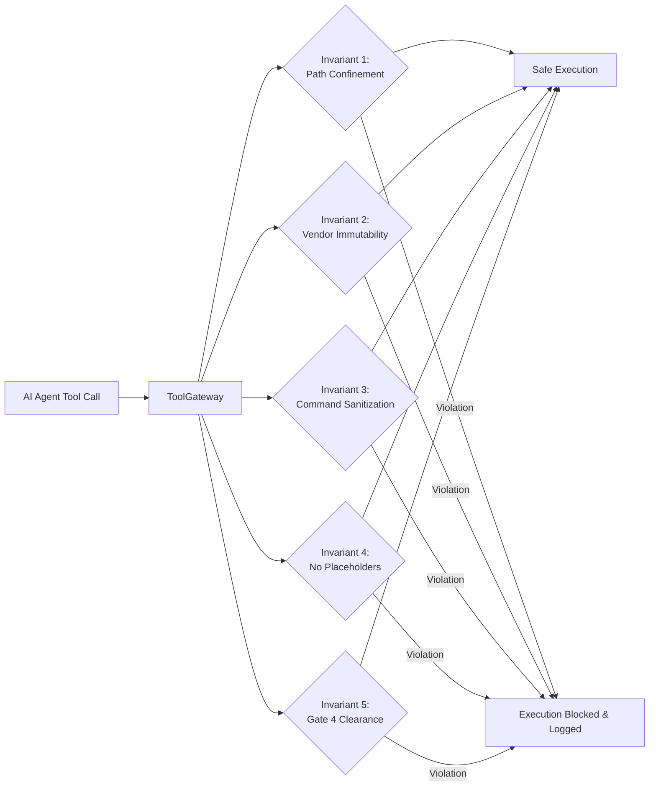

<div align="center">


<h1>UNIVERSAL AGENT OPERATING SYSTEM (UAOS) v2.0</h1>

<p>
  
</p>

<p>
  <a href="composer.json"></a>
  <a href="composer.json"></a>
  <a href="LICENSE"></a>
  
  
  
</p>

<p><br/><strong>Engineering Intelligence. Structured Execution. Cryptographic Governance. Verifiable Quality.</strong></p>

<p>
  <strong>Universal Agent Operating System (UAOS)</strong> is an independent, IDE-agnostic, and project-agnostic autonomous multi-agent orchestration runtime and engineering governance framework designed specifically for enterprise <strong>PHP and Laravel</strong> applications.
</p>

<br/>

<a href="https://wa.me/201067357431?text=Hello%2C%20I%20discovered%20UAOS%20through%20GitHub%20and%20would%20like%20to%20learn%20more.">
  
</a>
&nbsp;&nbsp;&nbsp;
<a href="#quick-start--installation">
  
</a>
&nbsp;&nbsp;&nbsp;
<a href="https://wa.me/201067357431?text=Hello%2C%20I%20discovered%20UAOS%20through%20GitHub%20and%20would%20like%20to%20learn%20more.">
  
</a>

<br/><br/>

<!-- TOP TELEMETRY METRICS DASHBOARD -->
<table width="100%">
  <tr>
    <td width="16.6%" align="center">
      <br/>
      
      <p><strong>REGISTERED AGENTS</strong><br/><sub>14 Departments</sub></p>
    </td>
    <td width="16.6%" align="center">
      <br/>
      
      <p><strong>SHARED SKILLS</strong><br/><sub>Engineering Standards</sub></p>
    </td>
    <td width="16.6%" align="center">
      <br/>
      
      <p><strong>GOVERNED STAGES</strong><br/><sub>Gate 0 to Gate 4</sub></p>
    </td>
    <td width="16.6%" align="center">
      <br/>
      
      <p><strong>TEST ASSERTIONS</strong><br/><sub>100% Automated Pass</sub></p>
    </td>
    <td width="16.6%" align="center">
      <br/>
      
      <p><strong>STDIO & HTTP</strong><br/><sub>Client & Server</sub></p>
    </td>
    <td width="16.6%" align="center">
      <br/>
      
      <p><strong>PLUGGABLE ADAPTERS</strong><br/><sub>Zero Lock-in</sub></p>
    </td>
  </tr>
</table>

</div>

<br/>

<!-- HERO PHILOSOPHY CARD -->
<table width="100%">
  <tr>
    <td align="center">
      <br/>
      
      <h3>Not just a collection of prompts. Not a fragile collection of AI assistants.</h3>
      <p>
        <strong>UAOS is an institutional engineering organization built inside code.</strong><br/>
        It structures autonomous engineering work through strictly segregated departmental responsibilities, cryptographic human authorization, sandboxed tool gateways, dynamic stack discovery, and verifiable research intelligence.
      </p>
      <br/>
    </td>
  </tr>
</table>

<br/>

---

## 📑 Table of Contents

- [01. Core Architecture & Philosophy](#01-core-architecture--philosophy)
- [02. The 14 Engineering Departments (112 Specialized Agents)](#02-the-14-engineering-departments-112-specialized-agents)
- [03. 23 Canonical Engineering Skills](#03-23-canonical-engineering-skills)
- [04. Governed Lifecycle & Gate 4 Cryptographic Clearance](#04-governed-lifecycle--gate-4-cryptographic-clearance)
- [05. Application-Level Tool Gateway & Security Invariants](#05-application-level-tool-gateway--security-invariants)
- [06. RDEI: Research-Driven Engineering Intelligence](#06-rdei-research-driven-engineering-intelligence)
- [07. Model Context Protocol (MCP) Integration](#07-model-context-protocol-mcp-integration)
- [08. Pluggable IDE & Platform Adapters](#08-pluggable-ide--platform-adapters)
- [09. Safe Technology Stack Discovery](#09-safe-technology-stack-discovery)
- [10. Quick Start & Installation](#10-quick-start--installation)
- [11. CLI Commands Reference](#11-cli-commands-reference)
- [12. Verification & Automated Test Suite](#12-verification--automated-test-suite)
- [13. Contact & Enterprise Engagement](#13-contact--enterprise-engagement)

---

<br/>

<!-- ================================================================= -->
<!-- 01. CORE ARCHITECTURE & PHILOSOPHY                               -->
<!-- ================================================================= -->
<div id="01-core-architecture--philosophy" align="center">
  <a id="01-core-architecture--philosophy" name="01-core-architecture--philosophy"></a>
  
</div>

<br/>

UAOS treats software engineering as an **institutional discipline** rather than a spontaneous code-generation exercise. It operates with mathematical rigour, bounded execution, and strict enforcement of engineering rules.

<table width="100%">
  <tr>
    <td width="33%" valign="top">
      
      <p><br/><strong>No code without architecture.</strong> Tasks must be specified, decomposed into atomic units, and reviewed before any code generation is permitted.</p>
    </td>
    <td width="33%" valign="top">
      
      <p><br/><strong>Strict division of responsibilities.</strong> 112 specialized agents operate with dedicated roles, ensuring no single model attempts to play architect, coder, and auditor at once.</p>
    </td>
    <td width="33%" valign="top">
      
      <p><br/><strong>Gate 4 Authorization.</strong> High-risk operations (file writes, database mutations, tool execution) require an HMAC-SHA256 clearance token bound to atomic nonces.</p>
    </td>
  </tr>
  <tr>
    <td width="33%" valign="top">
      
      <p><br/><strong>Preserve framework sanctity.</strong> UAOS strictly forbids mutating Laravel core, composer vendor files, or internal framework files.</p>
    </td>
    <td width="33%" valign="top">
      
      <p><br/><strong>Every claim backed by proof.</strong> The RDEI subsystem verifies source quorum, trust levels, and version freshness before implementation begins.</p>
    </td>
    <td width="33%" valign="top">
      
      <p><br/><strong>Department M Oversight.</strong> Every planned execution is independently reviewed and verified by an external auditing agent before task closure.</p>
    </td>
  </tr>
</table>

<br/>

<!-- ================================================================= -->
<!-- 02. THE 14 ENGINEERING DEPARTMENTS                                -->
<!-- ================================================================= -->
<div id="02-the-14-engineering-departments-112-specialized-agents" align="center">
  <a id="02-the-14-engineering-departments-112-specialized-agents" name="02-the-14-engineering-departments-112-specialized-agents"></a>
  
</div>

<br/>

UAOS organizes engineering capability into **14 distinct departments** comprising **112 specialized AI agents**, replicating the organizational depth of a tier-1 software engineering enterprise:

<table width="100%">
  <tr>
    <td width="50%" valign="top">
      
      <h4>Engineering Leadership & Governance</h4>
      <p>Engineering leadership, workflow authorization, architectural decision tracking, policy enforcement, and operational accountability.</p>
      <sub><strong>Key Agents:</strong> Engineering Director, Technical Lead, Governance Officer, Architectural Integrity Officer, Workflow Dispatcher, Gate Clearance Lead.</sub>
    </td>
    <td width="50%" valign="top">
      
      <h4>Project Discovery & Requirements</h4>
      <p>Domain discovery, stakeholder requirements analysis, functional specifications, boundary definition, and acceptance criteria.</p>
      <sub><strong>Key Agents:</strong> Requirements Engineer, Domain Analyst, Business Rules Specialist, User Story Architect, Acceptance Criteria Lead.</sub>
    </td>
  </tr>
  <tr>
    <td width="50%" valign="top">
      
      <h4>Software Architecture & System Design</h4>
      <p>System decomposition, bounded contexts, DDD design, component contracts, dependency graphs, and architectural compliance.</p>
      <sub><strong>Key Agents:</strong> Principal Architect, DDD Specialist, Component Modeler, Interface & Contract Designer, Dependency Graph Analyst.</sub>
    </td>
    <td width="50%" valign="top">
      
      <h4>Laravel & PHP Engineering (Core)</h4>
      <p>Enterprise PHP 8.2+ development, Laravel Service Providers, Facades, Eloquent models, Form Requests, Events, Listeners, and Middleware.</p>
      <sub><strong>Key Agents:</strong> Laravel Lead Architect, Eloquent Specialist, Container & Provider Engineer, Middleware & Routing Specialist, Queue & Event Specialist.</sub>
    </td>
  </tr>
  <tr>
    <td width="50%" valign="top">
      
      <h4>Database & Data Architecture</h4>
      <p>Database schema design, zero-downtime migrations, foreign key constraints, indexing strategies, query profiling, and data integrity.</p>
      <sub><strong>Key Agents:</strong> Database Architect, Migration Specialist, Indexing & Query Profiler, Data Integrity Auditor, Concurrency Lock Specialist.</sub>
    </td>
    <td width="50%" valign="top">
      
      <h4>Security, Cryptography & Compliance</h4>
      <p>Application security, Gate 4 HMAC verification, path sanitization, secret isolation, CSRF/SSRF prevention, and cryptographic auditing.</p>
      <sub><strong>Key Agents:</strong> Security Lead, Cryptographic Engineer, Gate 4 Verification Officer, SSRF Defense Specialist, Secrets Management Engineer.</sub>
    </td>
  </tr>
  <tr>
    <td width="50%" valign="top">
      
      <h4>UI/UX, Design Systems & Usability</h4>
      <p>User experience architecture, accessibility compliance (WCAG 2.1), design token management, and interaction consistency.</p>
      <sub><strong>Key Agents:</strong> UI/UX Lead, Design System Architect, Accessibility Specialist, Design Token Engineer, Component Usability Analyst.</sub>
    </td>
    <td width="50%" valign="top">
      
      <h4>Frontend & Client Engineering</h4>
      <p>Modern frontend integration: Inertia.js, Livewire, Alpine.js, Tailwind CSS, Vue, React, client-side state, and bundle optimization.</p>
      <sub><strong>Key Agents:</strong> Frontend Architect, Inertia.js Specialist, Livewire Engineer, Tailwind CSS Architect, Reactive State Engineer.</sub>
    </td>
  </tr>
  <tr>
    <td width="50%" valign="top">
      
      <h4>API Contracts & Ecosystem Integrations</h4>
      <p>RESTful APIs, JSON:API specifications, OpenAPI 3.0 contracts, GraphQL, webhooks, rate limiting, and third-party partner integrations.</p>
      <sub><strong>Key Agents:</strong> API Architect, OpenAPI Specialist, Webhook Security Engineer, Rate Limiting & Throttling Lead, Integration Contract Verifier.</sub>
    </td>
    <td width="50%" valign="top">
      
      <h4>Quality Assurance & Test Engineering</h4>
      <p>Automated test strategy, unit testing, feature verification, HTTP endpoint testing, concurrency regression, and mutation testing.</p>
      <sub><strong>Key Agents:</strong> QA Director, Unit Test Specialist, Feature Test Engineer, Concurrency & Race Condition Tester, Security Regression Tester.</sub>
    </td>
  </tr>
  <tr>
    <td width="50%" valign="top">
      
      <h4>Performance, Scalability & Reliability</h4>
      <p>Resource profiling, bottleneck detection, Redis cache layering, queue worker optimization, and database connection pooling.</p>
      <sub><strong>Key Agents:</strong> Performance Architect, Cache Layering Specialist, Query Bottleneck Profiler, Async Queue Scaler, Memory Leak Investigator.</sub>
    </td>
    <td width="50%" valign="top">
      
      <h4>DevOps, Infrastructure & Release</h4>
      <p>CI/CD pipelines, Docker containerization, staging environments, atomic deployment strategies, and health monitoring.</p>
      <sub><strong>Key Agents:</strong> DevOps Lead, Pipeline Engineer, Docker Architecture Specialist, Release Manager, Infrastructure Secrets Engineer.</sub>
    </td>
  </tr>
  <tr>
    <td width="50%" valign="top">
      
      <h4>Independent Review & Technical Audit</h4>
      <p>Strict third-party architectural review, governance compliance checks, code smell detection, and authorization verification before task closure.</p>
      <sub><strong>Key Agents:</strong> Independent Lead Auditor, Compliance Officer, Code Quality Reviewer, Boundary Violation Detector, Evidence Examiner.</sub>
    </td>
    <td width="50%" valign="top">
      
      <h4>Technical Documentation & Closure</h4>
      <p>Architectural Decision Records (ADRs), API documentation, audit dossier compilation, verification telemetry, and formal sign-off.</p>
      <sub><strong>Key Agents:</strong> Technical Documentation Director, ADR Compiler, API Documentation Specialist, Audit Dossier Publisher, Final Sign-off Lead.</sub>
    </td>
  </tr>
  <tr>
    <td colspan="2" align="center">
      <br/>
      
      <br/><br/>
    </td>
  </tr>
</table>

<br/>

<!-- ================================================================= -->
<!-- 03. 23 CANONICAL ENGINEERING SKILLS                               -->
<!-- ================================================================= -->
<div id="03-23-canonical-engineering-skills" align="center">
  <a id="03-23-canonical-engineering-skills" name="03-23-canonical-engineering-skills"></a>
  
</div>

<br/>

Agents do not rely on generic LLM instincts. Every agent executes through **23 standardized, versioned engineering skills** located in `.agents/skills/`:

<table width="100%">
  <tr>
    <td width="25%" valign="top">
      <strong>Core Laravel & PHP</strong>
      <ul>
        <li><code>laravel-architecture</code></li>
        <li><code>php-standards</code></li>
        <li><code>eloquent-data-modeling</code></li>
        <li><code>service-container-di</code></li>
        <li><code>queue-async-processing</code></li>
      </ul>
    </td>
    <td width="25%" valign="top">
      <strong>Security & Governance</strong>
      <ul>
        <li><code>security-hardening</code></li>
        <li><code>cryptographic-clearance</code></li>
        <li><code>secrets-management</code></li>
        <li><code>path-confinement</code></li>
        <li><code>constitutional-invariants</code></li>
      </ul>
    </td>
    <td width="25%" valign="top">
      <strong>Data & Integration</strong>
      <ul>
        <li><code>database-optimization</code></li>
        <li><code>api-contract-design</code></li>
        <li><code>mcp-protocol-standards</code></li>
        <li><code>caching-redis-strategies</code></li>
        <li><code>event-driven-architecture</code></li>
      </ul>
    </td>
    <td width="25%" valign="top">
      <strong>Quality & Delivery</strong>
      <ul>
        <li><code>automated-testing-suites</code></li>
        <li><code>independent-audit-review</code></li>
        <li><code>rdei-evidence-retrieval</code></li>
        <li><code>ui-design-systems</code></li>
        <li><code>wcag-accessibility</code></li>
        <li><code>docker-ci-cd-pipelines</code></li>
        <li><code>adr-documentation</code></li>
        <li><code>concurrency-control</code></li>
      </ul>
    </td>
  </tr>
</table>

<br/>

<!-- ================================================================= -->
<!-- 04. GOVERNED LIFECYCLE & GATE 4 CRYPTOGRAPHIC CLEARANCE           -->
<!-- ================================================================= -->
<div id="04-governed-lifecycle--gate-4-cryptographic-clearance" align="center">
  <a id="04-governed-lifecycle--gate-4-cryptographic-clearance" name="04-governed-lifecycle--gate-4-cryptographic-clearance"></a>
  
</div>

<br/>

UAOS replaces unstructured prompt-and-pray execution with a **14-Stage Governed Engineering Lifecycle** reinforced by two critical architectural gates:

```
[Discovery] ➔ [Research] ➔ [Gate 0 Quorum] ➔ [Specification] ➔ [Decomposition]
     ➔ [Architecture Review] ➔ [Task Planning] ➔ [Gate 4 Cryptographic Clearance]
     ➔ [Sandboxed Execution] ➔ [Automated Testing] ➔ [Security Review]
     ➔ [Department M Audit] ➔ [Telemetry Dossier] ➔ [Formal Closure]
```

### The Two Critical Clearances:

<table width="100%">
  <tr>
    <td width="50%" valign="top">
      
      <h4>Evidence Quorum & Freshness</h4>
      <p>Before any complex task is allowed to enter the implementation phase, Gate 0 verifies:</p>
      <ul>
        <li><strong>Eligible Source Quorum:</strong> Validates trusted research sources according to depth level (L0 to L4).</li>
        <li><strong>Freshness Validation:</strong> Rejects deprecated APIs, outdated package versions, and superseded framework conventions.</li>
        <li><strong>Conflict Resolution:</strong> Detects conflicting technical guidance across sources and requires explicit resolution before proceeding.</li>
      </ul>
    </td>
    <td width="50%" valign="top">
      
      <h4>HMAC-SHA256 Multi-Factor Binding</h4>
      <p>All file writes, mutations, or command executions require a cryptographically signed Gate 4 clearance:</p>
      <ul>
        <li><strong>HMAC Signature:</strong> Calculated over <code>hash_hmac('sha256', task_id + path + artifact_hash + timestamp + nonce, secret_key)</code>.</li>
        <li><strong>Single-Use Atomic Nonce:</strong> Enforced by <code>PersistentNonceStore</code> with SQLite transactions to prevent replay attacks.</li>
        <li><strong>Artifact Hash Binding:</strong> Approvals are mathematically bound to the exact content hash; modifying even one byte invalidates the token.</li>
      </ul>
    </td>
  </tr>
</table>

<br/>

<!-- ================================================================= -->
<!-- 05. APPLICATION-LEVEL TOOL GATEWAY & INVARIANTS                   -->
<!-- ================================================================= -->
<div id="05-application-level-tool-gateway--security-invariants" align="center">
  <a id="05-application-level-tool-gateway--security-invariants" name="05-application-level-tool-gateway--security-invariants"></a>
  
</div>

<br/>

Agents are never given raw, uncontrolled shell or file system access. Every tool call passes through the **`ToolGateway`** and **`PathValidator`** which strictly enforce the **5 Constitutional Invariants**:



<table width="100%">
  <tr>
    <td width="20%" valign="top">
      
      <p><br/><strong>Strict Directory Boundary:</strong> Resolves canonical paths and prevents path traversal (e.g., <code>../..</code> or symlink escapes) outside the project root.</p>
    </td>
    <td width="20%" valign="top">
      
      <p><br/><strong>Zero Vendor Pollution:</strong> File mutations directed at <code>vendor/</code>, <code>composer.lock</code>, or framework core files are immediately blocked.</p>
    </td>
    <td width="20%" valign="top">
      
      <p><br/><strong>Shell Sanitization:</strong> Prohibits destructive commands (<code>rm -rf</code>, <code>drop database</code>, pipe injection, unauthorized background daemons).</p>
    </td>
    <td width="20%" valign="top">
      
      <p><br/><strong>No Fake Implementations:</strong> Scans written code to reject lazy placeholders like <code>// TODO: implement later</code> or mock production functions.</p>
    </td>
    <td width="20%" valign="top">
      
      <p><br/><strong>Mandatory Gate 4:</strong> Any write, mutation, or destructive action requires verified cryptographic clearance prior to dispatch.</p>
    </td>
  </tr>
</table>

<br/>

<!-- ================================================================= -->
<!-- 06. RDEI: RESEARCH-DRIVEN ENGINEERING INTELLIGENCE                -->
<!-- ================================================================= -->
<div id="06-rdei-research-driven-engineering-intelligence" align="center">
  <a id="06-rdei-research-driven-engineering-intelligence" name="06-rdei-research-driven-engineering-intelligence"></a>
  
</div>

<br/>

The **RDEI** subsystem elevates AI capabilities from mere web scraping to formal technical intelligence. Built across 7 fully tested phases:

<table width="100%">
  <tr>
    <td width="33%" valign="top">
      <strong>1. Source Registry & Trust</strong>
      <p>Manages curated sources across official docs, RFCs, and peer-reviewed code. Automatically calculates trust scores and filters untrusted domains.</p>
    </td>
    <td width="33%" valign="top">
      <strong>2. Freshness & Version Intel</strong>
      <p>Understands PHP 8.2 vs 8.3 vs 8.4 syntax, Laravel 10 vs 11 changes, and automatically flags deprecated patterns.</p>
    </td>
    <td width="33%" valign="top">
      <strong>3. SSRF & Retrieval Defense</strong>
      <p>Secure HTTP and MCP retrievers block loopback, RFC 1918 private IPs, cloud metadata endpoints (169.254.169.254), and sanitize outputs.</p>
    </td>
  </tr>
  <tr>
    <td width="33%" valign="top">
      <strong>4. Conflict Detection & Resolution</strong>
      <p>Detects when two sources disagree on an architectural approach and creates an ADR resolving the conflict through evidence hierarchy.</p>
    </td>
    <td width="33%" valign="top">
      <strong>5. Adaptive Depth (L0–L4)</strong>
      <p>Scales from L0 (Zero retrieval for trivial tasks) to L4 (Deep multi-source research for high-risk architectural refactors).</p>
    </td>
    <td width="33%" valign="top">
      <strong>6. SQLite Knowledge Store</strong>
      <p>Persists evidence dossiers, source definitions, and research claims locally in <code>.agent-os/state/knowledge.sqlite</code>.</p>
    </td>
  </tr>
</table>

<br/>

<!-- ================================================================= -->
<!-- 07. MODEL CONTEXT PROTOCOL (MCP) INTEGRATION                      -->
<!-- ================================================================= -->
<div id="07-model-context-protocol-mcp-integration" align="center">
  <a id="07-model-context-protocol-mcp-integration" name="07-model-context-protocol-mcp-integration"></a>
  
</div>

<br/>

UAOS provides native, built-in **Model Context Protocol (MCP)** support acting as both an **MCP Server** and an **MCP Client**:

<table width="100%">
  <tr>
    <td width="50%" valign="top">
      
      <h4>Expose UAOS Capabilities to Any AI Client</h4>
      <p>Exposes all 112 specialized agents, 23 skills, Gate 4 verifiers, and workspace tools to external AI systems via standardized JSON-RPC 2.0:</p>
      <ul>
        <li><strong>STDIO Transport:</strong> Seamless integration with Claude Desktop, Cursor, and VS Code.</li>
        <li><strong>Streamable HTTP Transport:</strong> High-performance server-sent events (SSE) transport for networked agent clusters.</li>
      </ul>
      <pre><code>php bin/agent-os mcp:serve</code></pre>
    </td>
    <td width="50%" valign="top">
      
      <h4>Connect to External Tool Servers</h4>
      <p>UAOS orchestrators can dynamically connect to multiple external MCP servers simultaneously:</p>
      <ul>
        <li><strong>Concurrent Server Registration:</strong> Connect database MCPs, GitHub MCPs, and documentation servers.</li>
        <li><strong>Gate 4 Governed Tools:</strong> External MCP tools can be bound to Gate 4 cryptographic authorization before invocation.</li>
      </ul>
    </td>
  </tr>
</table>

<br/>

<!-- ================================================================= -->
<!-- 08. PLUGGABLE IDE & PLATFORM ADAPTERS                             -->
<!-- ================================================================= -->
<div id="08-pluggable-ide--platform-adapters" align="center">
  <a id="08-pluggable-ide--platform-adapters" name="08-pluggable-ide--platform-adapters"></a>
  
</div>

<br/>

UAOS is **completely IDE-agnostic**. It uses an extensible adapter registry (`src/Adapters/`) that automatically translates agent instructions, rules, and skills to your development environment of choice:

<table width="100%">
  <tr>
    <td width="25%" align="center">
      <br/>
      <sub>Native .gemini/ integration</sub>
    </td>
    <td width="25%" align="center">
      <br/>
      <sub>.cursorrules & rules/</sub>
    </td>
    <td width="25%" align="center">
      <br/>
      <sub>.windsurfrules integration</sub>
    </td>
    <td width="25%" align="center">
      <br/>
      <sub>.vscode/ & Cline configs</sub>
    </td>
  </tr>
  <tr>
    <td width="25%" align="center">
      <br/>
      <sub>Full IDE inspection</sub>
    </td>
    <td width="25%" align="center">
      <br/>
      <sub>Headless CI/CD execution</sub>
    </td>
    <td width="50%" colspan="2" align="center">
      <br/>
      <sub>Switch IDEs at any time without losing rules or agents</sub>
    </td>
  </tr>
</table>

<br/>

<!-- ================================================================= -->
<!-- 09. SAFE TECHNOLOGY STACK DISCOVERY                              -->
<!-- ================================================================= -->
<div id="09-safe-technology-stack-discovery" align="center">
  <a id="09-safe-technology-stack-discovery" name="09-safe-technology-stack-discovery"></a>
  
</div>

<br/>

UAOS automatically detects your application's architecture upon initialization without exposing sensitive operational credentials:

* **Safe Heuristic Detection:** Inspects `composer.json`, directory hierarchies, and configuration filenames without touching `.env` files or secret stores.
* **Stack Profile Generation:** Identifies Laravel versions, installed packages (Sanctum, Filament, Livewire, Inertia, Pest, PHPUnit, Redis), database types, and queue drivers.
* **Auto-Tailored Agent Context:** Automatically aligns agent prompts to match your detected tech stack without manual configuration.

```bash
vendor/bin/agent-os profile:discover
vendor/bin/agent-os profile:review
```

<br/>

<!-- ================================================================= -->
<!-- 10. QUICK START & INSTALLATION                                   -->
<!-- ================================================================= -->
<div id="10-quick-start--installation" align="center">
  <a id="10-quick-start--installation" name="10-quick-start--installation"></a>
  <a id="quick-start--installation" name="quick-start--installation"></a>
  
</div>

<br/>

### Prerequisites
* **PHP:** `^8.2 || ^8.3 || ^8.4`
* **Extensions:** `ext-json`, `ext-hash`, `ext-mbstring` (Optional: `ext-pdo_sqlite` for atomic nonce store, `ext-curl` for streamable HTTP MCP)
* **Framework:** Laravel 10.x, 11.x, or standalone PHP application.

### 1. Install via Composer
Install UAOS as a development dependency in your Laravel project:

```bash
composer require --dev universal-agent-os/agent-os
```

### 2. Initialize the Workspace
Initialize the `.agent-os/` workspace, storage confinement, and local state:

```bash
vendor/bin/agent-os init
```

### 3. Generate Gate 4 HMAC Secret
Create your cryptographic authorization key for approving write actions:

```bash
vendor/bin/agent-os gate4:keygen
```

### 4. Discover Your Tech Stack
Automatically inspect your project structure and generate the project profile:

```bash
vendor/bin/agent-os profile:discover
```

<br/>

<!-- ================================================================= -->
<!-- 11. CLI COMMANDS REFERENCE                                        -->
<!-- ================================================================= -->
<div id="11-cli-commands-reference" align="center">
  <a id="11-cli-commands-reference" name="11-cli-commands-reference"></a>
  
</div>

<br/>

The `bin/agent-os` binary provides a unified CLI for managing your autonomous engineering organization:

| Command | Arguments / Flags | Description |
| :--- | :--- | :--- |
| `init` | `--force` | Initializes the `.agent-os/` directory structure and configuration in the host project. |
| `profile:discover` | `--output=...` | Safely inspects the host project and writes `.agent-os/project-profile.json`. |
| `profile:review` | None | Displays a formatted summary of the detected tech stack, libraries, and tools. |
| `run` | `--task="..." --agent="..."` | Executes or plans a specific task using the specified agent and skill profile. |
| `gate4:keygen` | `--show` | Generates a cryptographically secure 256-bit HMAC key for Gate 4 authorization. |
| `mcp:serve` | `--transport=stdio\|http` | Launches the Model Context Protocol server for IDE and external AI integrations. |
| `mcp:test` | None | Runs the local MCP integration fixture and verifies client-server handshakes. |
| `--version` | None | Displays the installed version of Universal Agent Operating System. |

<br/>

<!-- ================================================================= -->
<!-- 12. VERIFICATION & AUTOMATED TEST SUITE                          -->
<!-- ================================================================= -->
<div id="12-verification--automated-test-suite" align="center">
  <a id="12-verification--automated-test-suite" name="12-verification--automated-test-suite"></a>
  
</div>

<br/>

Every subsystem in UAOS is backed by rigorous automated verification. The test suite covers Unit, Feature, Security, MCP, Concurrency, and Replay resistance:

```bash
php tests/run-all-tests.php
```

```
=======================================================
 UNIVERSAL AGENT OS (UAOS) AUTOMATED TEST SUITE RUNNER
=======================================================

Running Unit: PathResolverTest...                     [PASS]
Running Unit: PathValidatorTest...                    [PASS]
Running Unit: PersistentNonceStoreTest...             [PASS]
Running Unit: Gate4VerifierTest...                    [PASS]
Running Unit: ToolGatewayTest...                      [PASS]
Running Unit: ProjectDiscoveryTest...                 [PASS]
Running Unit: PromptBuilderTest...                    [PASS]
Running Unit: SkillEngineTest...                      [PASS]
Running Unit: OrchestratorTest...                     [PASS]
Running Unit: ResearchContractsAndModelsTest...       [PASS]
Running Unit: SQLiteKnowledgeStoreTest...             [PASS]
Running Security: PathValidatorAdversarialTest...     [PASS]
Running Security: StreamableHttpTransportSsrfTest...  [PASS]
Running Security: DangerousCommandExecutionTest...    [PASS]
Running Security: Gate4ReplayTest...                  [PASS]
Running Security: GovernanceBypassTest...             [PASS]
Running Adapters: AdapterContractTest...              [PASS]
Running MCP: McpAcceptanceTest...                     [PASS]
Running Feature: ComposerInstallationTest...          [PASS]
Running Feature: Gate0RuntimeIntegrationTest...       [PASS]

=======================================================
TEST SUITE SUMMARY:
  Total Assertions: 1219
  Passed:           1219 (100%)
  Failed:           0
=======================================================
ALL AUTOMATED TESTS PASSED SUCCESSFULLY
```

<br/>

<!-- ================================================================= -->
<!-- 13. CONTACT & ENTERPRISE ENGAGEMENT                              -->
<!-- ================================================================= -->
<div id="13-contact--enterprise-engagement" align="center">
  <a id="13-contact--enterprise-engagement" name="13-contact--enterprise-engagement"></a>


<h1>READY TO DEPLOY UAOS TO YOUR ENTERPRISE?</h1>
<h3>Experience institutional engineering, cryptographic governance, and autonomous multi-agent orchestration for Laravel.</h3>

<br/>

<a href="https://wa.me/201067357431?text=Hello%2C%20I%20discovered%20UAOS%20through%20GitHub%20and%20would%20like%20to%20learn%20more.">
  
</a>

<br/><br/>

<p><strong>Direct Line: +20 106 735 7431</strong></p>
<p><sub>Developed & Governed by <strong>Astrova Agency</strong></sub></p>

<br/>

<p><strong>UNIVERSAL AGENT OPERATING SYSTEM (UAOS)</strong></p>
<p><em>Engineering Intelligence. Structured Execution. Verifiable Quality.</em></p>

</div>
