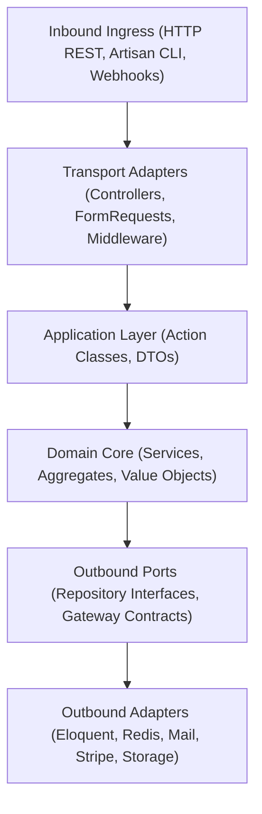

# High-Level Architecture Overview

**Document ID:** ARCH-DOC-001  
**Version:** 2.0.0  
**Classification:** Architecture Blueprint  
**Status:** [Active Architecture]  

---

## 1. Architectural Blueprint
Universal Core implements a layered Hexagonal (Ports & Adapters) architecture on top of Laravel 11.x:

### Architectural Tiers
1. **Ingress & Transport:** Translates HTTP requests and CLI invocations into typed Data Transfer Objects (DTOs). No domain logic.
2. **Application Layer:** Orchestrates business use cases via single-responsibility Action classes.
3. **Domain Core:** Pure business entities, aggregates, and domain invariants.
4. **Outbound Adapters:** Persistence engines (MySQL 8.4 via Eloquent), caching/queues (Redis), and third-party gateways.