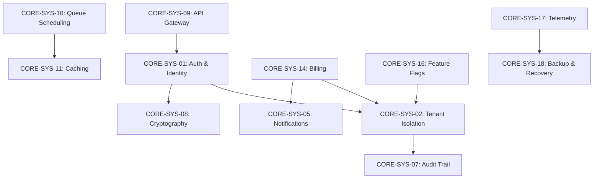

# Core System Dependency Map

**Document ID:** SYS-DEP-001  
**Version:** 2.0.0  
**Classification:** Architecture Topology  
**Status:** [Active Architecture]  

---

## 1. System Dependency Topology

