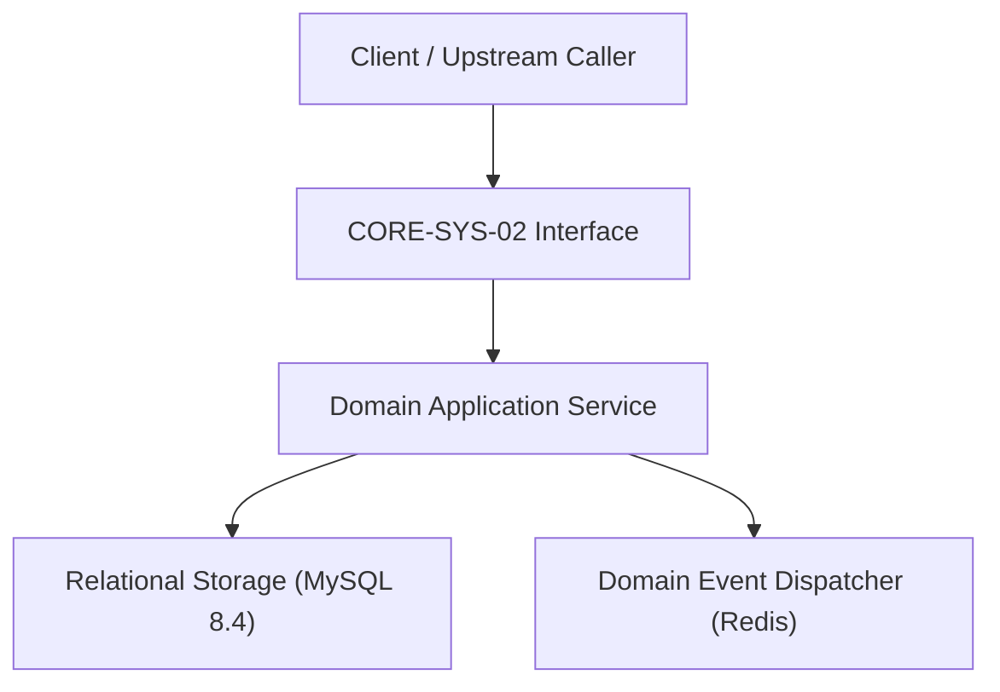

# Core System Specification: Multi-Tenant Isolation & Organization Hierarchy

**System ID:** CORE-SYS-02  
**System Name:** Multi-Tenant Isolation & Organization Hierarchy  
**Status:** [Designed but Not Implemented]  
**Responsible Agent:** MTEN-001  
**Classification:** Enterprise Core Subsystem  
**Canonical Path:** `docs/03-core-systems/systems/CORE-SYS-02/`  

---

## 1. System Mission and Purpose
CORE-SYS-02 provides Tenant scoping, organization structure, and data isolation across Universal Core applications.

## 2. Architectural Boundaries

## 3. Implementation Status and Traceability
- **Runtime Implementation:** `[Designed but Not Implemented]`. No concrete classes currently exist in `app/Core/CORE-SYS-02/`.
- **Approved Specifications:** Documented in `.agents/agents/` and `.agents/skills/`.
- **Precedence Note:** This document represents the approved target architecture and MUST NOT be construed as an existing runtime implementation.