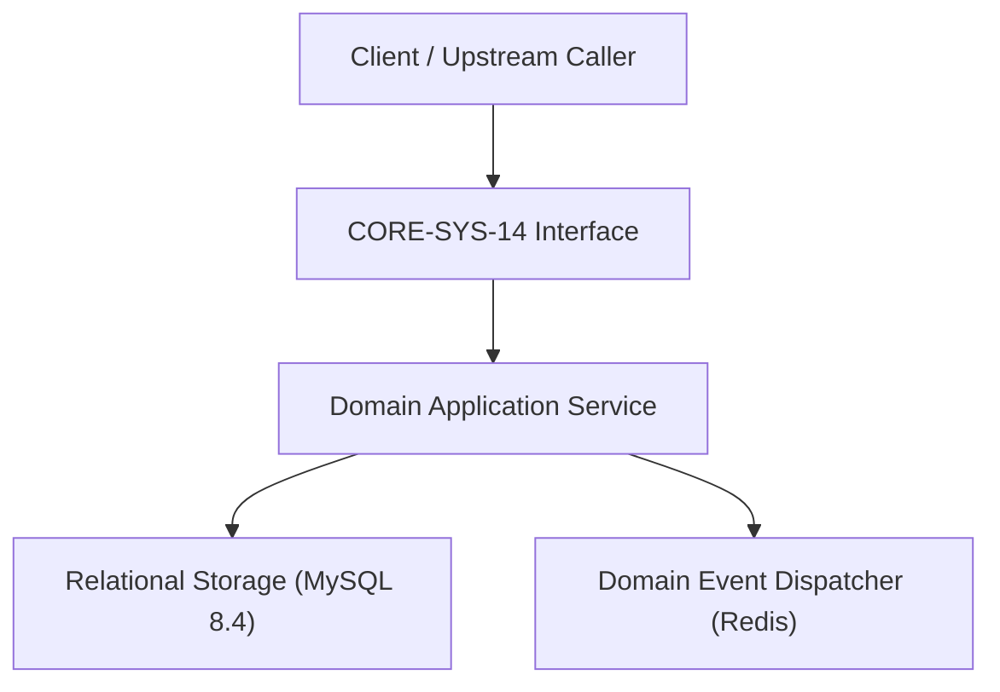

# Core System Specification: Billing, Subscription & Payment Integration

**System ID:** CORE-SYS-14  
**System Name:** Billing, Subscription & Payment Integration  
**Status:** [Designed but Not Implemented]  
**Responsible Agent:** LCOR-001  
**Classification:** Enterprise Core Subsystem  
**Canonical Path:** `docs/03-core-systems/systems/CORE-SYS-14/`  

---

## 1. System Mission and Purpose
CORE-SYS-14 provides Stripe payment gateways, subscription lifecycles, and invoices across Universal Core applications.

## 2. Architectural Boundaries

## 3. Implementation Status and Traceability
- **Runtime Implementation:** `[Designed but Not Implemented]`. No concrete classes currently exist in `app/Core/CORE-SYS-14/`.
- **Approved Specifications:** Documented in `.agents/agents/` and `.agents/skills/`.
- **Precedence Note:** This document represents the approved target architecture and MUST NOT be construed as an existing runtime implementation.