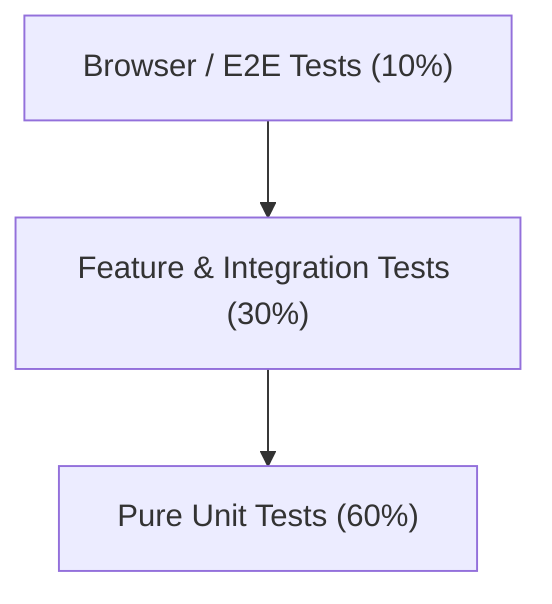

# Testing Strategy & Pyramid

**Document ID:** QA-DOC-001  
**Version:** 2.0.0  
**Classification:** Testing Strategy  
**Status:** [Active Reference]  

---

## 1. The Testing Pyramid

- **Unit (60%):** In-memory testing of Value Objects, DTOs, Actions, and math calculations.
- **Feature/Integration (30%):** HTTP request/response lifecycles, database transactions, queued jobs.
- **Browser/E2E (10%):** Critical user journeys and RTL visual layouts using Laravel Dusk.