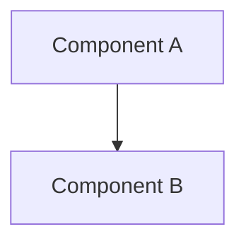

# Architecture Document Template

**Document ID:** [ARCH-ID]  
**Version:** 1.0.0  
**Classification:** Architectural Blueprint  
**Status:** [Active Architecture]  

---

## 1. Context and Goals
<!-- System context, architectural motivations, and constraints. -->

## 2. Component Topology

## 3. Interfaces and Contracts
<!-- Public interfaces, DTOs, and protocols. -->