# Universal Core Documentation

**Project:** Universal Core  
**Classification:** Enterprise Engineering Documentation  
**Version:** 2.0.0  
**Status:** [Active Reference]  
**Technical Standards Ref:** [SKILL-DOC-001](../.agents/skills/documentation-standards.md), [SKILL-GIT-001](../.agents/skills/git-change-management-standards.md)  

---

## 1. Welcome to Universal Core

Welcome to the central, authoritative documentation repository for **Universal Core**.

Universal Core is an enterprise-grade, domain-neutral application architecture built for the modern Laravel ecosystem (PHP 8.3+, Laravel 11.x, MySQL 8.4 LTS, and mandatory Redis). It provides a standardized foundation for scalable, secure, and multi-tenant SaaS platforms, administrative panels, and API services.

This documentation tree is structured to provide an unshakeable knowledge baseline for software developers, principal architects, QA engineers, DevOps operators, security specialists, and autonomous AI engineering agents.

---

## 2. Documentation Architecture and Navigation

The documentation is organized across 18 specialized engineering domains:

```mermaid
graph TD
    Root["docs/ Root Navigation"] --> Gov["00-governance"]
    Root --> Start["01-getting-started"]
    Root --> Arch["02-architecture"]
    Root --> Systems["03-core-systems"]
    Root --> Dev["04-development"]
    Root --> Guides["05-guides"]
    Root --> API["06-api-reference"]
    Root --> DB["07-database"]
    Root --> Sec["08-security"]
    Root --> Ops["09-operations"]
    Root --> QA["10-testing-and-quality"]
    Root --> Config["11-configuration-reference"]
    Root --> Rel["12-release-management"]
    Root --> Contrib["13-contributing"]
    Root --> Ref["14-reference"]
    Root --> ADR["15-decisions"]
    Root --> Tpl["16-templates"]
    Root --> Archv["17-archive"]
```

### Quick Navigation Directory
1. **[00-Governance](00-governance/README.md):** Documentation lifecycle, quality gates, and links to constitutional governance.
2. **[01-Getting Started](01-getting-started/README.md):** Complete developer onboarding on native Windows Laragon, PowerShell, PHP 8.3, and Redis.
3. **[02-Architecture](02-architecture/README.md):** High-level architectural principles, Hexagonal boundaries, and domain models.
4. **[03-Core Systems](03-core-systems/README.md):** Specifications and implementation status for CORE-SYS-01 through CORE-SYS-18.
5. **[04-Development](04-development/README.md):** Daily coding conventions, FormRequests, Action classes, and local workflows.
6. **[05-Guides](05-guides/README.md):** Step-by-step practical implementation, integration, and troubleshooting guides.
7. **[06-API Reference](06-api-reference/README.md):** OpenAPI 3.1.0 specifications, RFC 7807 problem details, and authentication.
8. **[07-Database](07-database/README.md):** MySQL 8.4 InnoDB data dictionaries, migrations, and indexing strategies.
9. **[08-Security](08-security/README.md):** Defense-in-depth, envelope encryption, secrets protection, and incident runbooks.
10. **[09-Operations](09-operations/README.md):** Atomic symlink deployments, Redis queue supervision, and disaster recovery.
11. **[10-Testing and Quality](10-testing-and-quality/README.md):** Testing pyramid, Pest/PHPUnit harnesses, and mutation score indicators.
12. **[11-Configuration Reference](11-configuration-reference/README.md):** Comprehensive `.env` variable dictionary and Pennant feature flags.
13. **[12-Release Management](12-release-management/README.md):** Semantic Versioning 2.0.0, release tagging, and changelogs.
14. **[13-Contributing](13-contributing/README.md):** Pull request lifecycle, Conventional Commits, and code review criteria.
15. **[14-Reference](14-reference/README.md):** Canonical glossaries, technology baselines, and frequently asked questions.
16. **[15-Decisions (ADRs)](15-decisions/README.md):** Architecture Decision Records repository and index.
17. **[16-Templates](16-templates/README.md):** Reusable engineering templates for ADRs, runbooks, and specifications.
18. **[17-Archive](17-archive/README.md):** Historical, superseded, or deprecated architectural records.

---

## 3. Foundational Principle: Code-Grounded Truth

All documentation in Universal Core is governed by the principles of **[SKILL-DOC-001](00-governance/documentation-governance.md)**:
- **Documentation reflects actual code:** Speculative claims, fictional endpoints, and unverified capabilities are strictly prohibited.
- **Explicit Implementation Status:** Every major document clearly distinguishes whether a component is `[Implemented]`, `[Verified]`, or `[Designed but Not Implemented]`.
- **Source-of-Truth Hierarchy:** Executable code is authoritative for runtime behavior; database migrations are authoritative for schema structure; approved specifications govern planned features.
- **Anti-Duplication:** Canonical governance documents in `.agents/governance/` are referenced via links rather than duplicated.

---

## 4. How to Contribute to Documentation

Documentation is maintained under version control alongside application source code:
1. All changes must follow **[Conventional Commits](../docs/13-contributing/commit-message-conventions.md)** using the `docs(...)` type.
2. Changes to public interfaces, database schemas, or configurations must include corresponding documentation updates within the same pull request.
3. Every document must pass the documentation quality gates (syntax validation, relative link checks, and peer review).

For complete guidelines, consult the **[Documentation Standards](DOCUMENTATION-STANDARDS.md)** and the **[Master Documentation Index](DOCUMENTATION-INDEX.md)**.
